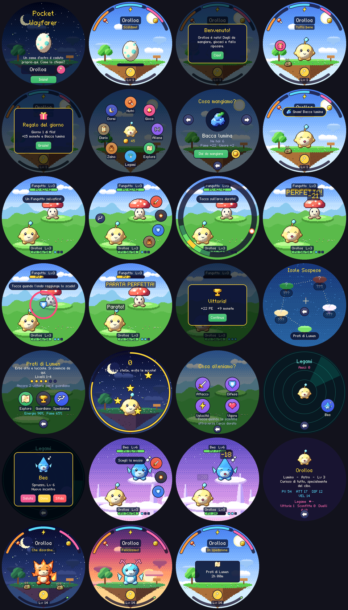

# Pocket Wayfarer

Un piccolo RPG tascabile con un cuore da tamagotchi, per il **Waveshare
ESP32-S3-Touch-AMOLED-1.75** (AMOLED rotondo 466×466, touch). Fai schiudere un
seme d'astro, cresci il tuo compagno, esplora le Isole Sospese, combatti con
un sistema di timing pensato per lo schermo rotondo e incontra altri Pocket
vicini via radio per saluti, doni e duelli.



> Ispirato al progetto [PocketD-D](https://github.com/ShydanRem/PocketD-D)
> (stesso hardware, stesso autore) solo per il dispositivo e lo stile da
> compagno in pixel art: nessuna regola o contenuto di D&D.

## Come si gioca

| | |
|---|---|
| **Il compagno** | Fame, Energia e Umore scendono in tempo reale (anche a schermo spento). Nutrilo, fallo dormire, gioca, pulisci il disordine, accarezzalo. Non muore mai, ma le trascuratezze contano. |
| **Evoluzione** | Seme → Lumino → forma elementale al **livello 5** (decisa dal cibo che mangia: Brace, Marea, Fronda) → forma adulta al **livello 12** (decisa da legame e cura). 11 forme. |
| **Lotta** | A turni, con un solo dito. In attacco una scintilla gira sul bordo dello schermo: tocca quando attraversa l'arco dorato (Bene / Ottimo / PERFETTO). In difesa un'onda si chiude verso lo scudo: tocca al momento giusto per parare, la parata perfetta contrattacca. Focus, abilità elementali (ustione, cura, radici) e triangolo Brace > Fronda > Marea > Brace. |
| **Mondo** | 5 isole, 20 creature, 5 guardiani. Ogni passo di esplorazione può essere una lotta, un oggetto, monete, una sorgente o un forziere. Il guardiano si sfida quando vuoi, dopo 6 vittorie nella zona. |
| **Spedizioni** | Manda il compagno via per 30 minuti, 2 o 8 ore: torna con PE, monete e oggetti. |
| **Ogni giorno** | Regalo giornaliero con serie di giorni consecutivi, 3 missioni nuove ogni giorno, bottega e frammenti d'astro da vendere. |
| **Minigiochi** | *Pioggia di stelle* (tocca le stelle, evita le nuvole) e l'allenamento sull'anello per migliorare Attacco, Difesa, Velocità o Vigore. |
| **Legami** | Radar dei Pocket vicini via **ESP-NOW** (niente router, niente account): saluta (bonus una volta al giorno per amico), regala oggetti, sfida a duello. Il duello è in lock-step: entrambi i dispositivi risolvono ogni round con lo stesso seme e le stesse mosse, quindi concordano sempre. |

Tasti fisici: **BOOT** breve = menu / indietro (durante lotta: tocco di timing),
**BOOT** lungo = casa, **PWR** = spegne/riaccende lo schermo. Lo schermo si spegne
da solo dopo 45 s di inattività fuori dalle lotte.

## Struttura

```
firmware/
  core/      logica di gioco in C11 puro, solo interi: compagno, lotta, mondo,
             salvataggi, protocollo radio (stesso codice su PC e dispositivo)
  ui/        interfaccia LVGL 9 (schermate, widget di timing, toolkit grafico)
  ui/art/    sprite, scenari e font generati (non modificare a mano)
  main/      ESP-IDF: display/touch/tasti, RTC, NVS, ESP-NOW, risparmio energetico
  host/      test del core e "preview" che esegue la vera UI su PC
scripts/
  art/       pixel art procedurale: compagni, creature, icone, scenari, font 5x7
  build_art.py, previews.py, firmware-deps.py, check.sh
docs/        progettazione, firmware, protocollo Legami, immagini
```

La grafica è **generata da codice** (`scripts/art`): forme con shading volumetrico,
rampe di colore con hue-shift, dithering ordinato e outline selettivo, poi
esportate come sprite indicizzati (~450 KB in flash) ed espanse a 3× in PSRAM.
Il font pixel 5×7 è originale e include le lettere accentate italiane.

## Compilare

Prerequisiti: ESP-IDF 5.5.x, Python 3 con Pillow e NumPy (solo per rigenerare la grafica).

```bash
python3 scripts/firmware-deps.py
```

```bash
cd firmware && idf.py set-target esp32s3 && idf.py build
```

```bash
idf.py -p /dev/ttyACM0 flash monitor
```

Il layout delle partizioni è dedicato (app 6 MB + NVS salvataggi 256 KB):
la prima installazione sostituisce il firmware presente, come per PocketD-D.

Controlli su PC (test del core, coerenza della grafica, screenshot reali della UI):

```bash
bash scripts/check.sh
```

Dettagli: [docs/FIRMWARE.md](docs/FIRMWARE.md) · [docs/DESIGN.md](docs/DESIGN.md) ·
[docs/LEGAMI.md](docs/LEGAMI.md)

## Stato

Versione **0.1**: tutto il ciclo di gioco è giocabile e verificato sul PC con la
vera UI LVGL (screenshot in `docs/img`) e 1400+ controlli sul core, incluso un
duello simulato con il 45% di pacchetti persi. Il firmware compila per ESP32-S3;
**il collaudo fisico sul dispositivo è ancora da fare** (vedi
[docs/FIRMWARE.md](docs/FIRMWARE.md#collaudo)).
