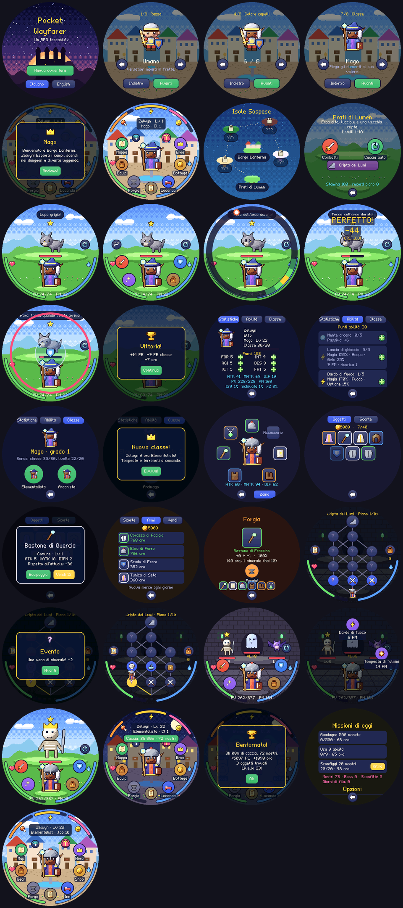

# Pocket Wayfarer

Un **RPG fantasy tascabile** per il **Waveshare ESP32-S3-Touch-AMOLED-1.75**
(AMOLED rotondo 466×466, touch): crei il tuo eroe, scegli una delle 8 classi e
la fai evolvere fino a 40 classi in stile Ragnarok Online, ti equipaggi, esplori
campi e dungeon a stanze, combatti gruppi di mostri con un sistema di timing
pensato per lo schermo rotondo, e l'eroe va a caccia da solo mentre il
dispositivo è in tasca. Nella città ti aspettano bottega, forgia, locanda e
missioni giornaliere. Interfaccia in italiano e inglese.



> Ispirato a [PocketD-D](https://github.com/ShydanRem/PocketD-D) (stesso
> hardware, stesso autore) per il dispositivo e lo stile pixel art, senza
> regole o contenuti di D&D. Progettazione completa: [docs/RPG-DESIGN.md](docs/RPG-DESIGN.md).

## Il gioco

| | |
|---|---|
| **Eroe** | 4 razze (Umano, Elfo, Nano, Ferino) con piccoli bonus, 5 carnagioni, 6 acconciature × 8 colori, colore degli occhi. L'aspetto cambia con classe, arma, mano secondaria ed elmo. |
| **Classi** | 8 di base (Guerriero, Mago, Arciere, Ladro, Chierico, Monaco, Artefice, Occultista) → 16 avanzate → 16 maestre. 104 abilità con livelli 1–5. Livello base e livello di classe separati. |
| **Caratteristiche** | FOR, AGI, VIT, INT, DES, FRT con costo crescente; attacco, magia, difese, critico, schivata, doppia azione. |
| **Equip** | 7 slot, 22 tipi di oggetto in 5 materiali, 5 rarità con affissi casuali, alveoli per le gemme d'anima dei mostri, forgia da +1 a +10. |
| **Lotta** | Fino a 3 nemici, tocchi per scegliere il bersaglio. In attacco tocchi quando la scintilla passa sull'arco dorato (PERFETTO = critico); in difesa pari l'onda di ogni nemico (parata perfetta = contrattacco). Stati alterati, elementi, evocazioni, abilità ad area, AUTO. |
| **Mondo** | 5 campi e 5 dungeon da 10 piani, 42 specie di mostri, 10 boss. Ogni piano è una mappa di stanze da scegliere (lotte, élite, forzieri e mimic, trappole, fontane, mercanti, eventi); checkpoint al piano 6. |
| **In tasca** | Caccia automatica fino a 12 ore; fame, stamina e morale dell'eroe calano in tempo reale; regalo giornaliero con serie e 3 missioni al giorno. |

Tasti: **BOOT** = indietro (in lotta: tocco di timing), **PWR** = schermo
spento/acceso. Lo schermo si spegne da solo dopo 45 s fuori dalle lotte.

Il bilanciamento è verificato da una simulazione (`firmware/rpg/host/test_rpg.c`):
ogni famiglia di classi, a 7 livelli, combatte in AUTO nei campi e scende in
tutti i dungeon.

## Struttura

```
firmware/
  common/   RNG, timing, toolkit LVGL, anello/parata, font, testi IT/EN
  rpg/      il gioco: core/ (regole, dati, lotta, mondo, salvataggi) e ui/
  pet/      la v0.1 col compagno tamagotchi (build alternativa)
  main/     ESP-IDF: display, touch, tasti, RTC, NVS, ESP-NOW, risparmio
  host/     build per PC: test e preview della vera interfaccia
scripts/
  art/      pixel art procedurale (eroe a strati, mostri, icone, scenari, font)
  build_rpg_art.py, build_art.py, previews.py, firmware-deps.py, check.sh
```

## Compilare

Prerequisiti: ESP-IDF 5.5.x; Python 3 con Pillow e NumPy solo per rigenerare la grafica.

```bash
python3 scripts/firmware-deps.py
```

```bash
cd firmware && idf.py set-target esp32s3 && idf.py build
```

```bash
idf.py -p /dev/ttyACM0 flash monitor
```

Per il gioco del compagno (v0.1): `idf.py -B build-pet -DWF_GAME=pet build`.

Controlli su PC (grafica aggiornata, test con sanitizer, screenshot reali):

```bash
bash scripts/check.sh
```

## Stato

**v0.2 (tappa M1)**: tutto il ciclo di gioco funziona ed è verificato su PC con
la vera UI LVGL (screenshot in `docs/img/rpg`). Il firmware compila per
ESP32-S3, ma **il collaudo sul dispositivo non è ancora stato fatto**
([checklist](docs/FIRMWARE.md#collaudo)). Prossime tappe: Legami via ESP-NOW
(party cooperativo, duelli, scambi), poi suoni e altri contenuti.
