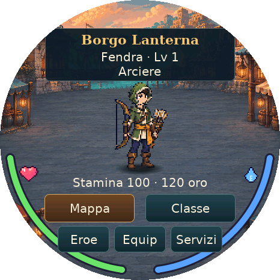
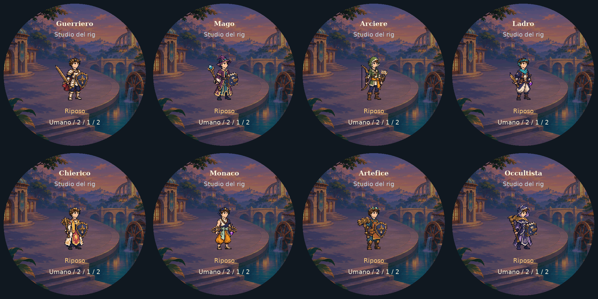
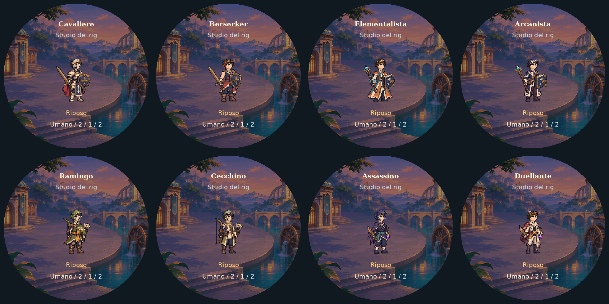
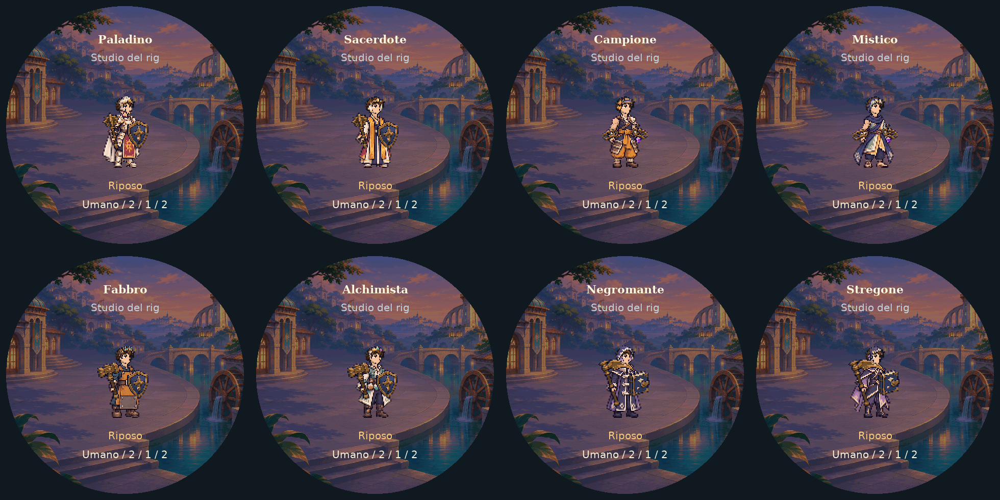
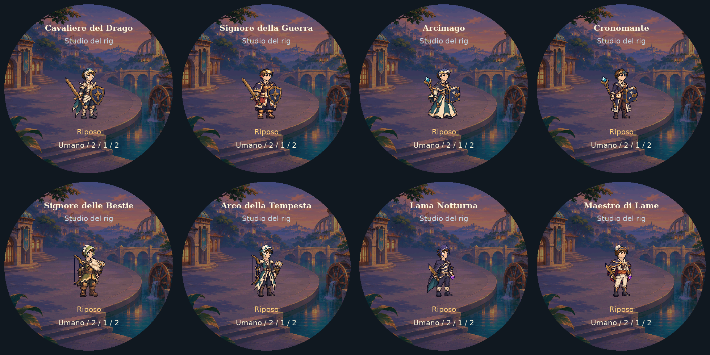
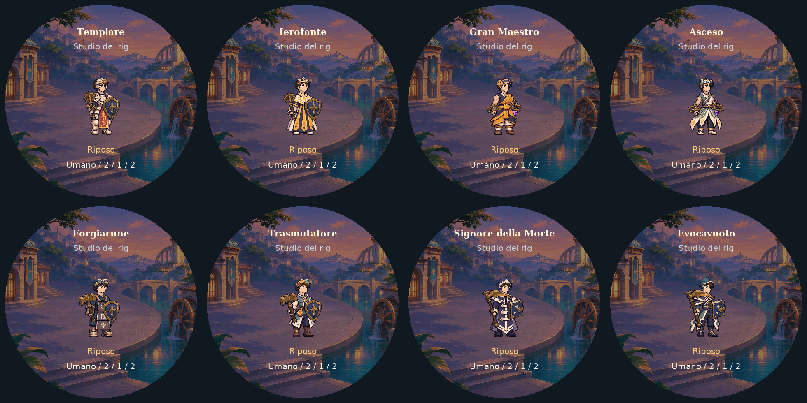
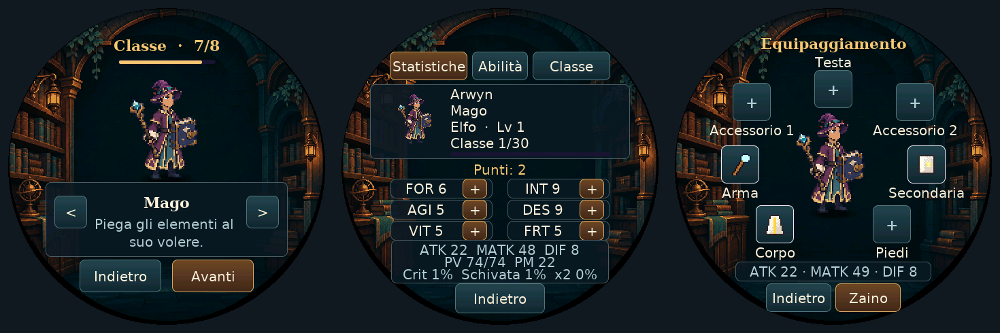

# Pocket Wayfarer

Un RPG fantasy HD-2D per **Waveshare ESP32-S3-Touch-AMOLED-1.75**, con schermo rotondo 466×466, touch e tasti. Crea l’eroe, scegli fra otto classi iniziali ed esplora le Isole Sospese.



**[Installa dal browser](https://shydanrem.github.io/pocketwayfarer/)** · **[Manuale illustrato](docs/GUIDA.md)** · **[Tutta la documentazione](docs/README.md)**

**[Roadmap operativa](docs/ROADMAP.md)** · [Stato del lotto attivo](docs/roadmap/STATUS.md) · [Direzione artistica delle 40 classi](docs/CLASS-ART-BIBLE.md)

> **0.10.0-preview.8** — Parata «Bene» più efficace e risultato della difesa visibile sopra l’arena. [Note di versione](CHANGELOG.md)

## Sul Pocket, in pochi passaggi

1. Apri l’installer da **Chrome o Edge su computer** e collega il Pocket con un cavo USB dati.
2. Conferma il modello, premi **Collega e installa** e scegli la porta USB.
3. Segui il dialogo e attendi il completamento. Per aggiornare una build Pocket Wayfarer con lo stesso layout, lascia **Erase device** disattivato.

Il pacchetto include firmware, grafica e font: non servono compilazione, microSD o configurazione Wi-Fi. La pagina verifica i tre binari prima di abilitare l’installazione. La cancellazione completa elimina i salvataggi; prima di cambiare gioco o layout consulta [Backup e aggiornamenti](docs/SALVATAGGI.md).

**Compatibilità:** soltanto Waveshare ESP32-S3-Touch-AMOLED-1.75, CO5300, CST9217, 16 MB flash, 8 MB PSRAM. Schede dal nome simile non sono considerate compatibili automaticamente. [Installazione completa e procedura manuale](docs/INSTALLAZIONE.md).

## Il primo viaggio

**Nuova avventura → scegli la classe → Inizia.** Apri **Aspetto** per personalizzare l’eroe. Scegli **Partiamo** per seguire la guida fino alla prima stanza della Cripta o **Salta guida** per partire in autonomia. Tocca **Classe → Cambia classe** per provare un’altra famiglia e tornare in seguito a quella già avanzata.



**Touch** seleziona bersagli e comandi. Durante attacco e parata puoi usare anche **BOOT**. Nei menu BOOT torna indietro. **PWR** salva e spegne o riaccende lo schermo. [Manuale illustrato](docs/GUIDA.md)

## Provare senza dispositivo

Su Linux, con runtime SDL2, CMake e compilatore C/C++:

```sh
bash scripts/play-desktop.sh
```

Mouse = touch, Spazio/Invio = BOOT, Esc = BOOT lungo, P = PWR, F5 = salva/ricarica. È la stessa UI nativa C/LVGL del firmware. Usa `--save build/prova.bin` per un profilo separato. [Requisiti e istruzioni di sviluppo](docs/SVILUPPO.md).

## Spedizione extra

**Servizi → Spedizione extra** apre Lanternbound, cinque stanze con tre assetti e sei reliquie. I suoi progressi sono conservati. **Borgo** riporta al percorso principale. [Regole di Lanternbound](docs/LANTERNBOUND.md)

## Documentazione

| Per… | Documento |
|---|---|
| Installare via USB o manualmente | [Installazione](docs/INSTALLAZIONE.md) |
| Imparare il gioco | [Manuale illustrato](docs/GUIDA.md) |
| Aggiornare, fare backup e ripristinare | [Salvataggi](docs/SALVATAGGI.md) |
| Problemi di browser, porta o schermo | [Risoluzione dei problemi](docs/RISOLUZIONE-PROBLEMI.md) |
| Compilare, verificare o modificare | [Sviluppo](docs/SVILUPPO.md) |
| Gestire sito e pacchetti su GitHub Pages | [Pubblicazione](docs/PUBBLICAZIONE.md) |
| Hardware, memoria e checklist fisica | [Firmware](docs/FIRMWARE.md) |

## Verifiche e provenienza

La suite nativa verifica il percorso dal primo avvio alla prima vittoria in italiano e inglese, il cambio di famiglia e il ripristino dei progressi. Copre anche combat timing, migrazione v1–v4, equipaggiamento e gioco salvato. Il collaudo della nuova preview sul Pocket fisico resta aperto. [Roadmap e prove](docs/ROADMAP.md)

Gli atlas HD-2D originali e i font hanno [sorgenti, prompt e registro](assets/lantern/README.md). [Crediti e licenze dei componenti](THIRD_PARTY.md). L’installazione dal browser si ispira al percorso di [TamaPoke](https://socquique.github.io/TamaPoke/web/) e usa ESP Web Tools; non copia firmware o contenuti del gioco. L’infrastruttura hardware deriva dal lavoro su [PocketD-D](https://github.com/ShydanRem/PocketD-D), senza contenuti o regole D&D.

R2 aggiunge 61.440 combinazioni estetiche, 89.768 composizioni, 147 catture native e prove di continuità/cache con sanitizer. [Prove e limiti R2](docs/roadmap/rig-evidence/README.md) · [Sorgenti del rig](assets/hero-rig/README.md).

Le prime otto avanzate ora hanno anche una propria illustrazione nell’atlante e un costume personale distinto dal ramo fratello.



R3.1 verifica 122.880 combinazioni estetiche e promozioni touch IT/EN con equipaggiamento conservato. [Prove e limiti](docs/roadmap/advanced-a-evidence/README.md).

R3.2 completa Paladino, Sacerdote, Campione, Mistico, Fabbro, Alchimista, Negromante e Stregone.



Verificati 184.320 combinazioni estetiche, 32 promozioni touch IT/EN e 512 catture native. La cintura decorativa dell’Alchimista conserva il proprio colore cambiando carnagione. [Prove R3.2](docs/roadmap/advanced-b-evidence/README.md).

R4.1 aggiunge Cavaliere del Drago, Signore della Guerra, Arcimago, Cronomante, Signore delle Bestie, Arco della Tempesta, Lama Notturna e Maestro di Lame.



Verificati 245.760 combinazioni estetiche, 1.200 confronti dei rami sotto lo stesso elmo e 16 percorsi touch completi fino alla maestra. La scheda Statistiche mantiene i nomi lunghi dentro il cerchio e separati dall’avatar. [Prove R4.1](docs/roadmap/master-a-evidence/README.md).

R4.2 completa Templare, Ierofante, Gran Maestro, Asceso, Forgiarune, Trasmutatore, Signore della Morte ed Evocavuoto.



Verificate 307.200 combinazioni estetiche e 1.600 confronti dei rami con lo stesso elmo. I 32 percorsi di promozione in italiano e inglese coprono tutte le maestre e verificano abilità ereditate e salvataggi. [Prove R4.2](docs/roadmap/master-b-evidence/README.md).


