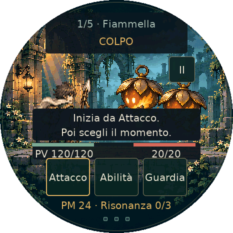
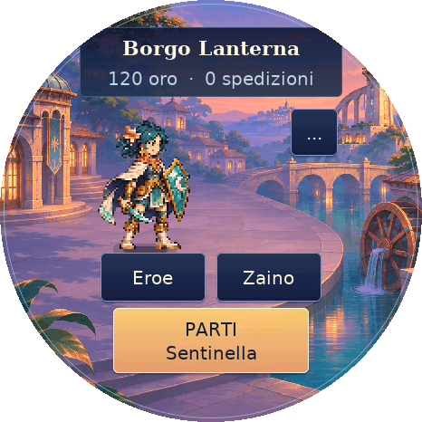
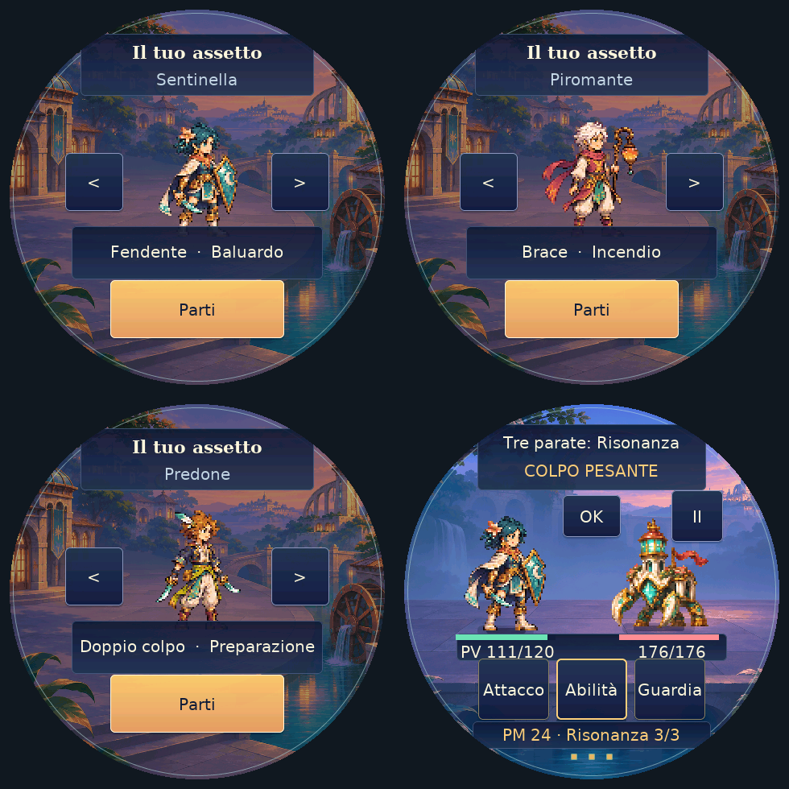

# Sagome, colore e profondità — 17 novembre 2026

La revisione `0.4.0-preview.1` affronta un difetto concreto: personaggi e mostri si confondevano con il fondale. La prima proposta più colorata aveva ancora troppi dettagli dietro le figure; è stata scartata. Le immagini di questa pagina sono catture del renderer C/LVGL a **466×466**, senza ritocco, non concept sostitutivi del gioco.

## Ricerca applicata

| Fonte primaria | Indicazione pertinente | Applicazione nel gioco |
|---|---|---|
| [Valve — Dota 2 Character Art Guide](https://help.steampowered.com/en/faqs/view/0688-7692-4D5A-1935) | La sagoma e l'organizzazione dei valori devono restare leggibili alla dimensione di gioco. | Verifica alla risoluzione nativa e in scala di grigi; silhouette intere, scala costante fra pose e spazio attorno ai combattenti. |
| [Riot — Clarity in League](https://www.leagueoflegends.com/en-us/news/dev/clarity-in-league/) | Gerarchia dei segnali, sagome riconoscibili e controllo del rumore visivo. | L'arena lascia una fascia poco dettagliata dietro gli attori. Indicazioni brevi nell'intestazione, risorse su pannelli leggibili e bersaglio segnato anche con un'ellisse. |
| [Acquire — intervista su Octopath Traveler II](https://www.unrealengine.com/developer-interviews/octopath-traveler-ii-builds-a-bigger-bolder-world-in-its-stunning-hd-2d-style) | L'incontro fra sprite e ambiente richiede attenzione a proporzioni, risoluzione e luce. | Piano di appoggio, ombre di contatto e fondali composti per le posizioni reali degli attori. La profondità è dipinta: questo firmware non usa la scena 3D e l'illuminazione di Octopath. |

Sono principi di composizione applicabili a questo hardware, non una promessa di equivalenza ai giochi citati. Non sono stati importati loro personaggi, mostri o fondali.

## Scelte visive realizzate

La schermata iniziale separa titolo, sottotitolo, figura intera e pulsanti: nessuna lettera attraversa la sagoma. Anche il sottotitolo ha un fondino leggibile. Il borgo usa un canale al crepuscolo, architetture illuminate ai bordi e una piazza libera dietro l'eroe. Nell'arena, la foschia blu-viola e le campiture ampie arretrano rispetto ad avorio, ambra e verde acqua delle figure. La saturazione è distribuita per importanza, anziché aumentata ovunque. Il fondale resta colorato, ma non deve contendere il primo piano ai combattenti.

I tre assetti hanno nuove forme e colori: Sentinella con mantello avorio e scudo verde acqua; Piromante con capelli chiari, veste prugna e lanterna; Predone con giacca indaco, fascia e due lame. Anche le sette specie nemiche hanno nuove sorgenti a quattro pose. Le palette sono condivise fra le pose di ciascuna riga, per evitare oscillazioni cromatiche dovute alla conversione.

I piedi dell’eroe restano sopra pulsanti e barre: la posizione nel borgo è y=195, in battaglia y=201; gli effetti condividono la stessa origine. La regressione controlla i pixel opachi della figura contro i limiti reali dell’HUD nelle catture. Il boss entra interamente nell'area di gioco. Nelle coppie, i due canvas da 88 pixel hanno centri a x=270 e x=370: le aree di selezione restano distinte. Un test tocca anche `(278,196)`, punto che prima veniva intercettato dal margine trasparente dell'altro nemico. Le ombre sono ellissi LVGL su due livelli, non un effetto di illuminazione dinamica.

## Come viene verificata

- Catture native di borgo, tre assetti, coppie, boss, timing ed effetti, in italiano e inglese.
- Confronto [prima/dopo, colore e scala di grigi](audit/clarity/comparison.png), per separare il contributo del valore da quello della tinta. Il confronto è diagnostico, non un voto automatico alla bellezza.
- Controllo dei bordi trasparenti delle celle sorgenti, scala e ancoraggio comuni fra pose, importazione deterministica senza dithering.
- Input reali LVGL sui due nemici e confronto byte per byte del framebuffer incrementale con il ridisegno completo.

Sorgenti generate con ImageGen, prompt, versione scartata e trasformazioni meccaniche restano nel [registro degli asset](../assets/lantern/README.md). Non sono sprite dichiarati disegnati a mano. Quattro pose non costituiscono un set completo di animazione: camminate, transizioni più ricche e rifinitura pixel per pixel restano possibili sviluppi. La leggibilità sul diametro fisico e durante una sessione sul Pocket richiede ancora un collaudo del nuovo firmware.
