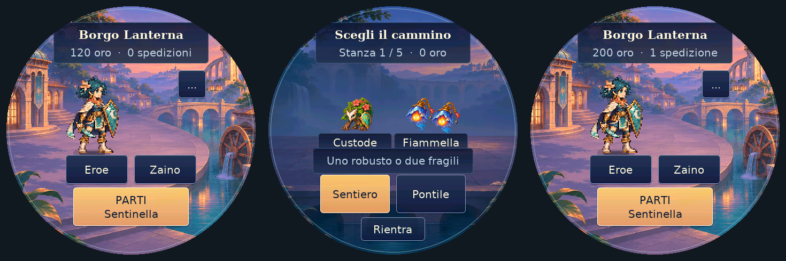
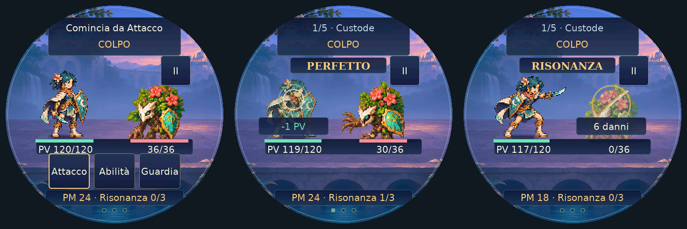
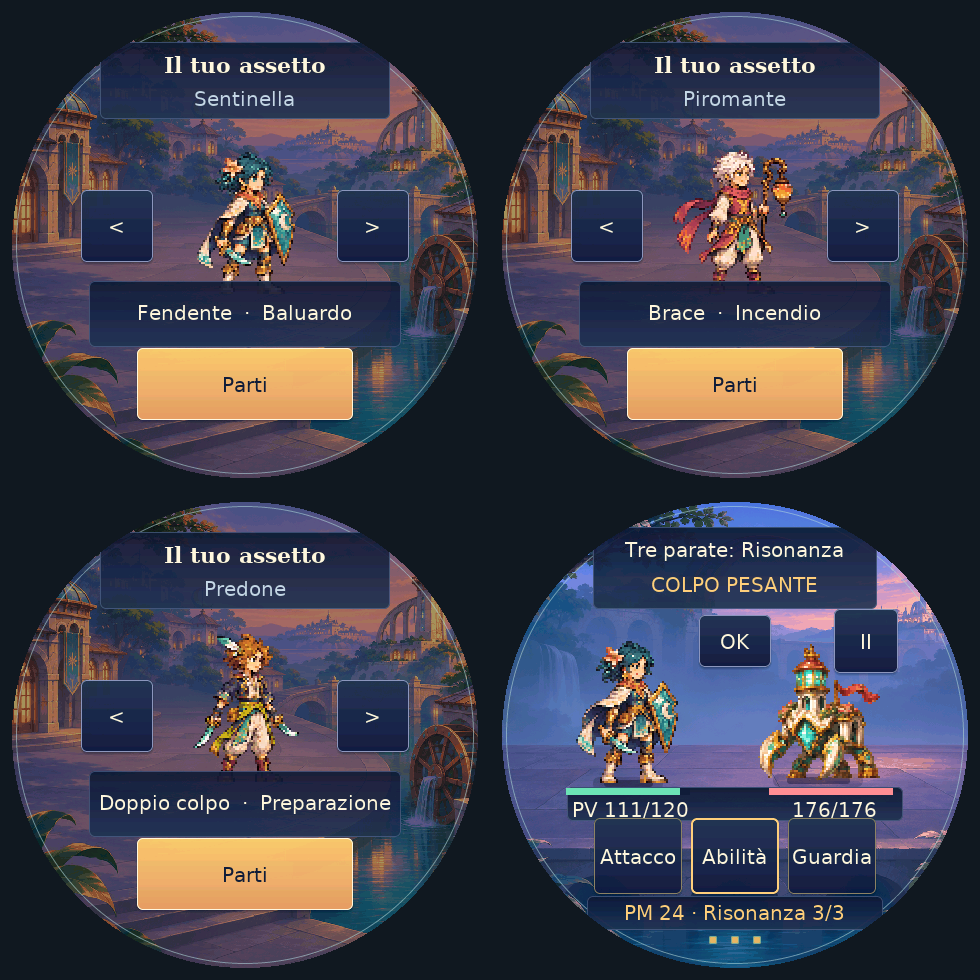
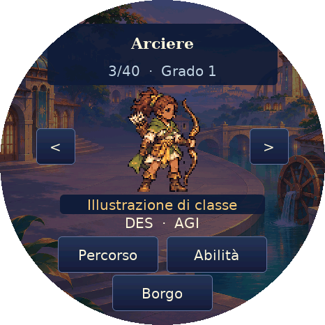
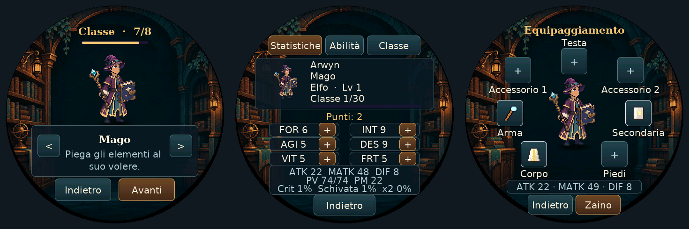
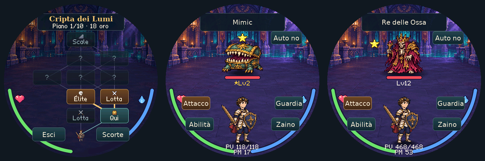

# Il tuo primo viaggio

Lanternbound è la nuova spedizione HD-2D di Pocket Wayfarer. Entri in cinque stanze, scegli come affrontarle e decidi quando tornare al borgo. Fame, stamina e livello del personaggio classico non bloccano queste spedizioni.

## Parti dal borgo

**Gioca → Parti → scegli il cammino.** Il pulsante **Parti** indica l’assetto che porterai in spedizione. Per cambiarlo, apri **Eroe** e usa le frecce. Da lì puoi partire subito oppure tornare al borgo con **Torna** o BOOT. Se hai una caccia o un dungeon classico attivo, concludilo prima di avviare Lanternbound.

L’anteprima del cammino mostra i nemici prima di entrare. La spedizione segue questo ordine: lotta, evento, lotta, bivio del Bastione e Guardiano del Faro. Nella stanza evento scegli Focolare o Specchio. Nella quarta stanza puoi confrontare il Sentiero e il Bastione.

### Il bivio del Bastione

Il **Sentiero** costa 0 PV e vale **10 oro** se vinci. Il **Bastione** costa **12 PV all’ingresso**, ha un Granchio di Marea da **88 PV** e vale **25 oro** se lo sconfiggi. Puoi entrare con almeno 13 PV. Il premio entra nel bottino della spedizione dopo la vittoria. Con **Rientra** puoi portarlo al borgo prima del Guardiano.

## I comandi

| Comando | Quando usarlo |
|---|---|
| Tocca un nemico vivo | Cambia bersaglio quando scegli l’azione. Il segno chiaro indica il bersaglio selezionato. |
| Attacco | Apre l’anello: tocca quando la scintilla passa sull’arco dorato. |
| Abilità | Apre offensiva da 6 PM e supporto da 5 PM. Le mosse troppo costose sono disabilitate. |
| Guardia | Recupera fino a 4 PM e dimezza i danni del turno nemico successivo. |
| Tocca sull’onda | Durante la parata, tocca quando l’onda raggiunge il cerchio centrale. |
| BOOT | Durante attacco/parata giudica il timing alla pressione iniziale. Nella scelta di battaglia mette in pausa; nei menu torna indietro al rilascio. |
| II | Mette in pausa anche durante l’anello e la parata. |
| PWR | Salva e spegne/riaccende lo schermo. Non è il comando di reset della scheda. |

La ripresa concede **650 ms di preparazione** prima di far ripartire la fase salvata. Il timing e gli effetti non avanzano durante la pausa.

## Attacco, intento e parata

Scegli il bersaglio e l’azione. In attacco il giudizio può essere Mancato, Bene, Ottimo o Perfetto: anche un attacco mancato infligge un danno ridotto. L’anello compie un giro in 1400 ms e l’azione scade dopo due giri.

Il nemico dichiara l’intento prima della parata. Impara a distinguere colpo, colpo pesante e doppio colpo. La falena può invece curare un alleato: quell’azione si risolve senza chiedere una parata inutile.

Una parata perfetta riduce molto il danno, ma non lo annulla sempre. Guardia e scudo si applicano dopo la qualità della parata. Ogni parata perfetta contro un attacco effettivo aggiunge una carica di **Risonanza**, fino a tre.

A tre cariche, l’abilità offensiva consuma la Risonanza e ottiene l’effetto dell’assetto. Sono evidenziati prima Abilità e poi il pulsante offensivo; i tre segmenti sotto le risorse mostrano anche la carica.

I suggerimenti insegnano una cosa alla volta. Attacco e parata vengono appresi con un giudizio almeno Bene; Guardia e abilità usandole. Puoi confermare il suggerimento di Risonanza con OK. Le lezioni restano apprese tra spedizioni e riavvii. In **Opzioni** trovi **Suggerimenti** e **Ripeti guida**.

## Scegli l’assetto

| Assetto | Risorse iniziali | Offensiva · supporto | Risonanza |
|---|---|---|---|
| Sentinella | 120 PV · 24 PM | Fendente · Baluardo: fino a 30 scudo e 6 PV | Aggiunge scudo. |
| Piromante | 96 PV · 36 PM | Brace · Incendio: bruciatura sui nemici | Potenzia la bruciatura sul bersaglio. |
| Predone | 104 PV · 28 PM | Doppio colpo · Preparazione: scudo e danno preparato | Aggiunge un colpo se il bersaglio sopravvive. |

I nomi possono essere abbreviati nei pulsanti di combattimento per mantenere leggibili i costi. I PM si recuperano anche durante la spedizione: Guardia aiuta a non dipendere soltanto dagli attacchi base.

## Le sei reliquie

Dopo ogni scontro ordinario vengono proposte due reliquie diverse. Ne porti **al massimo tre**; una reliquia iniziale equipaggiata occupa già uno slot. Con spazio libero usa **Scegli**; a tre slot usa **Confronta** per vedere la nuova reliquia in alto e quella da lasciare in basso. Le frecce scorrono le tre possedute: **Sostituisci** conferma lo scambio, **Indietro** o BOOT annullano senza rimuovere nulla. **Lascia** rinuncia alla ricompensa mantenendo l’assetto.

Se riavvii durante il confronto ritrovi le due proposte e tutte le reliquie possedute. La selezione temporanea non è un oggetto già rimosso. Il salvataggio conserva lo scambio soltanto dopo la conferma.

| Reliquia | Effetto |
|---|---|
| Cuore di Lanterna | Parata perfetta: recupera fino a 3 PM. |
| Ago di Rovo | Contro un nemico già ferito: +4 danni. |
| Vetro del Porto | Guardia prepara +8 danni al prossimo colpo. |
| Campana del Borgo | Ogni incontro comincia con 12 scudo. |
| Rosa di Brace | I colpi applicano 2 danni di bruciatura per due turni. |
| Bussola del Faro | Proseguire dopo una stanza recupera fino a 6 PV. |

Dopo la vittoria sul boss scegli un progetto fra le reliquie possedute nella spedizione. Il riepilogo mostra il nome, l’effetto e se il progetto è nuovo o già in collezione. Tocca **Equipaggia**, poi **Parti** per iniziare la prossima spedizione con la reliquia in uno dei tre slot.

**Collezione** apre la scheda del progetto. Puoi cambiare reliquia, usare **Rimuovi** per ripartire senza una reliquia iniziale o premere **Torna** per rivedere il riepilogo. La collezione è accessibile anche dal borgo tramite **Zaino**.

Vincere dopo aver rinunciato a tutte le reliquie accredita l’oro e aumenta il numero di vittorie. In quel caso il riepilogo mostra l’eventuale reliquia iniziale o il numero di progetti in collezione.

## Focolare o Specchio

Il **Focolare** offre fino a 25 PV oppure 12 PM. Lo **Specchio** propone un patto: offrire 12 PV, avendone più di 12, per Risonanza piena e fino a 8 PM. Rifiutare restituisce fino a 12 PM. L’offerta che costerebbe tutti i PV è disabilitata.

## Quando tornare

Completare la spedizione dà **80 monete** passando per il Sentiero o **95** passando per il Bastione. Rientrare fra le stanze conserva tutto l’oro guadagnato. La sconfitta sottrae un quarto del bottino arrotondato per difetto. Con 55 oro, per esempio, il riepilogo mostra 42 accreditati e 13 persi. L’accredito avviene una sola volta, anche se riavvii dal riepilogo.

**Riprova** riparte con PV/PM pieni e conserva profilo, oro già depositato, progetti, bestiario e opzioni. Non ci sono attese di stamina per riprovare Lanternbound.

## Borgo, opzioni e gioco classico

Il menu **…** contiene Mappa, Bestiario, Collezione, Opzioni, Come si gioca e Classico. Il bestiario registra le creature effettivamente incontrate e dà un indizio sul loro comportamento. Sono presenti sei specie ordinarie e il Guardiano del Faro.

**Timing assistito** allarga le finestre del 50%. **Movimento ridotto** elimina spostamenti, particelle e dissolvenze decorative mantenendo pose, simboli e informazioni di timing. Lingua e suggerimenti si cambiano dalle opzioni.

**Classico** apre il precedente RPG con creazione dettagliata, 40 classi, inventario, bottega, forgia, campi, dungeon e caccia offline. Le sue regole sono diverse da Lanternbound; la grafica di tutte le sue schermate non è ancora stata ridisegnata. Legami/ESP-NOW nell’RPG non è una funzione di gioco completata. Nessun suono viene promesso nella preview corrente.

Per installare: [guida USB](INSTALLAZIONE.md). Per proteggere il profilo: [salvataggi](SALVATAGGI.md).

## Le classi classiche, in un atlante

Da **Borgo → … → Classi** puoi sfogliare tutte le 40 classi, consultarne abilità e percorso di evoluzione. Ogni classe ha un’illustrazione dedicata. Sono rappresentanti della classe, non sostituzioni del tuo personaggio personalizzato.

Le frecce scorrono le schede; **Percorso** apre i cinque nodi della famiglia, selezionabili dopo lo scorrimento. **Abilità** mostra i dati della classe. **Chiudi** resta fisso sotto il dettaglio; BOOT chiude prima il dettaglio e poi torna al borgo. Consultare non assegna oggetti, abilità o livelli e non cambia classe: il passaggio resta disponibile da **Classico → Eroe → Classe** con i requisiti previsti.

## Il tuo personaggio nel Classico

In **Personalizza**, le frecce cambiano il valore della tappa corrente. **Avanti** passa alla successiva e **Indietro** torna alla precedente per rivedere la scelta. **Inizia!** salva il profilo.

Dal borgo apri **… → Classico**. In **Eroe** puoi distribuire i punti dalle schede **Statistiche** e **Abilità** o consultare il prossimo grado in **Classe**. Tocca un ramo per leggerne le abilità e, quando hai raggiunto i requisiti, confermare la promozione. **Indietro** e BOOT riportano alla scheda Eroe e quindi al borgo del Classico.

In **Equip** ogni slot mostra il proprio nome. Tocca un oggetto per vederne i dettagli o toglierlo. Il **+** su uno slot libero apre lo zaino, dove puoi scegliere un oggetto compatibile. Il bordo dell’icona indica la rarità.

Tutte le 40 classi usano avatar modulari: scegli razza, carnagione, capelli, occhi e volto nella creazione. Arma, mano secondaria e testa mostrano gli oggetti equipaggiati; senza un oggetto alla testa appare il copricapo della classe. Torso, piedi e accessori influiscono sulle statistiche ma non hanno ancora livelli grafici separati.

Un passaggio di classe conserva i tuoi dati estetici. L'illustrazione nell'atlante resta un rappresentante separato. Le pose del nuovo avatar sono preliminari; **Movimento ridotto** mantiene la posa di riposo.

Le prime avanzate sono Cavaliere, Berserker, Elementalista, Arcanista, Ramingo, Cecchino, Assassino e Duellante. Il passaggio continua a richiedere livello 20 e classe base 30. Puoi confrontare le due vie da **Classico → Eroe → Classe**, senza cambiare classe finché non confermi **Diventa!**.

Sono aggiornate anche le altre quattro famiglie: Paladino/Sacerdote, Campione/Mistico, Fabbro/Alchimista e Negromante/Stregone. Le ampolle sulla cintura dell’Alchimista sono decorazioni del costume: non indicano quante pozioni possiedi. I requisiti delle promozioni restano invariati.

Tutte le sedici maestre hanno un costume dedicato. Ogni avanzata conduce alla propria maestra: servono **livello 45 e classe avanzata 40**. Dopo la conferma, la classe riparte da 1 e può arrivare a 50; conservi le abilità già apprese e il tuo aspetto. Le otto abilità disponibili provengono dalla linea base → avanzata → maestra. Non puoi saltare direttamente dalla base alla maestra o scegliere quella dell’altro ramo.

## Dal borgo ai Prati di Lumen

Apri **… → Classico → Mappa** e tocca **Prati di Lumen** nella parte bassa della mappa. **Combatti** consuma un punto Stamina e apre un incontro. **Caccia auto** avvia la caccia offline. **Cripta dei Lumi** apre la discesa a stanze. Quando il tuo record raggiunge il piano 5, puoi partire dal piano 6.

Tocca attorno alla sagoma di un mostro per sceglierlo. Una stella lo indica e il suo nome appare in alto. Con **Attacco** tocca quando l’anello raggiunge il riferimento dorato. Quando vedi il messaggio di parata, tocca quando arriva l’onda. In entrambe le fasi puoi usare anche BOOT. La mossa annunciata compare sopra l’arena.

## Nella Cripta dei Lumi

La mappa procede dal basso verso l’alto. Scegli una stanza con il bordo dorato, collegata alla tua posizione. **Qui** indica la stanza in cui sei. **Visitata** marca una sosta precedente e **?** indica una stanza ancora da scoprire. I nodi dorati mostrano il tipo di stanza prima che tu entri. Una stanza ordinaria costa 2 punti Stamina.

In basso **Scorte** apre pozioni ed eteri. **Esci** chiede se usare una pergamena di ritorno. Puoi tornare al borgo anche dalle scale, tenendo il bottino. Dopo aver battuto il Re Gelatino al piano 5 puoi scegliere di rientrare dal piano 6 in una discesa successiva. Battere il Re delle Ossa al piano 10 sblocca la Riva di Vetro.

## Alla Riva di Vetro

Superata la Cripta dei Lumi, tocca **Riva di Vetro** sul lato sinistro della mappa del mondo. Gli incontri all’aperto coprono i livelli **10–20**. Da qui puoi aprire anche il **Tempio Sommerso**. Scegli le stanze dal basso verso l’alto seguendo i collegamenti dorati.

Al piano 5 il **Granchio corazzato** apre il checkpoint del piano 6. Al piano 10 il **Leviatano** chiude la discesa e sblocca il **Bosco Sussurrante**.

## Nel Bosco Sussurrante

Dopo il Tempio Sommerso si sblocca il **Bosco Sussurrante** nella parte alta a sinistra della mappa. Gli incontri all’aperto coprono i livelli **20–32**. Da qui puoi entrare nelle **Radici Antiche**. Le etichette delle stanze raggiungibili indicano il tipo di incontro e permettono di riconoscere una trappola dall’icona e dal nome prima di scegliere.

L’**Antico Ceppo** al piano 5 apre il checkpoint del piano 6. La **Regina Ragno** al piano 10 sblocca le **Caverne di Brace**.

## Nelle Caverne di Brace

Dopo le Radici Antiche, tocca le **Caverne di Brace** nella parte alta a destra della mappa. Gli incontri all’aperto coprono i livelli **32–48**. In battaglia leggi sopra l’arena l’azione annunciata dal nemico. L’onda della parata converge sullo scudo centrale.

Entra nella **Fucina Infernale** dalla schermata delle Caverne. Al piano 5 il **Drago di cenere** apre il checkpoint del piano 6. Il **Signore dei Demoni** al piano 10 sblocca le **Guglie del Cielo**.

## Sulle Guglie del Cielo

Dopo la Fucina Infernale, scegli le **Guglie del Cielo** sul lato destro della mappa. Gli incontri all’aperto coprono i livelli **48–70**. Dalla terrazza delle Guglie puoi entrare nella **Cittadella Celeste**.

Il **Custode Celeste** al piano 5 apre il checkpoint del piano 6. Al piano 10 il **Drago Stellare** chiude la spedizione. **Continua** porta al borgo con il bottino. Puoi tornare alle Guglie dalla mappa e vedere **Record piano 10** sotto l’ingresso della Cittadella.

## Orientarsi e gestire lo zaino

Tocca il nome di un’isola per raggiungerla. Il **lucchetto** segnala una strada chiusa e, toccandola, indica quale dungeon completare. La **spada** indica una caccia in corso. Il **trofeo** indica un dungeon completato. Tocca **Borgo Lanterna** o **Indietro** per tornare al borgo.

Da **Equip → Zaino** vedi nome, livello e rarità degli oggetti, oltre ai posti disponibili. Scorri la lista e tocca una riga per confrontare l’oggetto, equipaggiarlo, usare una gemma o venderlo. **Scorte** mostra le quantità e consente di usare le provviste utilizzabili al borgo. **BOOT** chiude prima la scheda aperta, poi torna a Equip.

## Bottega, forgia e missioni

- **Bottega.** **Scorte** mostra il prezzo e la quantità posseduta. Apri una riga in **Equip.** per vedere le statistiche prima di acquistare. **Vendi** mostra quanto ottieni per ogni oggetto.
- **Forgia.** Scegli un oggetto equipaggiato nella striscia in basso. Controlla la probabilità di riuscita, il costo e le risorse disponibili prima di toccare **Potenzia**.
- **Missioni.** Nel **Diario** trovi soglia, progressi e premio. **Ritira** consegna la ricompensa e segna la missione come ritirata. La scheda **Opzioni** contiene lingua, luminosità, ora e combattimento automatico.
