# Il tuo primo viaggio

## Crea l’eroe

1. Tocca **Nuova avventura** e usa le frecce per vedere le otto classi iniziali, il loro ruolo e il loro equipaggiamento.
2. Tocca **Inizia** per salvare l’eroe. Apri **Aspetto** se vuoi scegliere razza, volto, capelli e nome prima di partire.
3. Al **Borgo Lanterna** scegli **Partiamo**, poi **Mappa → Prati di Lumen → Combatti**. La guida ti presenta un Gelatino singolo, spiega il momento di attacco e parata e indica la Cripta dopo la prima vittoria.

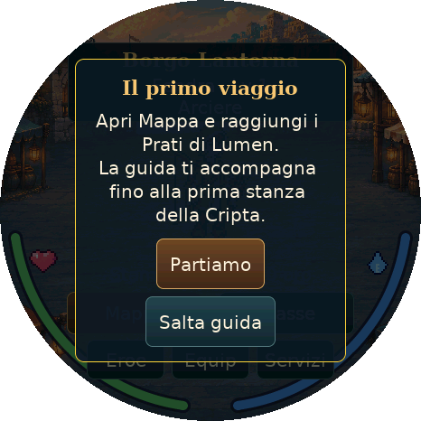

I suggerimenti di attacco e parata si riducono dopo il primo buon timing per ciascuna azione. Puoi scegliere **Salta guida** oppure riattivarla da **Servizi → Diario → Opzioni → Guida iniziale**. Un aggiornamento riprende il profilo esistente, anche con la guida disattivata. [Aggiornamento e backup](SALVATAGGI.md)

## La prima battaglia

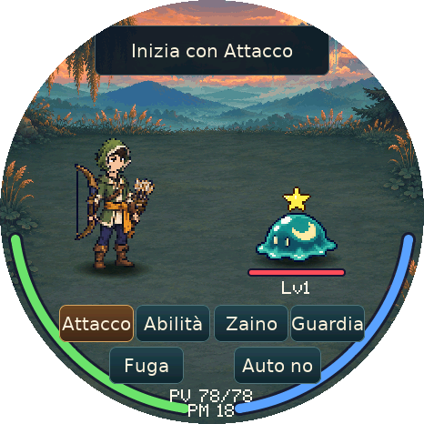

- Tocca un avversario per sceglierlo. La stella marca il bersaglio e il nome compare sopra l’arena.
- **Attacco** avvia l’anello. Tocca quando l’indicatore attraversa l’arco dorato. Durante la parata tocca quando l’onda raggiunge lo scudo. Puoi usare **BOOT** in entrambi i momenti.
- **Abilità**, **Zaino** e **Guardia** permettono di usare le mosse della tua classe, consumare una scorta o difenderti.
- **PWR** salva e spegne lo schermo. Al risveglio una breve preparazione precede la ripresa. Nei menu **BOOT** torna indietro o chiude la scheda aperta.

**Combatti** ai Prati di Lumen costa un punto Stamina. Da lì puoi anche avviare **Caccia auto** e ritirare il bottino al borgo, oppure entrare nella **Cripta dei Lumi**.

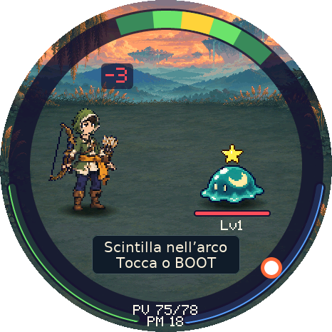

Quando l’onda raggiunge lo scudo, tocca o premi **BOOT**. Sopra l’arena leggi il risultato. **Bene** riduce il danno del 45%, **Ottimo** del 55%. **Perfetta** annulla il danno e risponde con un contrattacco. La riduzione da timing si applica prima di **Guardia**.

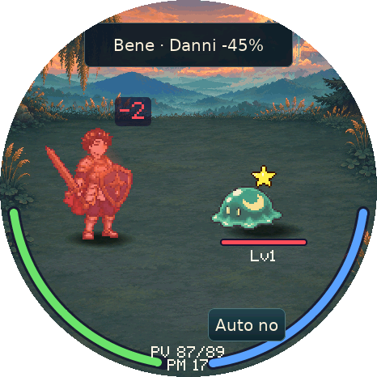

## Cambiare ed evolvere la classe

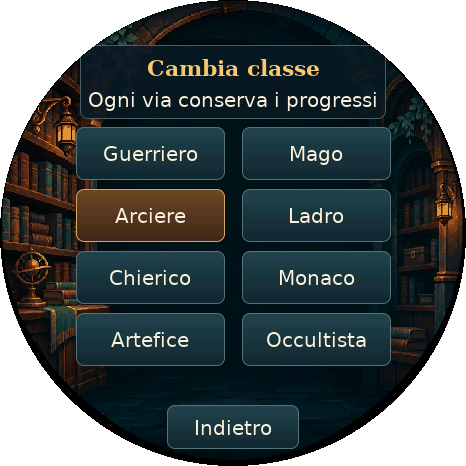

Al borgo tocca **Classe → Cambia classe**, seleziona una famiglia e conferma. Ogni famiglia conserva il proprio grado, l’esperienza di classe e i punti abilità. Quando torni a una via già iniziata riprendi la classe esatta che avevi lasciato. Il livello dell’eroe, il suo aspetto e il bottino lo seguono in tutte le famiglie.

Gli oggetti incompatibili passano nello zaino. Il gioco può equipaggiare un oggetto compatibile che possiedi già o dotarti dei pezzi iniziali al primo accesso alla famiglia. Se lo zaino è pieno o hai una caccia o un dungeon in corso, risolvi prima quella situazione. In **Equip** puoi rivedere l’equipaggiamento attivo.

**Classe** mostra anche le promozioni della famiglia attiva. Il grado avanzato richiede livello eroe **20** e classe base **30**. Il grado maestro richiede livello eroe **45** e classe avanzata **40**. Ogni avanzata prosegue verso il proprio maestro. **Atlante** mostra illustrazioni, abilità e requisiti delle 40 classi.

In **Eroe → Statistiche** e **Abilità** puoi spendere i punti guadagnati. Il tuo avatar conserva razza, volto e colori quando cambi equipaggiamento o classe. Arma, mano secondaria e testa mostrano gli oggetti equipaggiati.

Il **pugnale** aggiunge all’attacco una quota di Forza e una seconda quota pari al valore più alto tra Forza e Agilità. La spada usa la Forza per entrambe. Aprendo l’arma nello **Zaino**, leggi il cambio di **Attacco eroe** per il tuo equipaggiamento attuale.

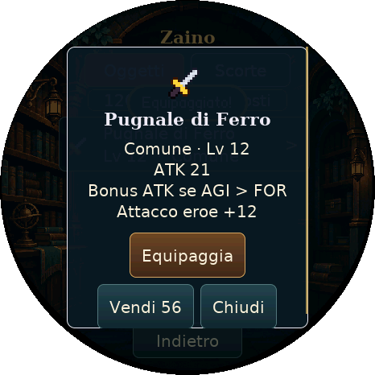

I **Missili arcani** dell’Arcanista colpiscono tre volte e usano **MATK** contro la difesa magica. Imbocca il ramo Arcanista partendo dal Mago se vuoi una magia a più colpi di elemento neutro.

## Lanternbound

Dal borgo scegli **Servizi → Spedizione extra** per giocare le cinque stanze di Lanternbound. Le opzioni **Assetto** e **Reliquie** valgono per la spedizione. Se avevi una spedizione in corso, nel menu trovi **Riprendi spedizione**. **Borgo** riporta all’eroe e alla mappa principali. [Regole, reliquie e ritorno](LANTERNBOUND.md)

## Nella Cripta dei Lumi

La mappa procede dal basso verso l’alto. Scegli una stanza con il bordo dorato, collegata alla tua posizione. **Qui** indica la stanza in cui sei. **Visitata** marca una sosta precedente e **?** indica una stanza ancora da scoprire. I nodi dorati mostrano il tipo di stanza prima che tu entri. Una stanza ordinaria costa 2 punti Stamina.

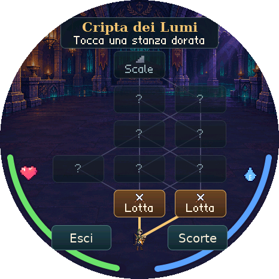

Quando raggiungi le scale o sconfiggi il boss su un piano mai completato, guadagni un bonus di **PE eroe e PE classe**. Alle scale puoi scendere o tornare al borgo con lo stesso bonus. Il gioco usa il tuo record per assegnarlo una sola volta per piano, anche sui profili esistenti.

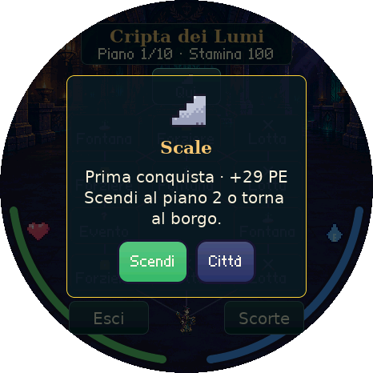

In basso **Scorte** apre pozioni ed eteri. Da inizio piano o dalle scale puoi rientrare col bottino. Dentro il piano, **Esci** usa una pergamena se la possiedi. Senza pergamena puoi ritirarti lasciando metà dell’oro trovato in quella discesa, conservando oggetti e checkpoint. Dopo il Re Gelatino al piano 5 puoi ripartire dal piano 6. Il Re delle Ossa al piano 10 sblocca la Riva di Vetro.

## Alla Riva di Vetro

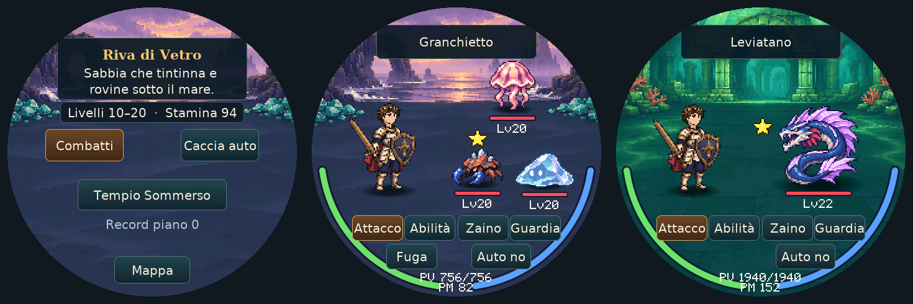

Superata la Cripta dei Lumi, tocca **Riva di Vetro** sul lato sinistro della mappa del mondo. Gli incontri all’aperto coprono i livelli **10–20**. Da qui puoi aprire anche il **Tempio Sommerso**. Scegli le stanze dal basso verso l’alto seguendo i collegamenti dorati.

Al piano 5 il **Granchio corazzato** apre il checkpoint del piano 6. Al piano 10 il **Leviatano** chiude la discesa e sblocca il **Bosco Sussurrante**.

## Nel Bosco Sussurrante

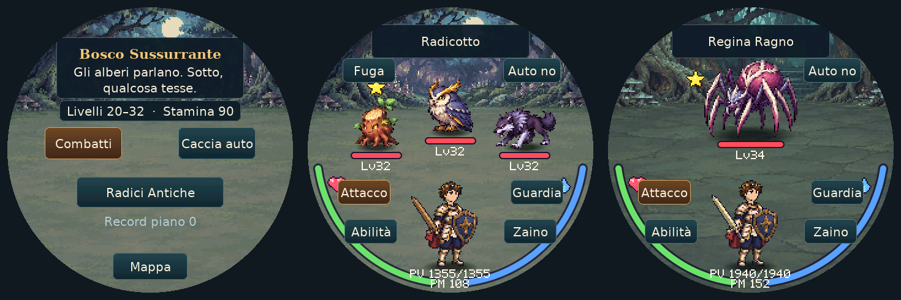

Dopo il Tempio Sommerso si sblocca il **Bosco Sussurrante** nella parte alta a sinistra della mappa. Gli incontri all’aperto coprono i livelli **20–32**. Da qui puoi entrare nelle **Radici Antiche**. Le etichette delle stanze raggiungibili indicano il tipo di incontro e permettono di riconoscere una trappola dall’icona e dal nome prima di scegliere.

L’**Antico Ceppo** al piano 5 apre il checkpoint del piano 6. La **Regina Ragno** al piano 10 sblocca le **Caverne di Brace**.

## Nelle Caverne di Brace

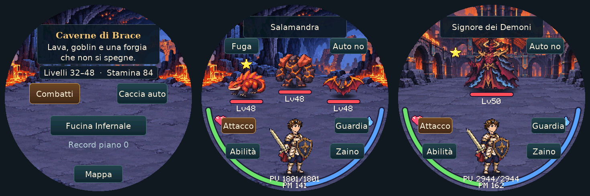

Dopo le Radici Antiche, tocca le **Caverne di Brace** nella parte alta a destra della mappa. Gli incontri all’aperto coprono i livelli **32–48**. In battaglia leggi sopra l’arena l’azione annunciata dal nemico. L’onda della parata converge sullo scudo centrale.

Entra nella **Fucina Infernale** dalla schermata delle Caverne. Al piano 5 il **Drago di cenere** apre il checkpoint del piano 6. Il **Signore dei Demoni** al piano 10 sblocca le **Guglie del Cielo**.

## Sulle Guglie del Cielo

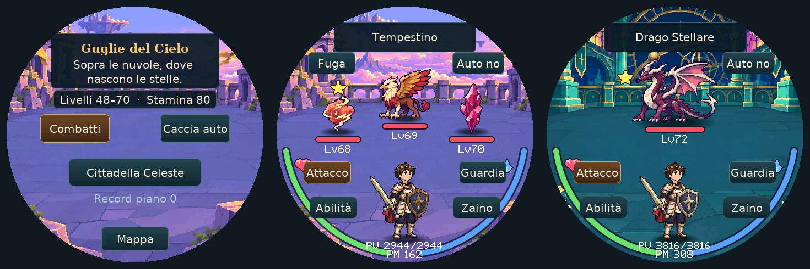

Dopo la Fucina Infernale, scegli le **Guglie del Cielo** sul lato destro della mappa. Gli incontri all’aperto coprono i livelli **48–70**. Dalla terrazza delle Guglie puoi entrare nella **Cittadella Celeste**.

Il **Custode Celeste** al piano 5 apre il checkpoint del piano 6. Al piano 10 il **Drago Stellare** chiude la campagna. Il riepilogo conferma i cinque dungeon completati e offre **Mappa** per vedere il progresso. Puoi tornare alle Guglie e rigiocare la Cittadella.

## Orientarsi e gestire lo zaino

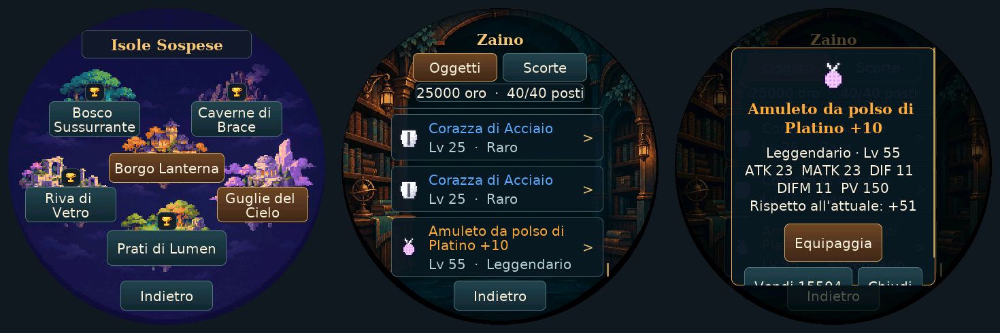

Tocca il nome di un’isola per raggiungerla. Il **lucchetto** segnala una strada chiusa e, toccandola, indica quale dungeon completare. La **spada** indica una caccia in corso. Il **trofeo** indica un dungeon completato. Tocca **Borgo Lanterna** o **Indietro** per tornare al borgo.

Da **Equip → Zaino** vedi nome, livello e rarità degli oggetti, oltre ai posti disponibili. Scorri la lista e tocca una riga per confrontare l’oggetto, equipaggiarlo, usare una gemma o venderlo. **Scorte** mostra le quantità e consente di usare le provviste utilizzabili al borgo. **BOOT** chiude prima la scheda aperta, poi torna a Equip.

## Bottega, forgia e missioni

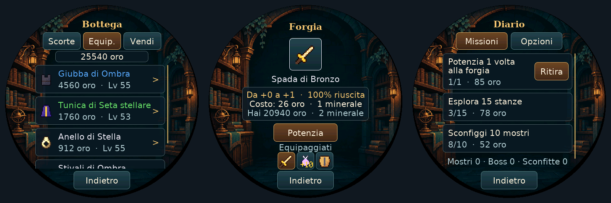

- **Bottega.** **Scorte** mostra il prezzo e la quantità posseduta. Apri una riga in **Equip.** per vedere le statistiche prima di acquistare. **Vendi** mostra quanto ottieni per ogni oggetto.
- **Forgia.** Scegli un oggetto equipaggiato nella striscia in basso. Controlla la probabilità di riuscita, il costo e le risorse disponibili prima di toccare **Potenzia**.
- **Missioni.** Nel **Diario** trovi soglia, progressi e premio. **Ritira** consegna la ricompensa e segna la missione come ritirata. La scheda **Opzioni** contiene lingua, luminosità, ora, combattimento automatico e movimento ridotto.
