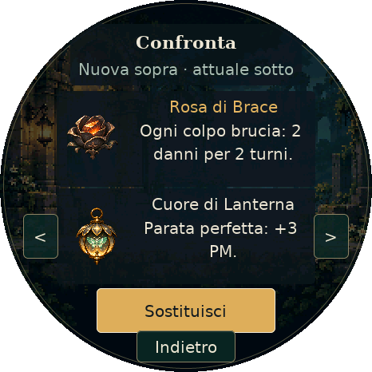

# Il tuo primo viaggio

Lanternbound è la nuova spedizione HD-2D di Pocket Wayfarer. Entri in cinque stanze, scegli come affrontarle e decidi quando tornare al borgo. Fame, stamina e livello del personaggio classico non bloccano queste spedizioni.

## Parti dal borgo

**Gioca → Parti → scegli l’assetto → Parti → scegli il cammino.** Se c’è una caccia o un dungeon classico ancora attivo, concludilo prima di cominciare Lanternbound. La caccia attiva mostra nel borgo un accesso al suo stato e alla raccolta.

L’anteprima del cammino mostra i nemici prima di entrare. La spedizione segue questo ordine: lotta, evento, lotta, lotta, Guardiano del Faro. Nella stanza evento scegli Focolare o Specchio; nelle lotte ordinarie puoi trovare un avversario robusto o una coppia più fragile.

## I comandi

| Comando | Quando usarlo |
|---|---|
| Tocca un nemico vivo | Cambia bersaglio quando scegli l’azione. Il segno chiaro indica il bersaglio selezionato. |
| Attacco | Apre l’anello: tocca quando la scintilla passa sull’arco dorato. |
| Abilità | Apre offensiva da 6 PM e supporto da 5 PM. Le mosse troppo costose sono disabilitate. |
| Guardia | Recupera fino a 4 PM e dimezza i danni del turno nemico successivo. |
| Tocca sull’onda | Durante la parata, tocca quando l’onda raggiunge il cerchio centrale. |
| BOOT | Durante attacco/parata vale come tocco di timing; fuori dal timing torna indietro o mette in pausa secondo la schermata. |
| II | Mette in pausa anche durante l’anello e la parata. |
| PWR | Salva e spegne/riaccende lo schermo. Non è il comando di reset della scheda. |

La ripresa concede **650 ms di preparazione** prima di far ripartire la fase salvata. Il timing e gli effetti non avanzano durante la pausa.

## Attacco, intento e parata

Scegli il bersaglio e l’azione. In attacco il giudizio può essere Mancato, Bene, Ottimo o Perfetto: anche un attacco mancato infligge un danno ridotto. L’anello compie un giro in 1400 ms e l’azione scade dopo due giri.

Il nemico dichiara l’intento prima della parata. Impara a distinguere colpo, colpo pesante e doppio colpo. La falena può invece curare un alleato: quell’azione si risolve senza chiedere una parata inutile.

Una parata perfetta riduce molto il danno, ma non lo annulla sempre. Guardia e scudo si applicano dopo la qualità della parata. Ogni parata perfetta contro un attacco effettivo aggiunge una carica di **Risonanza**, fino a tre.

A tre cariche, l’abilità offensiva consuma la Risonanza e ottiene l’effetto dell’assetto. Sono evidenziati prima Abilità e poi il pulsante offensivo; i tre segmenti sotto le risorse mostrano anche la carica.

I suggerimenti insegnano una cosa alla volta. Attacco e parata vengono appresi con un giudizio almeno Bene; Guardia e abilità usandole. Puoi confermare il suggerimento di Risonanza con OK. Le lezioni restano apprese tra spedizioni e riavvii. In **Opzioni** trovi **Suggerimenti** e **Ripeti guida**.

## Scegli l’assetto

| Assetto | Risorse iniziali | Offensiva · supporto | Risonanza |
|---|---|---|---|
| Sentinella | 120 PV · 24 PM | Fendente · Baluardo: fino a 30 scudo e 6 PV | Aggiunge scudo. |
| Piromante | 96 PV · 36 PM | Brace · Incendio: bruciatura sui nemici | Potenzia la bruciatura sul bersaglio. |
| Predone | 104 PV · 28 PM | Doppio colpo · Preparazione: scudo e danno preparato | Aggiunge un colpo se il bersaglio sopravvive. |

I nomi possono essere abbreviati nei pulsanti di combattimento per mantenere leggibili i costi. I PM si recuperano anche durante la spedizione: Guardia aiuta a non dipendere soltanto dagli attacchi base.

## Le sei reliquie

Dopo ogni scontro ordinario vengono proposte due reliquie diverse. Ne porti **al massimo tre**; una reliquia iniziale equipaggiata occupa già uno slot. Con spazio libero usa **Scegli**; a tre slot usa **Confronta** per vedere la nuova reliquia in alto e quella da lasciare in basso. Le frecce scorrono le tre possedute: **Sostituisci** conferma lo scambio, **Indietro** o BOOT annullano senza rimuovere nulla. **Lascia** rinuncia alla ricompensa mantenendo l’assetto.

Se riavvii durante il confronto ritrovi le due proposte e tutte le reliquie possedute. La selezione temporanea non è un oggetto già rimosso. Il salvataggio conserva lo scambio soltanto dopo la conferma.

| Reliquia | Effetto |
|---|---|
| Cuore di Lanterna | Parata perfetta: recupera fino a 3 PM. |
| Ago di Rovo | Contro un nemico già ferito: +4 danni. |
| Vetro del Porto | Guardia prepara +8 danni al prossimo colpo. |
| Campana del Borgo | Ogni incontro comincia con 12 scudo. |
| Rosa di Brace | I colpi applicano 2 danni di bruciatura per due turni. |
| Bussola del Faro | Proseguire dopo una stanza recupera fino a 6 PV. |

Dopo la vittoria sul boss scegli un progetto fra le reliquie possedute nella run. Nel borgo apri **Zaino/Collezione**, scorri i progetti e scegli **Equipaggia**. La prossima spedizione partirà con quella reliquia; **Rimuovi** torna a una partenza senza progetto.

Puoi rinunciare a tutte le reliquie: vincere senza averne mantiene il premio di 80 monete e aumenta le vittorie, ma non aggiunge un progetto alla collezione.

## Focolare o Specchio

Il **Focolare** offre fino a 25 PV oppure 12 PM. Lo **Specchio** propone un patto: offrire 12 PV, avendone più di 12, per Risonanza piena e fino a 8 PM. Rifiutare restituisce fino a 12 PM. L’offerta che costerebbe tutti i PV è disabilitata.

## Quando tornare

Le prime quattro stanze valgono 10 monete ciascuna; il boss 40. Completare la spedizione dà quindi **80 monete**. Rientrare fra le stanze conserva tutto l’oro guadagnato. La sconfitta sottrae `floor(oro / 4)` e accredita il resto una sola volta.

**Riprova** riparte con PV/PM pieni e conserva profilo, oro già depositato, progetti, bestiario e opzioni. Non ci sono attese di stamina per riprovare Lanternbound.

## Borgo, opzioni e gioco classico

Il menu **…** contiene Mappa, Bestiario, Collezione, Opzioni, Come si gioca e Classico. Il bestiario registra le creature effettivamente incontrate e dà un indizio sul loro comportamento. Sono presenti sei specie ordinarie e il Guardiano del Faro.

**Timing assistito** allarga le finestre del 50%. **Movimento ridotto** elimina spostamenti, particelle e dissolvenze decorative mantenendo pose, simboli e informazioni di timing. Lingua e suggerimenti si cambiano dalle opzioni.

**Classico** apre il precedente RPG con creazione dettagliata, 40 classi, inventario, bottega, forgia, campi, dungeon e caccia offline. Le sue regole sono diverse da Lanternbound; la grafica di tutte le sue schermate non è ancora stata ridisegnata. Legami/ESP-NOW nell’RPG non è una funzione di gioco completata. Nessun suono viene promesso nella preview corrente.

Per installare: [guida USB](INSTALLAZIONE.md). Per proteggere il profilo: [salvataggi](SALVATAGGI.md).
