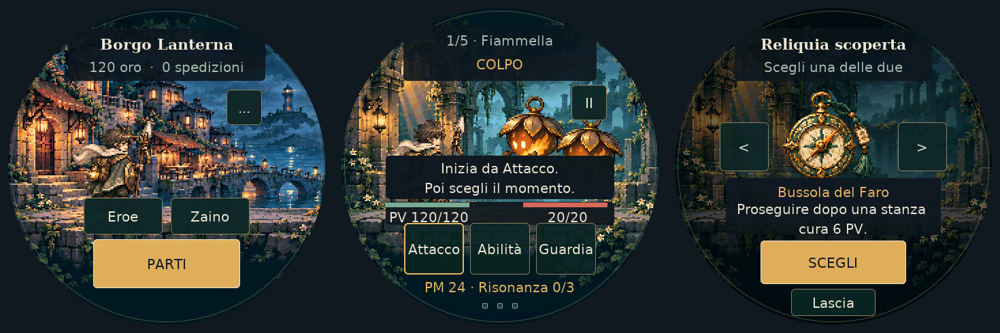
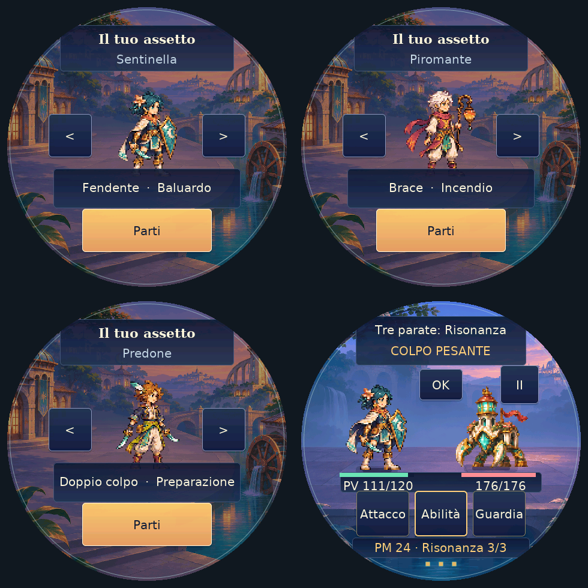
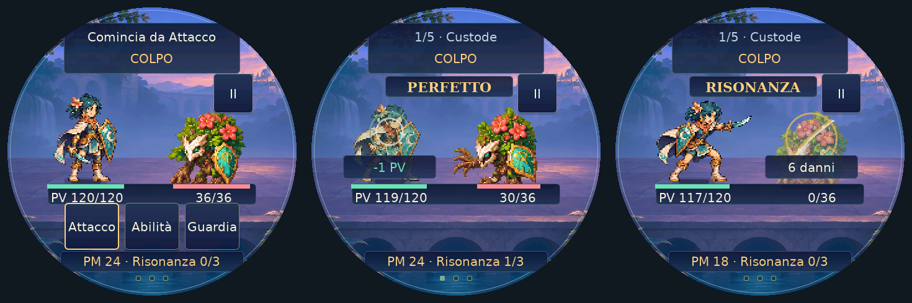
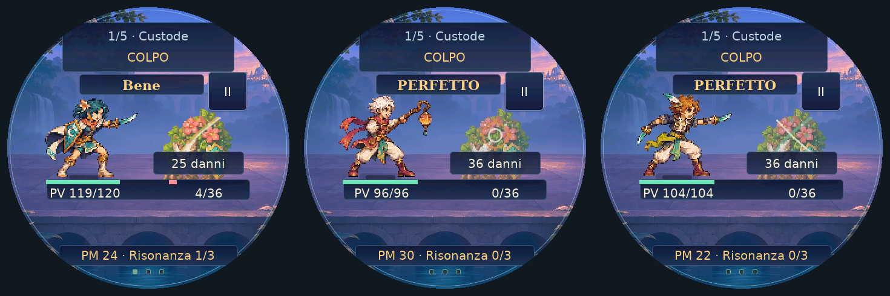

# Lanternbound — spedizione HD-2D giocabile

Implementazione del 16 novembre 2026 nella **UI nativa C11/LVGL di Pocket Wayfarer**, per l’AMOLED circolare 466×466. Sono disponibili firmware compilato e un eseguibile Linux interattivo dello stesso codice. Le immagini sotto sono catture della UI effettiva.



## Cosa si può giocare

Avvio rapido o creazione classica dell’eroe; borgo, scelta fra Sentinella, Piromante e Predone, e una spedizione di cinque stanze: lotta, evento, lotta, lotta, boss. Prima di entrare si vedono i nemici dei due percorsi; aprire questa anteprima non consuma RNG e non sblocca il bestiario. Sei specie ordinarie hanno comportamenti distinti: custode, fiammella, lupo, granchio corazzato, pipistrello a doppio colpo e falena che cura gli alleati. Il Guardiano del Faro è un automa originale con attacco pesante e doppio colpo.

Nella stanza evento si sceglie Focolare (25 PV o 12 PM) oppure Specchio (offrire 12 PV, avendone più di 12, per Risonanza piena e 8 PM; rifiutare dà 12 PM). Dopo ogni scontro ordinario vengono proposte due reliquie diverse non possedute. A tre slot si può confrontare e sostituire una delle possedute; si può anche rinunciare alla ricompensa. Le sei reliquie modificano parata, danno ai feriti, guardia, scudo iniziale, bruciatura e cura proseguendo. Dopo il boss si conserva un progetto fra le reliquie della run: dalla collezione si può equipaggiare una reliquia iniziale per le spedizioni successive. Occupa uno dei tre slot. Una vittoria senza reliquie termina senza assegnare un progetto. [Regole e prove dello scambio](RELIC-CHOICES.md).

Completare vale 80 monete: 10 per ciascuna delle prime quattro stanze e 40 per il boss. Rientrare conserva tutto; la sconfitta sottrae `floor(oro / 4)`. L’accredito è idempotente al riavvio. Riprova ripristina la spedizione conservando profilo, oro, progetti, bestiario e opzioni. Le statistiche della spedizione sono indipendenti da fame, stamina e livello classici.

Dal menu `...` si aprono mappa, bestiario con indizi, collezione, opzioni, guida in tre pagine e `Classico`. Una caccia già attiva mostra stato e raccolta nel nuovo borgo; per cominciare una spedizione occorre concludere caccia/dungeon classici attivi. Creazione dettagliata, inventario, 40 classi e mondo precedente restano accessibili nel classico.



## Controlli e regole

| Azione | Risultato |
|---|---|
| Toccare un nemico vivo | Cambia bersaglio e barra PV mostrata. |
| Attacco | Apre l’anello; tocco o BOOT giudica il timing. |
| Abilità | Due mosse: offensiva da 6 PM e supporto da 5 PM; disabilitate se manca la risorsa. |
| Guardia | Recupera 4 PM e dimezza i danni del turno nemico successivo. |
| Parata | Dopo 650 ms di intento, toccare quando l’onda raggiunge il cerchio centrale. |
| Parata perfetta | Una carica di Risonanza, massimo 3. L’offensiva a 3 cariche le consuma per l’effetto dell’assetto. |
| II / BOOT durante la scelta | Pausa; II resta raggiungibile anche durante il timing. |
| Riprendi | Conserva fase e tempo trascorso; 650 ms di preparazione prima della ripresa. |
| PWR / riavvio | Salva la spedizione in pausa; occorre Riprendi. |

L’anello gira in 1400 ms e scade dopo 2800 ms. Le finestre complete Bene/Ottimo/Perfetto sono 220/140/90 ms; il timing assistito le allarga del 50%. Il danno usa moltiplicatori 0,4/1/1,25/1,5 senza secondo critico automatico. La parata lascia passare 100/70/45/20% prima di guardia e scudi. Movimento ridotto ferma il ciclo di pose ambientali, mantenendo i segnali necessari al timing.

Sentinella: 120 PV/24 PM, Baluardo aggiunge 30 scudo e cura 6 PV; Risonanza aggiunge scudo. Piromante: 96/36, Incendio brucia per due turni; Risonanza potenzia la bruciatura. Predone: 104/28, Preparazione aggiunge scudo e danno al prossimo colpo; Risonanza aggiunge un colpo. Le offensive da 6 PM aumentano del 50% il danno del timing. Il boss ha 176 PV.

## Grafica e limiti del trattamento

Sono importate **52 immagini runtime**: due fondali, tre nuovi assetti a quattro pose, sei specie ordinarie e boss a quattro pose, sei reliquie, più quattro fotogrammi dell’eroe iniziale conservati nel vecchio atlas. Le pose sono inattiva, respiro, attacco e guardia/colpito; non sono un set completo di camminata e combo. Scala uniforme per riga e ancoraggio dei piedi evitano salti di dimensione fra pose.

Fondali 233×233 a 2×; attori e reliquie su griglia 88×88 con scala intera. Profondità e luce dei fondali sono dipinte, senza renderer 3D o illuminazione dinamica. Controlli, testi, font e barre sono oggetti LVGL effettivi. I titoli si adattano all’altezza dei testi IT/EN e i pulsanti abilità hanno spazio dedicato. I font DejaVu sono rasterizzati a 20/22 px con accenti italiani. Sorgenti, prompt, licenze, registro e hash: [assets/lantern](../assets/lantern/README.md).

Il redesign non copre ancora tutte le schermate, regioni o combinazioni estetiche delle 40 classi classiche. Nessun audio è implementato: il percorso hardware non è stato verificato. I segnali essenziali sono visivi.

## Prima spedizione e feedback

La prima lotta presenta una sola indicazione per volta: Attacco, arco dorato, intento e onda di parata. Un timing almeno Bene insegna l’azione; un miss mantiene il suggerimento. Guardia e abilità si apprendono usandole. Il suggerimento di Risonanza è confermabile con OK; a tre cariche sono evidenziati Abilità e poi il colpo offensivo. Nessun comando è bloccato dalla guida. L’apprendimento resta fra retry e riavvii; `Opzioni` consente di nascondere i suggerimenti o ripeterli.

Taglio dorato della Sentinella, brace circolare del Piromante e doppio taglio del Predone accompagnano affondo e rinculo. Parata perfetta, scudo assorbente, bruciatura e Risonanza hanno messaggi distinti; il danno offensivo mostrato è quello effettivo, incluso l’eventuale secondo colpo. Le tre cariche sono anche segmenti visibili. Il nemico sconfitto sfuma durante l’impatto. Movimento ridotto mantiene pose, simboli e testo senza spostamenti, particelle o dissolvenze. Nessun flash a tutto schermo o movimento della camera.





Gli effetti usano il tempo della fase salvata e si fermano con pausa/PWR. L’input dietro la pausa è escluso anche ai bordi delle immagini. I controlli verificano il contenimento dei testi nei pulsanti e confrontano byte per byte il framebuffer aggiornato con un ridisegno completo nelle 49 catture; un ridisegno completo dopo cambi di layout evita residui su PV e PM. Specifica e prove: [ONBOARDING-FEEDBACK.md](ONBOARDING-FEEDBACK.md).

## Correzioni dell’audit e salvataggi

Il formato **v4**, 2808 byte con header, accetta v1 (profilo da 1356 byte), v2 (1420 byte) e v3 (2788 byte). Mantiene identità, progressione, oggetti e snapshot di spedizione; aggiunge lezioni apprese e preferenza dei suggerimenti. L’indice dell’attore e i flag degli effetti usano i due byte prima riservati nello snapshot della v3, lasciandone invariati dimensioni e offset. Gli esistenti progetti, bestiario, resto delle monete e transazione classica restano conservati. Chi migra una v3 con vittorie può ripetere la guida dalle opzioni, senza doverla rifare automaticamente. CRC errata e dati troncati vengono rifiutati. Firmware più vecchi non leggono v4: conservare un backup NVS prima di un downgrade. Passare al Classico dentro questo firmware non richiede downgrade.

| Problema della baseline | Comportamento attuale verificato |
|---|---|
| Battaglia classica interrotta può saltare stanze o bloccare il boss | Un riavvio completo ripristina lo snapshot precedente all’ingresso: consumabili, PV/PM, stamina, RNG e nodo padre. L’incontro viene riproposto. Non riprende il timing classico a metà azione. |
| Esito già pagato / scale persi al riavvio | Ricostruisce la navigazione pendente e non paga due volte. Migrazione v1/v2 recupera anche gli incontri orfani. |
| PWR durante timing classico | Congela il tempo; al risveglio concede 650 ms e blocca input anticipati. |
| Morale diverso fra aggiornamenti frequenti e offline | Stesso risultato per minuto o ora, usando confini temporali assoluti. |
| Piccoli premi non contano per missioni oro | Accredito centralizzato con resto modulo 50 persistente e saturazione sicura. |
| Missioni sociali non completabili | Escluse dalla generazione e sostituite nei salvataggi con obiettivi disponibili. |
| Caccia perde equipaggiamenti con zaino pieno | Raccolta interamente rifiutata senza mutazioni; bottino conservato finché si libera spazio, con messaggio in UI. |

Le regressioni correnti sono in [test_reliability.c](../firmware/rpg/host/test_reliability.c). L’[audit](audit/REVIEW-2026-11-16.md) e le sue sonde rimangono documenti storici della baseline `df85308`.

## Verifiche eseguite

| Verifica | Evidenza |
|---|---|
| Asset | Importazione deterministica: 52 immagini, due font, originali e prompt conservati. |
| Core preesistente | 55.639 controlli RPG e 1.434 del compagno con ASan/UBSan. |
| Spedizione | **600 partite simulate**, 52.393 snapshot salva/ripristina e 51.509 transizioni. 288 run di base, 288 con tutti i progetti iniziali e politiche rinuncia/sostituzione (6 × 3 × 8 × 2), 24 vittorie senza reliquie. Verificate le venti combinazioni di tre slot. Incontrate tutte le sette specie incluso boss. |
| Affidabilità | Regressioni oro/morale/missioni/caccia/transazione/navigazione e migrazione v1/v2/v3 superate. |
| UI nativa | **49 catture, 430 salvataggi validati**: touch/BOOT, abilità/bersaglio, cinque stanze, eventi, reliquia iniziale, pagine del borgo, vittoria/sconfitta/retry, IT/EN, pause e recupero classico. Inclusi confronto di tutti gli effetti, annullamento touch/BOOT, PWR/riavvio durante lo scambio e vittoria senza reliquie. |
| Sanitizer UI | LVGL e UI compilati/eseguiti con ASan/UBSan senza errori rilevati. Leak scan finale disattivato perché l’app mantiene la scena attiva. Buffer immagini controllati anche su ricostruzioni ripetute del borgo. |
| Memoria immagini host | Picco 1.642.376 byte (~1,57 MiB), sotto 2 MiB. È memoria dei buffer immagini, non consumo totale del firmware. |
| Desktop interattivo | Avvio, percorso, primo suggerimento, menu abilità, timing e PWR/ripresa osservati nella vera app con profilo separato. Verificata anche la migrazione di un vero salvataggio desktop v3 tramite SDL dummy. |
| Firmware | ESP-IDF 5.5.1, build ESP32-S3 riuscita; dimensione e hash dell’app in [firmware.json](lantern-evidence/firmware.json). Nessun flash eseguito. |

Log in [lantern-evidence](lantern-evidence/). La strategia automatica usa offensive quando possibile e attacchi base altrimenti, senza riempire risorse fra incontri salvo l’evento. Senza reliquia iniziale, con timing sempre Bene, vincono 20/24 Sentinelle, 16/24 Piromanti e 15/24 Predoni; sempre Ottimo/Perfetto 24/24, sempre Mancato 0/24. Le 288 run con progetto iniziale usano Ottimo, le 24 senza reliquie Perfetto. Questa è taratura del modello, non una misura del divertimento.

**Game Maker AI**, nella precedente verifica del perimetro completo: **Game brief score: 95/100**, con avviso euristico sugli aggettivi. È un controllo del testo. Il modello di ondate resta `incomplete` per questo RPG; non si inventano velocità di salto/fuoco né si adotta il suo punteggio generico. Output e brief: [implementation-game-maker.json](audit/implementation-game-maker.json), [implementation-brief.en.md](audit/implementation-brief.en.md). Il flag mobile è soltanto il proxy touch dello schema, non un porting telefono. L’incremento corrente usa [Game Fix Prompt e criteri dedicati](ONBOARDING-FEEDBACK.md), senza interpretare un controllo del brief come prova della correzione. Flussi Design Game Studio applicati a revisione, sistemi, direzione artistica, asset, feedback, playtest e preparazione della build. La CLI `game-dev` non è disponibile in questo ambiente; asset prodotti con ImageGen e importatore locale, senza job di provider a pagamento.

## Giocare sul desktop Linux

Richiede un desktop grafico Linux, libreria runtime SDL2, compilatore C/C++, CMake, Python 3 con Pillow/NumPy. Dalla radice:

```sh
bash scripts/play-desktop.sh
```

Lo script verifica gli header SDL2 2.32.4 ufficiali tramite SHA-256, li mette in `build/desktop-deps/`, compila e apre la UI. Non installa librerie di sistema. Il gioco salva per default in `build/desktop-save.bin`; `--save percorso.bin` consente un profilo distinto. Il percorso padre deve esistere.

| Desktop | Dispositivo |
|---|---|
| Click sinistro | Touch |
| Spazio / Invio | BOOT breve |
| Esc | BOOT lungo |
| P | PWR, spegni/accendi |
| F5 | Salva e ricarica |

La finestra mantiene una superficie logica 466×466 con bande laterali: ridimensionarla non sposta i bersagli del mouse. La chiusura salva il profilo caricato. Non è un porting browser.

## Compilare e verificare

```sh
bash scripts/check.sh
```

Nel workspace gestito, CMake è anche in `/workspace/.pocketwayfarer-tools/python/bin`; lo script desktop lo rileva automaticamente. Per gli altri comandi:

```sh
export PATH=/workspace/.pocketwayfarer-tools/python/bin:$PATH
```

Per la verifica UI con sanitizer, usare una cartella catture separata:

```sh
cmake -S firmware/host -B build/host/asan -DCMAKE_BUILD_TYPE=Debug \
  -DCMAKE_C_FLAGS='-fsanitize=address,undefined -fno-omit-frame-pointer' \
  -DCMAKE_CXX_FLAGS='-fsanitize=address,undefined -fno-omit-frame-pointer'
cmake --build build/host/asan --target preview_lantern -j4
mkdir -p build/host/shots-lantern-asan
ASAN_OPTIONS=detect_leaks=0 build/host/asan/preview_lantern build/host/shots-lantern-asan
python3 scripts/previews.py build/host/shots-lantern-asan docs/img/lantern
```

Con ESP-IDF 5.5.x attivato, dalla cartella `firmware`:

```sh
idf.py -B ../build/firmware-hd2d \
  -D SDKCONFIG="$PWD/../build/firmware-hd2d/sdkconfig" build
```

Il build è in `build/firmware-hd2d/`; `pocketwayfarer.bin` è l’app, non un’immagine flash completa. Su dispositivo collegato, usando la stessa configurazione:

```sh
idf.py -B ../build/firmware-hd2d -p /dev/ttyACM0 flash monitor
```

## Prossima verifica di prodotto

Collaudo sul dispositivo: leggibilità al diametro reale, tocco/tasti, frame time e latenza in attacco/parata, spegnimento/ripresa, memoria totale e consumi. Poi cinque persone nuove: comprensione del timing, uso di guardia/abilità e decisione spontanea di iniziare un’altra spedizione. Durata 3–5 minuti e risposta sotto 100 ms restano obiettivi da misurare. Nessuna misura fisica o di coinvolgimento viene dedotta dai test automatici.
