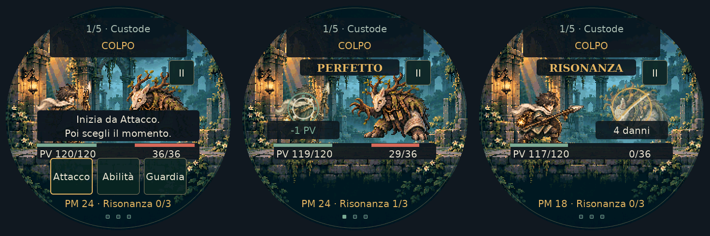
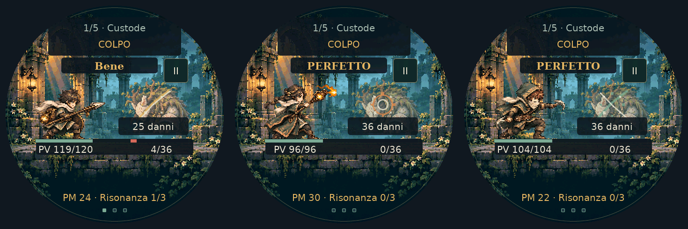

# Prima spedizione: guida e impatto

Incremento del 16 novembre 2026 sulla UI nativa LVGL 466×466. Obiettivo: arrivare dal primo incontro a una seconda spedizione comprendendo attacco, parata e Risonanza. Questo documento definisce il perimetro implementato; risultati e log correnti sono in `docs/lantern-evidence/`.

## Comportamento richiesto

- Un suggerimento contestuale alla volta. Attacco e parata si apprendono con un timing almeno Bene; guardia e abilità con l'uso. La Risonanza ha un breve suggerimento confermabile e una segnalazione a tre cariche. Nessuna lezione blocca un comando o altera le finestre di timing.
- Progressi conservati fra morte, retry e riavvio. Opzioni per nascondere i suggerimenti o ripeterli; nessuna modifica ai progressi dell'eroe. I vecchi salvataggi v1/v2/v3 restano leggibili.
- Il feedback mostra l'attore effettivamente coinvolto: affondo, rinculo, taglio della Sentinella, brace del Piromante, doppio taglio del Predone; scudo per la parata perfetta; Risonanza riconoscibile per forma e testo.
- Gli effetti derivano dalla fase e dal tempo già salvati. Pausa, PWR e ripresa li congelano; non consumano tempo di attacco/parata. Movimento ridotto elimina spostamenti, particelle e pulsazioni decorative mantenendo simboli e messaggi.
- Il campo centrale resta visibile: niente flash a tutto schermo, shake della camera o schermate di istruzioni sopra un timing attivo. Effetti sotto HUD/input; testo IT/EN a dimensione nativa.

## Accettazione

1. Nuovo profilo: suggerimento Attacco, istruzione sul timing, suggerimento Parata; le lezioni completate scompaiono. Un miss non viene segnato come apprendimento.
2. Riprova e riavvio conservano le lezioni; disattivazione/ripetizione funzionano senza cambiare oro, eroe o spedizione. Migrazione vera v3 verificata oltre a v1/v2.
3. Catture native mostrano i tre effetti offensivi, parata perfetta, Risonanza e versione con movimento ridotto. Pause durante impatto/ripresa non cambiano PV, RNG o tempo.
4. Effetti e suggerimenti non intercettano bersagli, timing o II; nessuna sovrapposizione dei testi nei casi IT/EN verificati. Controlli automatici su layout e suite preesistenti.
5. Build host, sanitizer e firmware ESP32-S3. Nessuna dichiarazione di latenza, consumi o divertimento senza misure fisiche/umane.

## Prompt incrementale — Game Maker AI / Game Fix Prompt

```text
Extend the existing native C11/LVGL Pocket Wayfarer Lanternbound game with one bounded first-expedition guidance and combat-feedback layer. When I enter my first fight, I expect a contextual explanation of Attack, parry and Resonance; the current UI only supplies general timing captions and four poses. Teach one action at a time without blocking controls or changing timing, damage, RNG or rewards. Persist learned lessons, expose hide/replay controls and migrate existing v1/v2/v3 CRC saves. Add class-specific hit effects, recoil and perfect-parry/Resonance cues derived from saved phase time; freeze with pause and honor reduced motion. Preserve native 466x466 circular layout, touch/BOOT/PWR, classic mode, all existing content and save recovery. Done when real LVGL inputs teach/dismiss lessons, retry/reload retain them, native captures demonstrate every effect and reduced-motion fallback, all regressions pass and the ESP32 build fits. This is an incremental feature brief, not evidence that the work has run.
```

Le skill applicate sono Improve Existing Game, Gameplay Systems, Audio Animation, Game Art Direction e Playtest Optimize di Design Game Studio; Game Fix Prompt di Game Maker AI delimita l'incremento. Le indicazioni generali sulla gerarchia HUD di Game UI Frontend sono adattate alla UI LVGL esistente. Nessuna dipendenza web viene introdotta. Gli effetti sono grafica procedurale originale in C, senza nuovi asset di terzi o job a pagamento.

## Risultati eseguiti

- Suite del modello: 432 spedizioni con gli stessi esiti di bilanciamento precedenti, più regressioni su apprendimento, miss, guardia/supporto, Risonanza, danno effettivo, bruciatura e attore del feedback. 38.075 snapshot e 37.639 transizioni.
- UI/LVGL con AddressSanitizer e UBSan: 45 catture native e 306 salvataggi validati. Prima lezione, errore senza apprendimento, attacco e parata riusciti, conferma Risonanza, seconda spedizione senza ripetizione dei suggerimenti, tre assetti, movimento ridotto, IT/EN, opt-out/ripetizione e pausa/riavvio durante il colpo potenziato.
- Per ciascuna cattura, il framebuffer aggiornato coincide byte per byte con il ridisegno completo. Verificato il contenimento del testo nei pulsanti. La guida non intercetta il timing, il bersaglio o II; gli input su immagini dietro la pausa vengono ignorati. A Risonanza piena è evidenziata la vera offensiva nel menu abilità.
- Regressioni preesistenti, migrazione v1/v2/v3 e roundtrip v4. Il formato corrente è 2808 byte incluso header. Una copia del vero profilo desktop v3 da 2804 byte è stata letta e risalvata come v4 con CRC valida tramite l'eseguibile interattivo in modalità SDL dummy.
- Finestra desktop effettiva: avvio rapido, assetto/percorso, suggerimento iniziale, menu abilità con PV/PM leggibili, istruzione durante l'anello, PWR spento/acceso e scena in pausa osservati con Cloud Desktop. Profilo separato `build/desktop-onboarding-playtest.bin`; la sessione precedente è rimasta aperta.
- Build ESP-IDF 5.5.1 riuscita. Byte/hash in [firmware.json](lantern-evidence/firmware.json). Nessun flash o misura sul dispositivo fisico. Le prove automatiche non dimostrano il coinvolgimento di giocatori reali.





### Riprodurre

```sh
bash scripts/check.sh
bash scripts/play-desktop.sh --save build/nuovo-profilo.bin
```

Per la UI con sanitizer usare i comandi in [LANTERNBOUND.md](LANTERNBOUND.md#compilare-e-verificare). Gli effetti originali sono in `r_lantern_fx.c`; la politica dei suggerimenti è pura e separata in `core/lantern_coach.c`. Sorgenti degli atlas, font e relative licenze restano quelli registrati in `assets/lantern/`.
