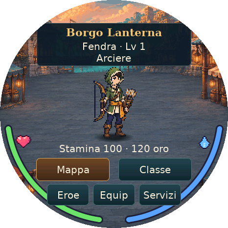

# La guida di Pocket Wayfarer

Pocket Wayfarer è un RPG fantasy per **Waveshare ESP32-S3-Touch-AMOLED-1.75**. Scegli fra otto classi all’avvio ed esplora le Isole Sospese con lo stesso eroe.

## Da dove cominciare

| Vuoi… | Apri |
|---|---|
| Mettere il gioco sul Pocket, senza compilare | [Installazione dal browser](INSTALLAZIONE.md) |
| Creare l’eroe, giocare e cambiare classe | [Manuale illustrato](GUIDA.md) |
| Aggiornare conservando il profilo, fare un backup o ripristinarlo | [Salvataggi e aggiornamenti](SALVATAGGI.md) |
| Risolvere problemi di USB, schermo o avvio | [Risoluzione dei problemi](RISOLUZIONE-PROBLEMI.md) |
| Giocare su PC, compilare o modificare il progetto | [Sviluppo e build](SVILUPPO.md) |
| Pubblicare sito e firmware su GitHub Pages | [Pubblicazione e rilascio](PUBBLICAZIONE.md) |

La versione `0.10.0-preview.7` è verificata su PC e compilata per ESP32-S3. Resta da collaudare sul Pocket fisico.

## Per approfondire

- [Regole e prove del redesign Lanternbound](LANTERNBOUND.md).
- [Roadmap dettagliata](ROADMAP.md), [lotto attivo](roadmap/STATUS.md) e [direzione artistica delle classi](CLASS-ART-BIBLE.md).
- [Ricerca e nuova leggibilità grafica](ART-CLARITY.md).
- [Audit di cerchio, input, risveglio e dialoghi](DEVICE-AUDIT-2026-11-17.md).
- [Guida contestuale e feedback del combattimento](ONBOARDING-FEEDBACK.md).
- [Confronto e sostituzione delle reliquie](RELIC-CHOICES.md).
- [Hardware, partizioni, alimentazione e checklist fisica](FIRMWARE.md).
- [RPG classico: documento di design](RPG-DESIGN.md).
- [Log di verifica correnti](lantern-evidence/README.md).
- [Provenienza della grafica e font](../assets/lantern/README.md), [componenti e licenze](../THIRD_PARTY.md).

I documenti sotto `audit/` descrivono la baseline precedente e le decisioni di redesign; non sostituiscono i manuali correnti. Il gioco del compagno in `firmware/pet/` è una build alternativa per sviluppatori, non un’opzione dell’installer Lanternbound.
