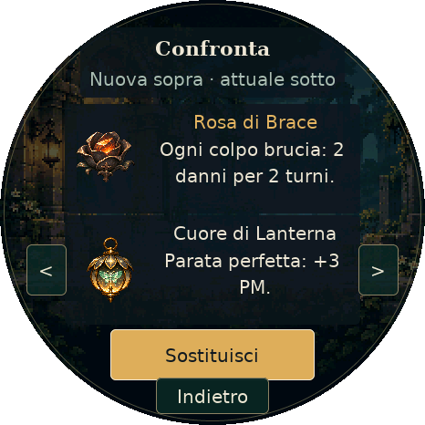

# Reliquie: scegliere, confrontare, sostituire

Incremento nativo C11/LVGL della preview `0.3.0-preview.2`. L’obiettivo è mantenere interessanti le ricompense quando l’assetto ha già tre reliquie: una nuova proposta può migliorare la combinazione prima del Guardiano.

## Esperienza di gioco

Dopo ogni scontro ordinario compaiono due reliquie non possedute. Con uno slot libero, **Scegli** aggiunge la proposta selezionata. Con tre slot, **Confronta** mostra la nuova reliquia sopra e quella da lasciare sotto, con nome, immagine ed effetto completo. Le frecce scorrono soltanto le tre possedute.

**Sostituisci** esegue uno scambio; **Indietro** o BOOT tornano alle proposte. **Lascia** rinuncia alla ricompensa. Non vengono introdotti un quarto slot, un costo in oro, un’attesa o un premio per aprire ripetutamente il confronto.



La reliquia iniziale occupa sempre uno slot. Sostituirla durante la spedizione non cancella il progetto dalla collezione né cambia quello equipaggiato per il viaggio successivo. Nessun progetto viene sbloccato semplicemente raccogliendo una ricompensa.

## Regole e persistenza

`ln_choose_relic` accetta proposte valide soltanto sotto il limite di tre. `ln_replace_relic` verifica fase, proposta non posseduta, tre slot e reliquia uscente posseduta prima di cambiare il bitmask. Un comando rifiutato lascia invariati oggetti, RNG, risorse, oro e fase. Una conferma riuscita porta a `LN_CLEARED`, impedendo di ripetere lo scambio.

Il confronto è una selezione temporanea della UI: il core resta in `LN_RELIC` con le due proposte originali e tutti gli oggetti. PWR conserva la vista; un riavvio completo riapre le proposte, senza applicare una sostituzione non confermata. Dopo la conferma viene salvato l’assetto aggiornato.

Il formato resta **v4, 2808 byte**: nessun nuovo campo persistente o migrazione aggiuntiva. La lettura di v1/v2/v3 resta verificata. Conservare un backup prima di un downgrade: lo stesso formato non garantisce che una build precedente conosca ogni nuovo percorso di gioco.

Rinunciando a ogni reliquia si può comunque vincere: il boss porta al risultato finale, incrementa le vittorie e accredita 80 monete una volta. Non si apre una scelta di progetto senza oggetti e non si assegna un progetto inesistente. La generazione delle offerte aggiuntive usa il normale RNG salvato; i valori di danno, timing e premio rimangono quelli precedenti.

## Accettazione

1. Una vittoria ordinaria con tre slot mostra due proposte diverse, entrambe non possedute.
2. Tutte le venti combinazioni di tre reliquie permettono di sostituire ciascuna delle tre possedute con una delle due proposte. Il risultato ha sempre tre slot.
3. Proposte/indici non validi, oggetti non posseduti, capacità errata e comandi ripetuti vengono rifiutati senza mutazioni.
4. La UI mostra tutti e sei gli effetti in IT/EN, senza sovrapposizioni fra nome e descrizione. Le tre opzioni possedute sono raggiungibili tramite touch.
5. Annullamento touch/BOOT, PWR e riavvio prima della conferma non consumano oggetti. Conferma e riavvio conservano il nuovo assetto; rinuncia conserva quello corrente.
6. Un viaggio completo senza reliquie raggiunge la vittoria, conserva i progetti precedenti e non paga due volte al riavvio.
7. Passano le regressioni preesistenti, UI/LVGL con sanitizer, firmware ESP32-S3 e controlli del pacchetto/sito. Le prove sul dispositivo e con persone restano separate.

## Prompt incrementale — Game Maker AI / Game Fix Prompt

```text
When my existing Pocket Wayfarer Lanternbound run reaches three relic slots, I expect later rewards to offer a meaningful choice, but they currently skip relic selection. Add one bounded relic exchange mechanic to the native C11/LVGL 466x466 game. Continue offering two distinct unowned relics after ordinary fights. At capacity, compare the incoming relic with each owned relic, then confirm one atomic exchange or cancel; allow skipping a reward. Preserve the three-slot limit, saved RNG, existing gold/timing/combat rules, equipped village blueprints, controls, reduced motion, classic mode and v1-v4 save reading. Keep comparison state transient until confirmation, so power/restart cannot remove an item prematurely. A player declining every relic must still finish the boss and bank the reward exactly once without a blueprint-selection softlock. Done when all 20 full loadouts, both offers, invalid/repeated actions, cancel/reload paths, native IT/EN text bounds and a complete no-relic win are exercised, the original regressions pass and the firmware/site package builds. Do not replace the project or create a new browser game.
```

Game Fix Prompt delimita l’incremento; non viene usato il controllo di un brief completo per dichiarare riuscita la modifica. Gameplay Systems separa regole e transazioni dalla UI; i principi di Game UI Frontend sono adattati a LVGL, con testi reali e immagini esistenti. Playtest Optimize distingue prove automatiche e misure umane. Nessun nuovo asset di terzi o job a pagamento.

Le evidenze correnti sono elencate in [lantern-evidence](lantern-evidence/README.md). Le catture provengono dal framebuffer LVGL, non da mockup. Non viene dedotto un aumento del divertimento dai risultati automatici.

Sono passate 600 spedizioni simulate e 49 catture native con 430 salvataggi validati; la UI è stata eseguita anche con AddressSanitizer/UBSan. La build ESP32-S3 occupa 2.974.688 byte nella partizione da 6 MiB. L’avvio SDL headless passa; la prova manuale nella finestra desktop è rimasta bloccata dall’ambiente, come descritto in [relic-desktop.txt](lantern-evidence/relic-desktop.txt).
