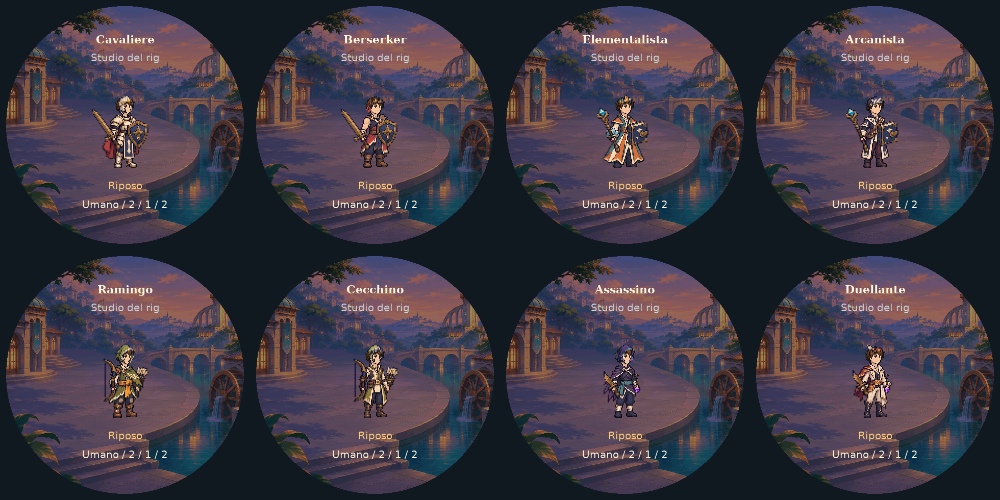
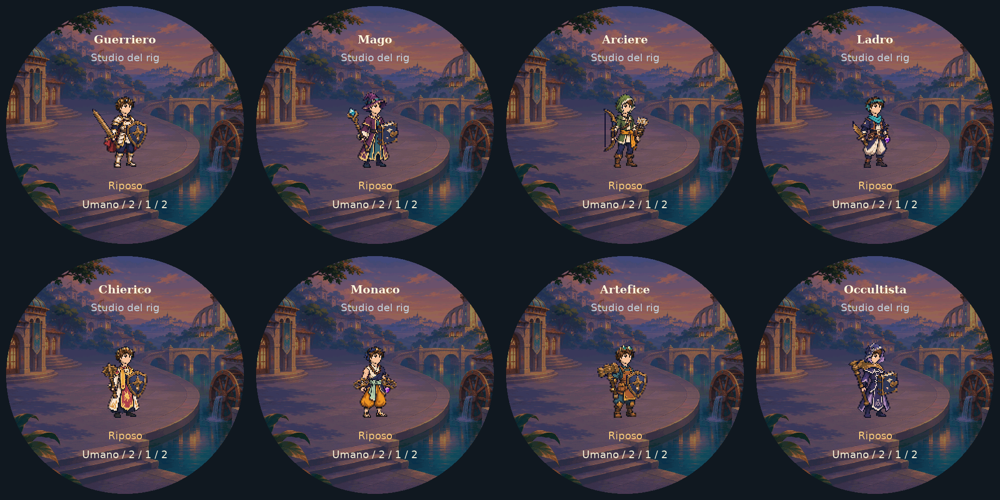
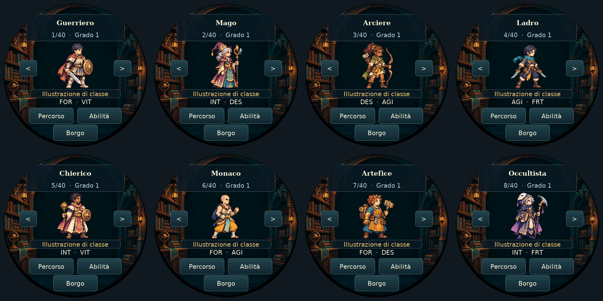

# Roadmap di Pocket Wayfarer

**Piano operativo del 17 novembre 2026.** Riferimento visivo approvato: `0.4.0-preview.1`, con figure leggibili sul fondale, piedi visibili e bersagli separati. Questo documento stabilisce l'ordine di lavoro; [STATUS.md](roadmap/STATUS.md) registra il lotto attivo e le prove. Le versioni sotto sono obiettivi di contenuto, non date promesse.

## Obiettivo e regole di avanzamento

Portare il gioco a un'identità coerente: personaggi riconoscibili, mondo leggibile sul display circolare, combattimenti precisi, scelte comprensibili e progressione che inviti a provare un'altra via. Il ciclo resta **scelgo il percorso → combatto e gestisco risorse → scelgo una ricompensa → affronto il rischio successivo → torno al borgo e preparo una nuova spedizione**.

Un lotto è completato quando entra nel gioco, supera i controlli pertinenti e dispone di catture native. Un atlas generato, un concept o un punteggio del brief non equivalgono a una funzione completata. Si lavora su un solo lotto principale alla volta; correzioni di crash, salvataggi, input o leggibilità hanno precedenza. Il collaudo fisico può procedere in parallelo quando il Pocket è disponibile: non impedisce di produrre e verificare arte su PC, ma resta necessario per la release stabile.

## Stato reale di partenza

**Consegna R3.1 /0.6.0-preview.1:**16/40 avatar modulari e16 illustrazioni specifiche: otto basi più Cavaliere, Berserker, Elementalista, Arcanista, Ramingo, Cecchino, Assassino e Duellante. Le altre24 classi restano nel trattamento precedente. R3.1 è chiuso; R3.2 completa le altre otto avanzate. [Prove R3.1](roadmap/advanced-a-evidence/README.md).

**Avanzamento R2 / 0.5.0-preview.1:** le otto basi ora hanno avatar modulari nel Classico, oltre alle illustrazioni dell'atlante. Personalizzazione, oggetti visibili e salvataggi v4 conservati; 147 catture native e 61.440 combinazioni estetiche verificate. Le 32 evoluzioni restano nel renderer precedente. [Prove R2 e limiti](roadmap/rig-evidence/README.md).

La tabella seguente conserva la baseline da cui è partito il piano.

| Area | Già presente | Lavoro rimanente |
|---|---|---|
| Lanternbound | Tre assetti, cinque stanze, sei reliquie, sette nemici, eventi, guida, IT/EN, pausa/ripresa | Varietà e rifinitura da valutare con giocatori; non confondere i tre assetti con le classi classiche |
| Classi classiche | **40 classi e 104 abilità** implementate | Nuovo trattamento grafico e presentazione coerente |
| Aspetto classico | Quattro razze, cinque carnagioni, sei capelli/otto colori, quattro occhi, variante del volto, equipaggiamento visibile | Il renderer usa famiglia × grado: **24 abiti per 40 classi**, con rami fratelli identici |
| Grafica approvata | Nuovi borgo, arena, tre assetti e sette specie Lanternbound | Il resto del Classico usa ancora il trattamento precedente |
| Affidabilità | Correzioni timing/input/risveglio; test host, sanitizer, firmware e installer verificati | Nuove misure e collaudo fisico della build |
| Audio e rete RPG | Non completati | Fasi distinte; nessuna dipendenza per il completamento delle classi |

Il primo incremento della roadmap aggiunge **otto illustrazioni base nell'atlante**, non otto nuovi avatar modulari. Le 32 evoluzioni usano un'immagine esplicitamente indicata come ritratto della famiglia. Il [registro delle 40 voci](roadmap/classes.csv) distingue illustrazione e sprite del giocatore.

## Ordine dei blocchi

| Blocco / obiettivo di versione | Dipende da | Consegna | Criterio per chiudere |
|---|---|---|---|
| R0 — baseline e collaudo | `0.4.0-preview.1` | Preservare le correzioni; raccogliere misure fisiche quando possibile | Regressioni sempre verdi; collaudo fisico registrato separatamente, senza dedurlo dai test PC |
| **R1 — atlante e otto classi base / 0.4.1-preview** | R0 host | Otto illustrazioni, 40 schede, abilità e alberi consultabili; roadmap e registro | 80 schede IT/EN, 16 percorsi di famiglia e input reali verificati; eroe/salvataggio invariati; firmware e sito verificati |
| **R2 — avatar modulare e otto basi / 0.5-preview: completato su host** | R1 | Otto costumi base nel mondo, rig e canali estetici/equipaggiamento | Catture reali, continuità, cache e sanitizer verificati; collaudo fisico separato |
| R3 — sedici avanzate / 0.6-preview: R3.1 verificato, R3.2 aperto | R2 | Due lotti da otto, con rami A/B distinti | Ogni ramo riconoscibile anche in grigio e con copricapo equipaggiato; regole di classe invariate |
| R4 — sedici maestre / 0.7-preview | R3 | Due lotti da otto, con identità propria | 40/40 identità modulari e relativo materiale di presentazione, senza riempitivi conteggiati come completati |
| R5 — mondo e interfaccia / 0.8-preview | R2; R3/R4 per relativo abito | Creazione, eroe, classi, equipaggiamento, città, campi/dungeon e mostri coerenti | Percorso completo in italiano/inglese, controlli circolari raggiungibili e immagini confrontate sul renderer |
| R6 — varietà e progressione / 0.9-preview | R4 + parte giocabile R5 | Scelte di percorso, nemici, eventi e ricompense rifinite | Difficoltà simulata e provata da persone; nuove strutture persistenti solo con migrazione esplicita |
| R7 — animazione e audio | Rig R2; hardware audio per suono | Transizioni, effetti per ruolo, feedback e suoni opzionali | Nessun segnale essenziale affidato solo al colore/suono; movimento ridotto e pausa rispettati |
| R8 — consolidamento / candidata 1.0 | R4–R7 nel perimetro scelto + R0 fisico | Ottimizzazione misurata, lunga sessione, backup/aggiornamento e pacchetto finale | Checklist hardware e rilascio superata; limiti residui dichiarati |

Non si introducono multiplayer, account o un nuovo motore durante questi blocchi. Una futura espansione dei tre assetti Lanternbound alle altre famiglie richiederà una specifica dedicata: non si ottengono automaticamente 40 assetti cambiando l'illustrazione.

## R1 — consegna iniziale

1. Inventario dei 40 ID, nomi IT/EN, famiglie, genitori e stato dell'arte, controllato contro i dati del core.
2. Otto illustrazioni rappresentative: Guerriero, Mago, Arciere, Ladro, Chierico, Monaco, Artefice, Occultista. Sorgenti, prompt, diritti e hash conservati.
3. Atlante da **Borgo → … → Classi**: frecce con ritorno circolare, scheda abilità e percorso di famiglia con nodi toccabili. Consultazione senza ricompense o cambio classe.
4. Chiusura dei dettagli sempre raggiungibile; BOOT chiude prima il dettaglio e poi torna al borgo. PWR/risveglio non modifica il profilo.
5. Catture native e test di tutte le schede, dei riferimenti alle abilità, dell'etichetta delle immagini mancanti e della conservazione dell'eroe personalizzato.

Questo blocco dà subito un posto leggibile alle classi. Il personaggio personale mantiene l'aspetto precedente finché R2 non è completo: non si perde la personalizzazione per mostrare una figura fissa.

## R2 — prima il rig, poi la produzione in serie

**R2.0 — prova tecnica.** Realizzare un Guerriero e un Mago sul medesimo sistema di ancoraggi. Separare posa, espressione, corpo, capelli, abito/cappa e oggetti. Provare una griglia candidata 88×88 a 2×; adattare ogni chiamante invece di moltiplicare gli attuali 48 pixel a 3×. Conservare una strada reversibile finché il confronto non passa.

Il mapping deve usare l'**ID classe esatto**, derivato da `hero.cls` in memoria UI, non soltanto famiglia/grado. Non serve cambiare il salvataggio per questa chiave. La cache non deve riutilizzare descrittori ancora collegati a oggetti visibili: l'attuale LRU da sei immagini non è adatto a una griglia di 40 avatar.

**R2.1 — compatibilità dell'aspetto.** Verificare tutte le quattro razze e cinque carnagioni, sei capelli, otto colori e quattro occhi, variante volto/ciglia e combinazioni rappresentative di accessori. Le 7.680 combinazioni prima degli oggetti non vanno convertite in altrettanti eroi fissi. Oggi sono visibili arma, mano secondaria e testa; torso, piedi e accessori non sono ancora canali grafici separati. Prima di estenderli, definire la precedenza fra costume della classe e armatura posseduta.

**R2.2 — otto basi.** Dopo l'approvazione tecnica del rig, produrre otto costumi e le pose necessarie. Idle/respiro, attacco e difesa/colpito devono mantenere scala e piedi; espressioni e pose sono stati distinti. Integrare creazione, statistiche, cambio classe, equipaggiamento, città, campo/dungeon e battaglia nello stesso lotto.

**Accettazione:** nessuna perdita di dati estetici o sovrapposizione con HUD; salvataggio v4 leggibile; classe scelta e oggetti reali rappresentati correttamente; prove cache/sanitizer, misure di memoria e build entro budget. La promozione di classe continua a usare i requisiti del core.

**Esito R2:** gli otto ID 0–7 usano il rig 88×88, con preset 44/88/176 pixel. Le cinque pose sono trasformazioni parametriche dei componenti, non strisce di animazione finale. Il refresh di arma/mano secondaria/testa è stato anticipato da R5 perché i vecchi oggetti non reggevano il nuovo corpo; nessuno slot aggiunto. Torso/piedi/accessori restano solo statistici. In revisione sono stati corretti un giunto aperto durante il respiro, livelli nemici coperti dai comandi e falce davanti al volto. Le maschere dedicate per gli arti e la rifinitura delle transizioni restano R7.

## R3 e R4 — copertura completa delle classi

| Famiglia | Base (ID) | Avanzata A → maestra A | Avanzata B → maestra B |
|---|---|---|---|
| Guerriero | Guerriero (0) | Cavaliere (8) → Cavaliere del Drago (24) | Berserker (9) → Signore della Guerra (25) |
| Mago | Mago (1) | Elementalista (10) → Arcimago (26) | Arcanista (11) → Cronomante (27) |
| Arciere | Arciere (2) | Ramingo (12) → Signore delle Bestie (28) | Cecchino (13) → Arco della Tempesta (29) |
| Ladro | Ladro (3) | Assassino (14) → Lama Notturna (30) | Duellante (15) → Maestro di Lame (31) |
| Chierico | Chierico (4) | Paladino (16) → Templare (32) | Sacerdote (17) → Ierofante (33) |
| Monaco | Monaco (5) | Campione (18) → Gran Maestro (34) | Mistico (19) → Asceso (35) |
| Artefice | Artefice (6) | Fabbro (20) → Forgiarune (36) | Alchimista (21) → Trasmutatore (37) |
| Occultista | Occultista (7) | Negromante (22) → Signore della Morte (38) | Stregone (23) → Evocavuoto (39) |

Per ciascun grado si chiudono prima le quattro famiglie Guerriero/Mago/Arciere/Ladro (otto rami), poi Chierico/Monaco/Artefice/Occultista (otto rami). Ogni consegna include costume modulare, illustrazione specifica, catture, registro e prova delle due lingue. Non basta ricolorare il ramo fratello: sono richiesti almeno due segni distintivi nell'abito/cappa, leggibili anche quando il casco nasconde il copricapo.

Gli ID non cambiano. L'avanzata richiede livello base 20 e job 30; la maestra livello base 45 e job 40. Ogni avanzata conduce a **una** maestra. Le abilità ereditate lungo la linea restano 3/6/8; non si ribilanciano mentre si sostituisce la grafica.

## R5 — unificare il resto del gioco

- **UI:** prima creazione/eroe/classi/equipaggiamento, poi zaino/bottega/forgia, infine missioni/mappa/dungeon. Stessi font, pannelli, stati premuto/disabilitato, azione primaria e indicazioni di ritorno. Test dei nomi lunghi e dello scorrimento sul cerchio.
- **Ambienti:** borgo e cinque regioni classiche, con relativo linguaggio visivo dei dungeon. Per ogni ambiente: fascia di gioco quieta, dettagli ai margini, luce motivata e profondità dipinta. Conservare i nodi di navigazione e le regole esistenti.
- **Mostri:** inventario delle 42 specie classiche distinto dai sette nemici Lanternbound; mappatura esplicita prima di contare riusi. Lotti di massimo otto specie, con attacco leggibile, élite/boss riconoscibili per forma e bersagli separati anche in tre.
- **Oggetti:** arma, mano secondaria, testa e icone coerenti con le cinque fasce di equipaggiamento. Ampliare la rappresentazione degli altri slot solo dopo il contratto definito in R2.

Non si aspetta di avere tutti gli asset per osservare il risultato: dopo ogni lotto si cattura una scena completa con HUD e interazioni.

## R6 e R7 — profondità, ritmo e feedback

Il primo obiettivo di design è una scelta comprensibile, non più numeri sullo schermo. Registrare, con consenso e senza introdurre account, osservazioni di playtest: tempi reali di spedizione, motivo delle sconfitte, scelte di percorso/reliquia, uso di Guardia/supporti e volontà di iniziare un altro viaggio. Una sessione di 5–8 minuti è una **ipotesi da provare**, non un dato già misurato.

Prima confrontare le opzioni attuali con seed ripetibili; poi introdurre un cambiamento per volta: intenti nemici, rischio/ricompensa dei percorsi, eventi, sinergie o ricompense. Ogni proposta deve indicare quale decisione migliora, cosa conserva al retry e come evitare premi duplicati. Non aumentare simultaneamente danni, nemici e premi per rendere impossibile capire l'effetto del cambiamento.

Espandere classi, abilità, specie, zone o reliquie può toccare maschere e array persistenti: serve prima la specifica del nuovo formato, migrazione, rollback degli incontri classici e test di dati vecchi. Le 600 spedizioni simulate attuali sono una base di regressione, non la prova che il gioco coinvolga i giocatori.

Per animazione: completare prima le transizioni e l'effetto caratteristico di ogni ruolo, poi aggiungere dettagli decorativi. Per audio: verificare il percorso hardware e i consumi, poi un set piccolo di conferma, attacco, parata, danno e ricompensa, con volume/muto. Il gioco resta comprensibile senza suono e con movimento ridotto.

## Budget e criteri di rilascio

| Voce | Gate |
|---|---|
| Flash | Limite fisico app 6 MiB; obiettivo di produzione ≤5,4 MiB con margine. Misurare ogni lotto; non accumulare per sempre atlas vecchi e nuovi. Se si supera il budget, fermare l'ammissione di asset e misurare una soluzione |
| Buffer immagini host | Registrare il picco per scena; obiettivo iniziale ≤2 MiB per la normale scena di gioco. Non è una misura dell'intero heap firmware |
| Cache | Descrittori stabili finché mostrati; rilascio per scena verificato; nessuna crescita continua dopo ritorni ripetuti al borgo |
| Input | Conservare regressioni da 120 ms, pressione BOOT, tempo dell'evento, scadenze, pausa e risveglio; misurare la latenza fisica prima di fissare una garanzia numerica |
| Aspetto | Catture 466×466 e in grigio; sagome intere, nessun dettaglio indispensabile dietro HUD, nessun ramo distinto soltanto per tinta |
| Salvataggi | Compatibilità e CRC; passaggi di classe e ricompense atomici; nessuna migrazione implicita |
| Hardware | Almeno una sessione continua di 30 minuti e 20 cicli pausa/PWR/risveglio come obiettivi iniziali di collaudo; riportare risultati e build esatta. Consumi e autonomia vanno misurati, non stimati dal PC |
| Distribuzione | Build dal commit pubblicato, installer/ZIP/hash verificati via HTTP e istruzioni di aggiornamento/backup coerenti |

Una preview può procedere con gate hardware ancora aperto e dichiarato. La candidata stabile no. Nessuna fase viene chiusa solo per rispettare un numero di versione.

## Come mantenere il piano

Per ogni lotto aggiornare [STATUS.md](roadmap/STATUS.md): obiettivo, file interessati, stato, prove, problemi aperti e prossimo passo. Aggiornare il registro delle classi solo insieme all'asset effettivamente integrato; `scripts/class_inventory.py --check` controlla l'allineamento dell'inventario ai dati. Se una scoperta cambia l'ordine, registrare il motivo e le dipendenze; evitare aggiunte fuori fase che sottraggano tempo al lotto attivo.

Direzione artistica operativa: [CLASS-ART-BIBLE.md](CLASS-ART-BIBLE.md). Fonti sulla leggibilità: [ART-CLARITY.md](ART-CLARITY.md). Audit dei difetti: [DEVICE-AUDIT-2026-11-17.md](DEVICE-AUDIT-2026-11-17.md).

**Game Maker AI:** [brief inglese e output originali](roadmap/GAME-MAKER-NOTES.md). **Game brief score: 83/100**: controllo euristico del testo, non del gioco. I suggerimenti automatici per telefono 375/390 px, punteggi a ondate e asset di altre dimensioni non sono adottati per questo firmware.
