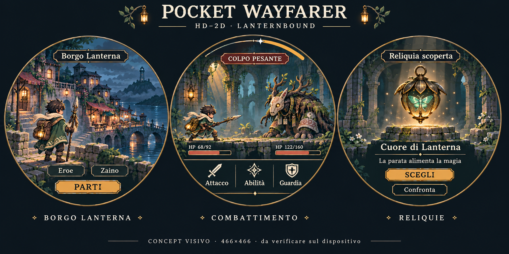

# Pocket Wayfarer — redesign HD-2D da zero

**Aggiornamento:** la prima spedizione nativa è ora implementata. Per schermate effettive, regole, build e controlli vedere [LANTERNBOUND.md](../LANTERNBOUND.md). La tavola e le specifiche sotto documentano la direzione iniziale; non tutto il piano di espansione è già realizzato.

Direzione scelta dall'utente il 16 novembre 2026: **pixel art d'autore, altissima qualità, HD-2D**. Questo documento sostituisce il trattamento visivo provvisorio del brief meccanico. Titolo, classi e hardware del gioco esistente restano il punto di partenza; “Lanternbound” è un sottotitolo di lavoro.

**Stato:** concept generato e ispezionato visivamente, non schermata catturata da firmware, non asset già separati/animati. Il testo nei concept è parte dell'immagine: nella produzione sarà vero testo LVGL localizzabile. La tavola misura 1774×887; la leggibilità effettiva a 466×466 e sul dispositivo non è ancora certificata.

## Il salto da fare

La versione attuale comunica un prototipo con molte funzioni: sfondi morbidi e personaggi a griglia grossa, colori dei pulsanti molto diversi, indicatori lungo quasi tutta la circonferenza e schermate dense. Nella schermata reale di [combattimento](evidence/10-lotta-scelta.png), il testo dei PV/PM è troppo vicino al bordo inferiore e compete con gli archi; nella [città](evidence/06-citta.png), molte icone hanno pari evidenza. Sono problemi di composizione e gerarchia oltre che di qualità degli asset.

Il redesign deve comunicare un **piccolo mondo da portare con sé**, con luoghi che si ricordano, un eroe riconoscibile in silhouette e ricompense desiderabili a colpo d'occhio. Il livello qualitativo va stabilito su una scena rappresentativa, poi mantenuto su ogni asset. Produrre più immagini prima di fissare questo standard moltiplicherebbe le incoerenze.

## Tre pilastri visivi

1. **Lanterna nel buio.** Ambiente in petrolio e giada freddi; il calore ambra indica vita, opportunità e ricompensa. La luce ha una sorgente riconoscibile e un'area limitata. Il pericolo usa vermiglio, simbolo e animazione: non soltanto il colore.
2. **Diorama in movimento.** Primo piano, piano di gioco e fondale separati. Prospettiva laterale a tre quarti coerente, piedi sullo stesso terreno, ombre di contatto. Profondità soprattutto preparata negli asset; pochi livelli mossi con moderazione.
3. **Pixel art con intenzione.** Contorni, gruppi di pixel e materiali costruiti su una griglia condivisa. Il dettaglio sostiene silhouette, volume e lettura. Bloom, foschia e particelle non devono cancellare il disegno.

L'HD-2D qui è un obiettivo estetico: **sprite 2D nitidi + scenografie stratificate + illuminazione preparata + movimento selettivo**. Non implica un cambio a Unity, Unreal o un renderer 3D sull'ESP32. Un'eventuale versione PC/web con illuminazione dinamica sarebbe un progetto distinto.

## Palette e materiali

| Ruolo | Colore iniziale | Regola |
|---|---|---|
| Inchiostro | `#101820` | Fondi e pannelli, OLED valorizzato con ampie zone scure. |
| Petrolio | `#14282F` | Ombre ambientali fredde. |
| Giada | `#264D4A` | Natura, mantello e distanza; non saturare tutta la scena. |
| Avorio | `#EEE7D6` | Testo, segnali e punti di massimo contrasto. |
| Ambra | `#E6B461` | Azione principale, lanterne, timing riuscito e ricompensa. |
| Vermiglio | `#D06B5D` | Pericolo e intento ostile, sempre con simbolo/parola. |

Ottone consumato, pietra umida, tessuto spesso e ceramica crepata devono avere gruppi di pixel e valori distinti. Le variazioni regionali cambiano la luce ambientale e i materiali, mantenendo l'alfabeto di UI e interazioni. La rarità degli oggetti richiede anche una forma o un sigillo; evitare cornici arcobaleno come identità dominante.

## Personaggi e creature

**Eroe base proposto:** viandante con mantello giada, sciarpa avorio, zaino asimmetrico e lanterna tonda in ottone. Il volto rimane leggibile, la lanterna è la firma, l'arma cambia la silhouette. Proporzioni più curate dell'attuale paper doll, senza affidare tutto a un cappello enorme. La versione in battaglia usa la stessa identità della versione al borgo.

**Primo nemico rappresentativo:** guardiano di radici con maschera di ceramica e un occhio ambra. Deve essere distinguibile da un nemico rapido o volante anche senza testo. Prima di generare altri mostri, fissare per questo nemico altezza, appoggio, palette, posa inattiva e anticipazione del colpo.

La prima validazione riguarda 3 archetipi e 6 creature. L'estetica delle 40 classi potrà essere riprogettata con famiglie di silhouette e materiali, riusando costumi/accessori coerenti. Non sostituire 40 sprite con 40 immagini generate indipendentemente: serve continuità di proporzioni, camera, luci e animazioni. Personalizzazione ed equip visibile richiedono una decisione produttiva tra livelli ridisegnati e varianti limitate; non promettere automaticamente tutte le combinazioni attuali.

## Composizione delle tre schermate

| Schermata | Punto focale | Informazioni/azioni prioritarie | Cosa spostare altrove |
|---|---|---|---|
| Borgo | Eroe davanti a un luogo vivo, lanterne e faro lontano | **Parti**, poi Eroe/Zaino; segnale discreto della caccia pronta | Fame, morale, negozi, missioni e opzioni raccolti in viste secondarie. |
| Battaglia | Eroe e minaccia sul medesimo piano, intento leggibile | PV, bersaglio, Attacco/Abilità/Guardia; timing solo quando serve | AUTO e fuga nel menu secondario accessibile, statistiche dettagliate fuori dall'arena. |
| Reliquia | Un oggetto grande, desiderabile e riconoscibile | Nome, effetto concreto, Scegli/Confronta | Elenchi di affissi e numeri secondari nella comparazione. |

Durante il timing l'interfaccia delle azioni arretra e l'arco diventa il segnale principale. Durante la scelta tattica il terreno resta visibile e l'intento nemico anticipa il problema da risolvere. I menu non devono coprire il bersaglio appena selezionato.

La tavola mostra il trattamento di una singola reliquia: il flusso operativo prevede due alternative, navigabili e confrontabili nello stesso spazio. La frase evocativa “La parata alimenta la magia” va accompagnata nel gioco da una regola esatta, ad esempio “3 parate perfette: la prossima magia ottiene [effetto dichiarato]”. Il concept non sostituisce la specifica dell'interazione.

## Geometria e tipografia sul display

- Canvas 466×466, centro `(233,233)`, raggio fisico circa 233. Per un rettangolo interattivo controllare tutti gli angoli contro la maschera, includendo focus, etichetta e stato premuto. Un generico margine rettangolare non garantisce di stare nel cerchio.
- Cerchio di sicurezza proposto raggio **210** per i bordi delle azioni importanti; segni decorativi e arco possono occupare il bordo esterno. La composizione va controllata nelle singole schermate, senza obbligare tutti i testi a seguire l'arco.
- Azioni primarie almeno **72×72 px** o altezza 72px per un bottone largo; a 466px su 1,75 pollici nominali sono circa 6,9mm. L'attuale obiettivo di 52px per elementi secondari è circa 5mm: va provato sul touch e ingrandito se gli errori sono frequenti.
- Font UI originale o con licenza verificata, rasterizzato alla dimensione d'uso; corpo iniziale **20–22px**, secondario 18px, titoli 26–30px. Sono valori di partenza: la metrica, gli accenti italiani e le stringhe inglesi devono essere verificati. Evitare di derivare il carattere dal testo raster delle immagini generate.
- Poche parole per schermata; massimo una descrizione breve alla volta. Pannello scuro opaco dietro ai testi sopra ambienti complessi. Mostrare numero e icona per PV/risorsa, con contrasto verificato dopo RGB565.
- Focus, pressione e selezione devono essere distinguibili anche in scala di grigi. Il timing assistito deve modificare la finestra senza aggiungere confusione visiva.

## Regole di produzione degli asset

Queste misure sono proposte per un primo benchmark, non limiti hardware già provati.

| Asset | Griglia sorgente di partenza | Presentazione | Note |
|---|---|---|---|
| Fondale | 233×233 indicizzato | 2× → 466×466 | Ricostruire i pixel alla griglia scelta; evitare il semplice rimpicciolimento dell'intera tavola. |
| Eroe | fino a 56×72 per frame | 2× → 112×144 | Stessa origine ai piedi e area trasparente per ogni frame; arma non tagliata. |
| Nemico ordinario | fino a 80×80 | 2× → 160×160 | Sagoma verificata con HUD e secondo nemico. |
| Boss | fino a 104×104 | 2× → 208×208 | Una sola presenza grande; composizione dedicata, non semplice ingrandimento del mostro normale. |
| Oggetto premio | fino a 72×72 | 2× → 144×144 | Icona inventario ridisegnata a 24/32px, non downsample cieco. |
| Icone e cornici | 24/32px per simboli | Dimensione intera prestabilita | Spessore e diagonali condivisi; vero testo separato. |

Per ogni asset: originale generato/disegnato, prompt e riferimento approvato, versione, autore/fornitore, diritti, trasformazioni, origine/pivot, palette, stato di verifica. Il [registro](asset-register.csv) distingue ciò che esiste da ciò che è pianificato. Nessuna immagine di concept è stata dichiarata sprite pronto all'uso.

## Movimento e feedback

| Evento | Risposta proposta | Vincolo |
|---|---|---|
| Toccare un'azione | Pressione 60–90ms, riscontro visivo immediato | Non aspettare un'animazione lunga per accettare l'input. |
| Eroe inattivo | 4–6 frame a 6–8fps, sciarpa/lanterna in movimento lieve | Nessun cambio involontario di scala o posizione dei piedi. |
| Attacco | Anticipazione 120–160ms, contatto chiaro, recupero 150–200ms | Il giudizio del timing usa il clock di gioco, separato dalla riproduzione dei frame. |
| Parata perfetta | Flash locale e arresto visivo 40–60ms | Non bloccare lettura input o alterare le finestre del turno successivo. |
| Nuova reliquia | Rivelazione 350–500ms, poi controllo immediato | Salta/riduci animazione disponibile, niente sequenze ripetute obbligatorie. |
| Ambiente | 1–2 layer lenti, acqua e lanterne con cicli brevi | Riduzione movimento, niente foschia davanti a bersagli o testo. |

Impostazione “movimento ridotto”: elimina tremolio camera, pulsazioni e parallax; mantiene segnali informativi. Il suono resta un'aggiunta condizionata a un percorso audio fisico verificato: non risulta provato un altoparlante nel firmware attuale. Tutti i feedback necessari devono funzionare in silenzio.

## Compatibilità con il firmware esistente

Il sistema attuale usa sprite indicizzati (`wf_sprite`) con dimensioni a 8 bit, palette RGB565 e trasparenza binaria sul colore 0. I fondali vengono espansi a scala intera e il personaggio è composto sulla griglia 48×48. Per il nuovo trattamento serve un percorso import dedicato, anziché continuare a ritoccare i pittori procedurali attuali.

1. Conservare i sorgenti e i generatori attuali come baseline. Nuove risorse in un namespace distinto e una scena rappresentativa selezionabile per confronto.
2. Preparare i fondali a 233×233 e scalarli 2×. Questa misura rimane entro il limite a 255 di `wf_sprite`; una texture diretta 466×466 richiederebbe un descrittore diverso.
3. Ridisegnare compositore/pivot dell'eroe, o introdurre un primo personaggio a frame per il benchmark; esplicitare la temporanea differenza rispetto a tutte le combinazioni paper doll esistenti.
4. Per bordi morbidi/ombre mobili valutare un piano alfa opzionale: il formato sorgente attuale non conserva alpha parziale. In alternativa preparare luce e ombre nel fondale con effetti LVGL limitati.
5. Caricare soltanto i livelli della scena visibile, liberare quelli precedenti e misurare PSRAM e heap DMA. Evitare di tenere tutte le animazioni di tutte le classi in memoria.
6. Testare cambio lingua, accenti, finestre di confronto, sconfitta, pause e riavvio oltre alla schermata più fotogenica.

**Ordini di grandezza calcolati:** un fondale RGB565 a 466×466 occupa 434.312 byte (~424KiB) dopo espansione; un frame eroe 112×144 RGB565+A8 occupa 48.384 byte (~47KiB); un frame nemico 160×160 ne occupa 76.800 (~75KiB). Otto frame per entrambi più un fondale fanno circa 1,37MiB, prima di HUD, cache, composizione e overhead. Lo storage indicizzato è inferiore, ma il rendering lavora sui dati espansi. Non sono misure di consumo del firmware.

Budget iniziale da misurare: grafica viva entro 2MiB nella scena campione, almeno 30fps stabili come obiettivo, frame p95 entro 33ms, input con feedback sotto 100ms. Sono gate di sviluppo proposti: mancano ancora misure su hardware, frammentazione, carico con effetti, flash finale e margine per il resto del sistema.

## Prima consegna implementativa da accettare

Il primo lavoro da portare in LVGL è **un borgo, uno scontro e una reliquia**, non tutte le regioni. Deve passare queste verifiche prima di estendere la produzione:

- Aspetto confrontato a dimensione nativa con la tavola, poi su dispositivo: nessun dettaglio essenziale perso, silhouette di eroe e mostro leggibili, nessun testo tagliato.
- Elementi UI ricostruiti come controlli reali: gerarchia, tocco, pressione, disabilitato, focus, IT/EN. Nessuna intera schermata appiattita in una PNG al posto del gioco.
- Animazioni con piedi, arma e ombre stabili; input e stato di gioco indipendenti da frame mancanti.
- Profili di memoria, tempo frame e latenza registrati. Confronto effetti attivi/disattivi e movimento ridotto.
- Prova con persone nuove: individuare “Parti”, capire il bersaglio e distinguere attacco/parata; registrare tocchi errati e descrizioni non comprese. Correggere il layout prima di nuovi asset.

## Strumenti usati e confine della consegna

Game Maker AI è stato usato per le specifiche di gameplay; Design Game Studio per revisione, art direction, asset pipeline e feedback; ImageGen per questa tavola HD-2D. È stata consultata anche la procedura di Game Development Studio per produzione e tracciabilità degli asset. Il CLI `game-dev` non è presente nel PATH: non sono stati eseguiti package canonici, verifiche tramite quel CLI o job Tripo/Leonardo. Il concept è stato creato con la capacità ImageGen disponibile, con prompt conservato e provenienza dichiarata; non è un rimpiazzo di quei passaggi di produzione.

Sorgente: [hd2d-direction-01.png](concepts/hd2d-direction-01.png). Prompt esatto: [hd2d-concept-prompt.txt](hd2d-concept-prompt.txt). La tavola è una prima proposta concreta nella direzione richiesta, non una certificazione di asset pronti, animazioni esistenti o prestazioni sul dispositivo.
