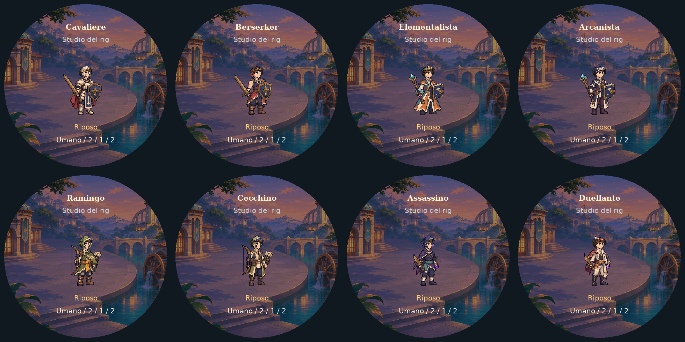
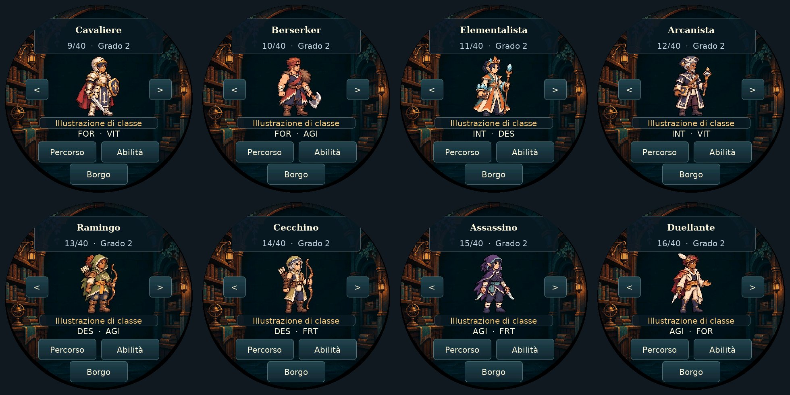

# Prove R3.1 — prime otto avanzate

Consegna `0.6.0-preview.1`, 18 novembre 2026. Baseline pubblica R2:
`980a0a18353ac50bf2154aebd8170957060afcb9`. Nuovi ID 8–15: Cavaliere, Berserker,
Elementalista, Arcanista, Ramingo, Cecchino, Assassino, Duellante. Sono 16/40 gli
avatar modulari e 16/40 le illustrazioni specifiche; le altre 24 classi mantengono
renderer e riferimento familiare precedenti. Lanternbound resta separato.

## Verifiche eseguite

| Evidenza | Risultato |
|---|---|
| `host-checks.txt` | Suite completa: 55.639 controlli RPG, 1.434 compagno, 600 spedizioni; regressioni input/risveglio, dialoghi/cache e tre catture timing conservate |
| `rig-sanitizers.txt` | ASan/UBSan con leak scan: 88 livelli, 180.336 composizioni, 58.568 confronti, 12.160 controlli di continuità, zero errori |
| Aspetto | Tutte le 7.680 combinazioni per ciascuna delle 16 classi: 122.880 totali. Quattro razze, cinque carnagioni, sei capelli/otto colori, quattro occhi, due volti; espressioni/pose e 16 tipi di oggetto/cinque tier verificati. Non si pretende unicità visiva quando cappelli o occhi chiusi nascondono un canale |
| Fratelli sotto elmo | 400 confronti: 4 coppie × 4 razze × 5 tier elmo × 5 pose, senza arma/offhand. Minimo 143 pixel alfa distinti sotto la testa; differenze di costume conservate anche in grigio. Le due firme di forma sono registrate nella bibbia e revisionate nelle catture |
| `ui-sanitizers.txt` | 281 catture del rig: tutte le 16 classi nelle schermate native, cinque pose, creazione base IT/EN, equip/borgo/schede, formazioni 1/2/3/boss/élite 99, dungeon, quattro razze e stress livello 99 moderno/legacy IT/EN. Framebuffer incrementale/completo identico, alfa avatar separata dai comandi, target laterali toccati e save/wake verificati |
| `atlas-sanitizers.txt` | 80 schede IT/EN, 208 riferimenti alle abilità, 16 percorsi; 33 catture, 16 illustrazioni specifiche e 24 riferimenti familiari. Navigazione touch/BOOT, chiusura e profilo invariato rispetto alla simulazione temporale attesa |
| `promotions-sanitizers.txt` | 16 promozioni con tocchi reali IT/EN; 32 tentativi bloccati a livello 19/job 30 o 20/job 29; 16 roundtrip dell'eroe v4. Stato confrontato col risultato del core, cosmetici/oggetti conservati e rami diversi sotto lo stesso elmo. 24 catture, incluse otto viste diagnostiche senza arma/offhand che non modificano gli oggetti salvati |
| Memoria | Picco buffer immagini rig 788.618 byte; atlante 620.168; promozioni 527.240. I 1.000 cambi di aspetto mantengono un buffer a regime; fallimenti di allocazione e movimento ridotto conservano la corretta identità. Non è una misura dell'intero heap ESP32 |
| `firmware-build.txt`, `firmware.json` | ESP-IDF5.5.1, ESP32-S3: app locale 3.504.752 byte /3, 34 MiB, 44%libero nella partizione 6 MiB, sotto l'obiettivo 5, 4 MiB. Salvataggio v4 da 2.808 byte, nessun array persistente aggiunto |

Le tre app UI sono state eseguite con ASan/UBSan; il leak scan finale è
disabilitato perché mantengono runtime LVGL e cache FX globali a fine processo.
Il test puro del rig mantiene il leak scan attivo. Le prove cache indipendenti
di R2 restano parte della suite.

## Due difetti HUD corretti

I valori a tre cifre facevano uscire il vecchio footer a riga singola dal
display circolare: il probe indipendente trovava 29 pixel di glifi tagliati.
Ora PV/HP e PM/SP occupano due righe compatte, centro y444 e passo 16 pixel.
L'ink reale è a y428–441 e 444–457, dopo i piedi massimi a y425. Il probe
`footer-before.txt`/`footer-after.txt` confronta anche sei cifre IT/EN:
zero pixel tagliati dopo il fix. Il test UI legge le bitmap effettive del font:
**71.556 pixel opachi dentro il cerchio e sotto i piedi**, anche nei profili 99.
Le aree trasparenti dei rettangoli di testo non vengono confuse con i glifi.

Lo stress sul costume legacy 31 ha inoltre trovato la vecchia barra del nemico
singolo sopra arma/corpo del giocatore. Formazione, scala nemici e comandi
separati ora si applicano anche ai fallback legacy; la loro grafica resta
precedente. Catture livello 99 verificano entrambe le correzioni.

## Revisione e fonti

Revisione indipendente di 40 pose avanzate, equip/borgo, colore/grigio, formazioni,
atlante e 24 promozioni: nessun blocco residuo. Anche le tre catture EN dello stress finale sono state riesaminate: footer
completo, piedi separati e barra del nemico libera nel fallback legacy. Passano
le stesse proprietà automatiche e il probe indipendente dei glifi IT/EN.

Sorgenti originali, prompt, trasformazioni/hash e rettifica alpha:
[rig](../../../assets/hero-rig/README.md),
[illustrazioni](../../../assets/classes/README.md). Il primo foglio illustrato
aveva un fondo bianco semitrasparente ed è stato rifiutato; ImageGen ha prodotto
la versione alpha corretta. Non è stato dipinto o scontornato localmente.

Le scene Studio sono strumenti di verifica, non nuovi luoghi giocabili.
Pose parametriche preliminari e maschere degli arti definitive restano R7;
ambienti/mostri/UI classica restante R5. La consegna successiva è R3.2, ID 16–23.
Il collaudo fisico resta aperto: nessuna misura host certifica touch, FPS,
autonomia, stabilità prolungata o coinvolgimento dei giocatori.

Sito, pacchetto, cinque immagini native e download firmware vengono ricostruiti
e verificati via HTTP dal [workflow pubblico](https://github.com/ShydanRem/pocketwayfarer/actions/workflows/pages.yml).

Aggiornamento storico: la directory delle immagini è ora ampliata da R3.2; i log sopra restano relativi alla loro consegna. [Stato e prove correnti](../advanced-b-evidence/README.md).
