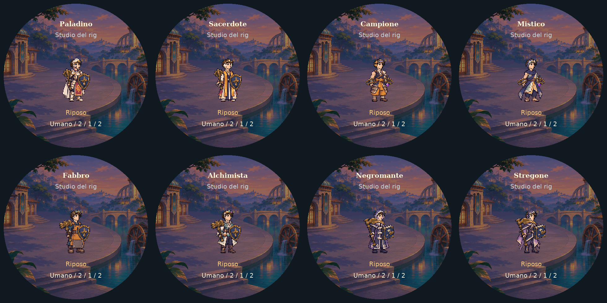
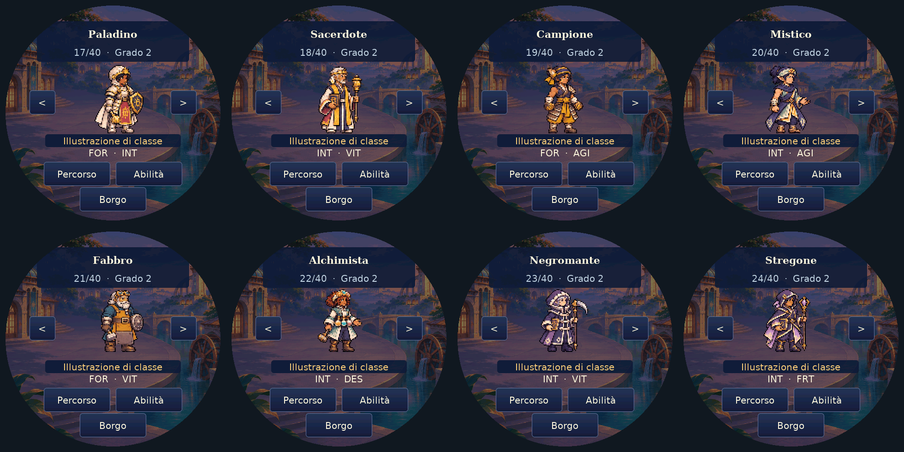

# Prove R3.2 — tutte le sedici avanzate

Consegna `0.6.0-preview.2`, 18 novembre 2026. Baseline R3.1:
`6d6cf97d21751303f730c89faa8dc2fbc56349b6`. Il lotto aggiunge gli ID 16–23:
Paladino, Sacerdote, Campione, Mistico, Fabbro, Alchimista, Negromante, Stregone.
Copertura reale: **24/40 avatar modulari e 24 illustrazioni specifiche**; le
sedici maestre mantengono il renderer precedente e il riferimento familiare
esplicito. Lanternbound resta un sistema distinto.

## Verifiche riproducibili

| Evidenza | Risultato |
|---|---|
| `host-checks.txt` | Suite completa: 55.639 controlli RPG, 1.434 compagno, 600 spedizioni e regressioni input/UI/risveglio conservate |
| `rig-sanitizers.txt` | ASan/UBSan con leak scan: 104 livelli, 270.909 composizioni, 88.148 confronti, 18.240 controlli del giunto e zero errori |
| Aspetto | Tutte le 7.680 combinazioni per ciascuna delle 24 classi: **184.320** totali; quattro razze, cinque pelli, sei capelli/otto colori, quattro occhi e due volti. Espressioni, cinque pose e 16 tipi di oggetto/cinque tier verificati. Non si pretende unicità sotto cappelli o occhi chiusi |
| Fratelli sotto elmo | 800 confronti: otto coppie × quattro razze × cinque tier elmo × cinque pose, senza arma/offhand. Minimo 119 pixel alfa distinti sotto la testa; la revisione nativa in grigio controlla anche le due firme della bibbia |
| `ui-sanitizers.txt` | **415 catture**: tutti i 24 costumi, cinque pose, creazione base IT/EN, borgo/schede/equip, formazioni 1/2/3/boss/élite 99, dungeon, quattro razze e stress livello 99 moderno/legacy IT/EN. Framebuffer incrementale/completo identico, alfa libera dai comandi, target laterali raggiunti, save/wake e allocazione fallita verificati |
| `atlas-sanitizers.txt` | **49 catture**, 80 schede IT/EN, 208 riferimenti alle abilità e 16 percorsi. Ventiquattro illustrazioni specifiche e sedici riferimenti familiari. Consultazione, touch/BOOT, chiusura e profilo invariato |
| `promotions-sanitizers.txt` | **48 catture**: 32 promozioni con tocchi reali IT/EN, 64 tentativi respinti a livello 19/job 30 o 20/job 29, 32 roundtrip v4. Stato confrontato col core, aspetto/oggetti conservati, 16 confronti dei fratelli con lo stesso elmo. Le viste diagnostiche senza arma/offhand non cambiano gli oggetti salvati |
| Footer | 114.600 pixel opachi dei glifi verificati dentro il cerchio e sotto i piedi; le due righe corrette in R3.1 restano leggibili anche nelle nuove famiglie a livello 99 |
| Memoria | Picco immagini rig 788.618 byte, atlante 620.168, promozioni 527.240. I 1.000 cambi conservano un buffer avatar a regime; non è una misura dell'intero heap ESP32 |
| `firmware-build.txt`, `firmware.json` | ESP-IDF 5.5.1 / ESP32-S3: app locale **3.590.432 byte / 3,42 MiB**, 43% libero nei 6 MiB della partizione. Sotto il budget di produzione 5,4 MiB. Save v4 da 2.808 byte, nessuna struttura persistente aggiunta |

Totale: **512 catture native**. Le tre app UI sono state eseguite con ASan/UBSan;
il leak scan finale è disabilitato perché mantengono runtime LVGL/cache FX
globali. Il test puro del rig mantiene il leak scan attivo.

## Palette dell'Alchimista: difetto e regressione

Sette pixel dell'ampolla viola condividevano un RGB565 quantizzato con le ombre
magenta tecniche delle mani. Ricevevano quindi il ruolo pelle e cambiavano
colore con la carnagione. Il PNG non era il problema: la palette univa colore
e comportamento in una sola identità.

Il layout ora registra il rettangolo logico semiaperto `[36,45,55,64]` della
cintura come decorazione fissa. La palette distingue **RGB565 e ruolo semantico**:
lo stesso colore nelle mani resta ricolorabile e nella cintura resta originale.
Non vengono dipinti, eliminati o ricostruiti pixel del PNG.

Il nuovo test confronta la cintura nelle cinque carnagioni: **1.444 confronti**
superati. Collegato al precedente oggetto compilato, rileva **28 errori attesi**
(`palette-before.txt`); la matrice completa e i sanitizer passano dopo la
correzione. È una regressione del comportamento del costume, non un confronto
di soli valori interni alla palette.

## Revisione e limiti

Revisione indipendente delle 40 pose nuove, otto equipaggiamenti, studi sotto
elmo identico, promozioni IT/EN, atlante e campioni borgo/battaglie/dungeon:
nessun blocco di forma, clipping, volto o separazione dai controlli. Il difetto
di palette è stato trovato dopo questa revisione; il test aggiuntivo e le prove
successive sono stati completati dal lead con prosecuzione sequenziale quando
il secondo agente non era disponibile. Non si attribuisce all'agente una
revisione della correzione che non ha eseguito.

Sorgenti, prompt e hash: [rig](../../../assets/hero-rig/README.md),
[illustrazioni](../../../assets/classes/README.md). Il primo foglio illustrato
aveva gutter insufficienti, pur passando il controllo dei pixel sui bordi;
ImageGen ha prodotto un layout più ampio, conservando l'originale rifiutato.
Le scene Studio sono strumenti di verifica, non nuovi luoghi giocabili.

Le pose sono ancora trasformazioni parametriche preliminari; maschere degli
arti e animazione definitiva restano R7. Il prossimo lotto è R4.1, prime otto
maestre. Il collaudo sul Pocket resta aperto: host e simulazioni non certificano
touch, FPS, autonomia, sessioni prolungate o coinvolgimento dei giocatori.

Il [workflow](https://github.com/ShydanRem/pocketwayfarer/actions/workflows/pages.yml)
ricostruisce il pacchetto dal commit e controlla via HTTP quattro documenti,
sette immagini native, tre hash firmware e ZIP completo.

Aggiornamento storico: la directory delle immagini è ora ampliata da R4.1; i log sopra restano relativi alla consegna R3.2. [Stato e prove correnti](../master-a-evidence/README.md).
