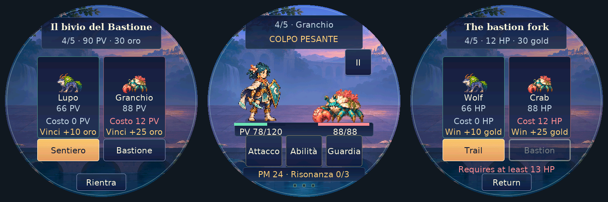

# R6.2 — Sentiero e Bastione



Nella quarta stanza scegli quanto rischiare prima del Guardiano. Il **Sentiero** costa 0 PV e rende 10 oro alla vittoria. Il **Bastione** costa 12 PV all’ingresso e rende 25 oro se sconfiggi un Granchio di Marea da 88 PV. Il Granchio usa il colpo pesante e riduce il danno degli attacchi base. La scheda mostra i PV del nemico, il prezzo e il premio prima della scelta. I tuoi PV e l’oro già raccolto sono nella testata.

Il Bastione richiede almeno 13 PV. L’ingresso scala i PV una volta sola. Il premio entra nel bottino di spedizione alla vittoria e diventa oro del profilo al rientro. Puoi rientrare dopo la quarta stanza con **40 oro dal Sentiero** o **55 dal Bastione**. Sconfiggendo anche il Guardiano rientri con **80** o **95 oro**, rispettivamente. Una sconfitta al Bastione lascia il premio della stanza fuori dal bottino e applica la normale perdita di un quarto all’oro già raccolto, arrotondata per difetto.

## Confronto sui due seed di R6.1

Sentinella senza reliquie, Focolare con +25 PV e attacco base e parata a tempo perfetto. Le due vie sono state percorse in IT/EN nell’interfaccia LVGL a 466 × 466. Il runner usa un orologio simulato.

| Seed | Via | PV al bivio → ingresso → vittoria | Lotta simulata | PV al rientro | Oro |
|---|---|---|---:|---:|---:|
| 3294095628 | Sentiero | 115 → 115 → 111 | 7,420 s | 96 | 80 |
| 3294095628 | Bastione | 115 → 103 → 95 | 10,570 s | 80 | 95 |
| 2224073057 | Sentiero | 117 → 117 → 110 | 10,570 s | 92 | 80 |
| 2224073057 | Bastione | 117 → 105 → 96 | 10,570 s | 77 | 95 |

Le misure in tabella provengono dalle tracce italiane. Tutte e otto le spedizioni terminano in vittoria e con 24 PM. Il Sentiero riproduce tutte le 80 righe della preview.1. Il Bastione costa 15–16 PV in più al rientro in questi scenari e aumenta il bottino di 15 oro. La prima sessione con persone, inclusa la preferenza fra le due vie, e il collaudo sul Pocket fisico restano da eseguire. [Traccia Sentiero](sentiero.csv) · [Traccia Bastione](bastione.csv)

## Salvataggio e riproduzione

- Ispezionare il bivio lascia invariati RNG, bestiario, PV e bottino. A 12 PV il pulsante del Bastione è disabilitato e il tocco lascia la spedizione invariata.
- Le prove riprendono prima della scelta, dopo l’ingresso e dopo la vittoria. Prima del rientro i 55 oro restano nella spedizione. Un secondo riavvio dopo il rientro conserva un solo accredito.
- Il modello verifica una sconfitta a 13 PV iniziali e il recupero della vecchia variante del Pontile in corso, che assegna ancora 10 oro. La struttura del salvataggio continua a usare v4 con 2.808 byte. La preview.2 riconosce il Bastione e il tetto di 95 oro. La preview.1 conosce il tetto precedente di 80 oro.

```sh
cmake -S firmware/host -B build/host/cmake -DCMAKE_BUILD_TYPE=Release
cmake --build build/host/cmake --target preview_lantern
mkdir -p build/r62/sentiero build/r62/bastione
build/host/cmake/preview_lantern build/r62/sentiero --pacing > build/r62/sentiero/trace.csv
build/host/cmake/preview_lantern build/r62/bastione --pacing-bastion > build/r62/bastione/trace.csv
```

Il firmware locale ESP32-S3 occupa 5.240.544 byte e lascia libero il 17% della partizione da 6 MiB. [Dimensione e hash](firmware.json) · [Roadmap](../../ROADMAP.md)
