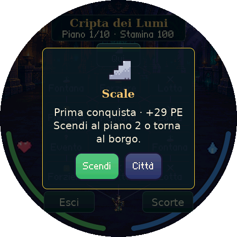

# R7.6 — ritmo della campagna



I dungeon ora ricompensano la prima conquista dei piani. Il bonus base vale metà dei PE necessari per avanzare dal livello nominale del piano e assegna PE di classe pari al 70% del bonus. Si applicano i normali modificatori all’esperienza. Alle scale il giocatore può avanzare o tornare al borgo e ricevere lo stesso premio. Il record nel salvataggio v5 vale anche per i piani conquistati prima dell’aggiornamento.

Nelle Caverne di Brace l’Arcanista era il ramo del Mago che più spesso esauriva i tentativi. I Missili arcani usavano l’attacco fisico e la difesa fisica del bersaglio. Ora usano MATK e difesa magica. Restano tre colpi, con gli stessi costi e la stessa prova dell’anello.

## Confronto su PC

| Variante | Arrivano alla fine | Tentativi mediani nei campi | Ritirate e sconfitte mediane | Arcanisti che arrivano alla fine |
|---|---:|---:|---:|---:|
| Preview.6 | 108/128 | 79,5 | 16 | 0/8 |
| Solo correzione dei Missili arcani | 116/128 | 79 | 16 | 8/8 |
| Solo PE al primo completamento | 116/128 | 40 | 10 | 0/8 |
| Preview.7 | 124/128 | 39 | 10 | 8/8 |

I profili coprono otto famiglie e 16 seed (`90–105`), con entrambi i rami di ciascuna famiglia. Tutti partono dal livello 1. Usano bottino reale, riposi a pagamento, punti guadagnati e scorte. La strategia tenta il dungeon quando il livello raggiunge il minimo della regione più uno, torna dopo il boss intermedio e prova altri tre incontri nei campi dopo una discesa fallita. L’attacco e la parata usano qualità `GREAT` simulata. Il limite è di 12 discese per regione. Le mediane includono anche le partite che si fermano prima del finale.

Il campione usato per scegliere la variazione di PE aveva altri 12 seed (`60–71`). Il recupero automatico di PV e PM tra i piani, provato separatamente su quel campione, ha portato al finale 83/96 profili rispetto a 86/96 nella preview.6. Il bonus del 50% è stato poi verificato sul campione della tabella. [Simulatore della campagna](../../../firmware/rpg/host/playtest_campaign.c)

```sh
cc -std=c11 -O2 -Ifirmware/rpg/core -Ifirmware/common \
  firmware/rpg/core/*.c firmware/common/rng.c firmware/common/timing.c \
  firmware/rpg/host/playtest_campaign.c -o /tmp/pocket-campaign
/tmp/pocket-campaign 90 16
```

Per riprodurre la riga della preview.6, compila lo stesso simulatore con il core del commit `02ac2e11260700b02e830e37ab2fb36901ad7bbc`.

## Verifiche della modifica

- Scendi e ritorna al borgo da una schermata delle scale ripristinata dopo il riavvio, in italiano e inglese. Il bonus si salva dopo entrambe le scelte. [Test dell’interfaccia](../../../firmware/rpg/host/test_device_ui.c)
- Un piano già completato e un boss ancora vivo non assegnano PE. Tornare dopo aver sconfitto il boss intermedio registra il nuovo checkpoint e i PE. [Test di affidabilità](../../../firmware/rpg/host/test_reliability.c)
- I Missili arcani infliggono tre colpi magici e sottraggono il costo una volta. La selezione dell’abilità nel gioco apre l’anello e accetta BOOT. [Test di combattimento](../../../firmware/rpg/host/test_rpg.c) · [Test dell’interfaccia](../../../firmware/rpg/host/test_device_ui.c)

Il confronto misura scontri e tentativi con una strategia ripetibile. I tempi di sessione, la facilità con cui si trovano le scorte e la risposta di touch e BOOT vanno misurati durante partite sul Pocket.
