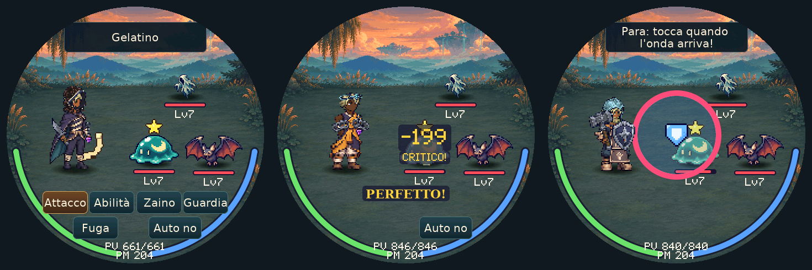
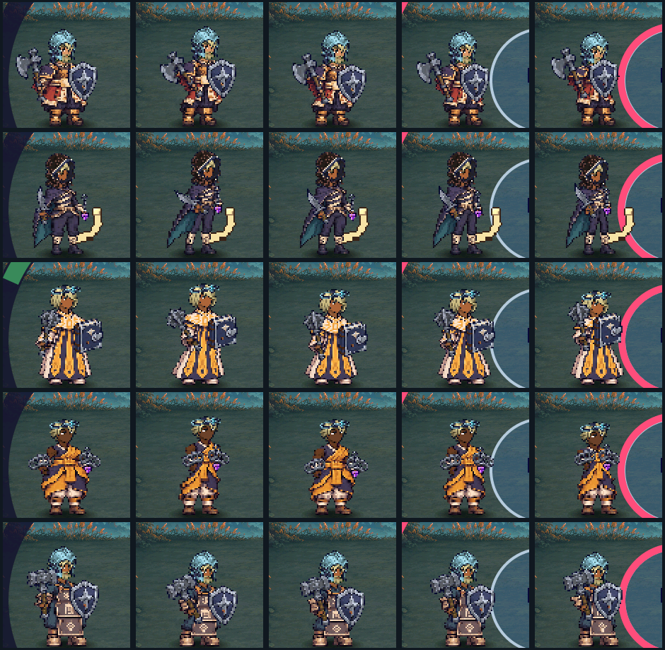

# R7.2c — pose di combattimento per tutte le classi del Classico



Le nuove pose coprono **40 classi su 40**. Nel Classico l’eroe affronta da sinistra fino a tre nemici schierati a destra. Il terzo nemico occupa la seconda fila, lasciando distinte le sagome e le aree touch. I comandi si trovano sotto l’arena.

| Famiglia | Classi aggiunte in questo lotto | Esempio nelle catture |
|---|---|---|
| Guerriero | Guerriero, Cavaliere, Berserker, Signore della Guerra | Signore della Guerra con ascia, scudo ed elmo |
| Ladro | Ladro, Assassino, Duellante, Lama Notturna, Maestro di Lame | Lama Notturna con pugnale, amuleto e cappuccio |
| Chierico | Chierico, Sacerdote, Templare, Ierofante | Ierofante con mazza, tomo e cerchietto |
| Monaco | Monaco, Campione, Mistico, Gran Maestro, Asceso | Gran Maestro con tirapugni su entrambe le mani |
| Artefice | Artefice, Fabbro, Alchimista, Forgiarune, Trasmutatore | Forgiarune con martello, scudo ed elmo |

L’ascia e il martello ruotano attorno alla presa. Il Ladro raccoglie la lama vicino al busto in carica. Il Monaco muove le due mani separatamente. Il Chierico usa il profilo del bastone quando lo equipaggia. Costume, razza e oggetti continuano a seguire il personaggio salvato. [Atlanti, provenienza e SHA-256](../../../assets/hero-rig/manifest.json)

Da sinistra **carica, contatto, recupero, ingresso in parata, parata**. Ogni ritaglio è a scala 1:1 da una schermata LVGL di 466 × 466.



[Confronto in scala di grigi](../../img/hero_rig/transizioni-famiglie-classico-grigio.png)

## Verifiche

- **800 pose** verificate su 40 classi, quattro razze e cinque fasi. La suite controlla continuità delle sagome, livelli degli oggetti e appoggio dei piedi e passa anche attraverso **307.200 combinazioni estetiche**.
- **70 catture native** per dieci classi delle otto famiglie. Coincidono con il ridisegno completo e con le catture ASan/UBSan. Il percorso usa l’inventario per equipaggiare gli oggetti e verifica tre bersagli touch, BOOT, attacco e parata perfetti, traduzioni IT/EN, movimento ridotto e risveglio durante l’impatto.
- **60 salvataggi validati** nel percorso mirato. Il riavvio ripristina il profilo v4 e l’equipaggiamento. Il picco dei buffer immagine è di **702.821 byte**. Il firmware locale occupa **5.320.000 byte** e lascia **971.456 byte** liberi nella partizione app. [Build locale ESP32-S3](firmware.json)

```sh
cmake -S firmware/host -B build/host/cmake -DCMAKE_BUILD_TYPE=Release
cmake --build build/host/cmake --target preview_hero_rig test_hero_rig
mkdir -p build/r72c/native
build/host/cmake/test_hero_rig --full
build/host/cmake/preview_hero_rig build/r72c/native --combat-poses
python3 scripts/previews.py build/r72c/native build/r72c/png/hero_rig
```

Restano aperti il collaudo sul Pocket fisico e il playtest con persone. [Roadmap](../../ROADMAP.md)
