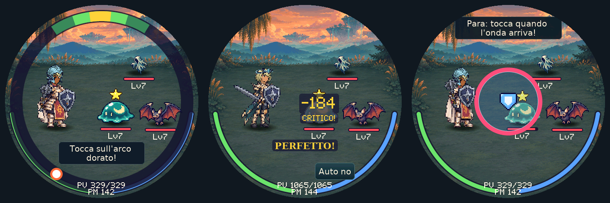
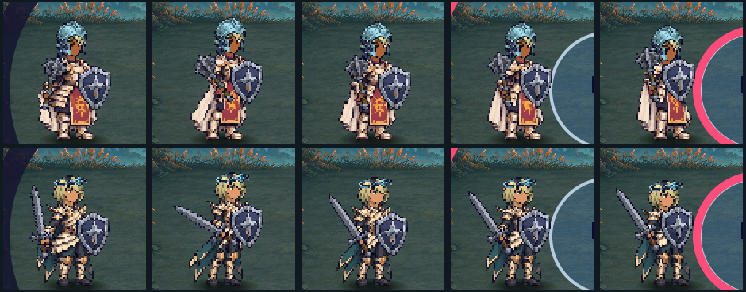

# R7.2a — il primo lotto di animazione del Classico



Le catture mostrano le pose dei due personaggi nello schieramento laterale introdotto nella preview seguente. [Prove R7.2b](../classic-weapons-evidence/README.md)

Il **Paladino** raccoglie l’arma e porta lo scudo davanti al busto. Il **Cavaliere del Drago** entra più aperto nell’affondo e fa seguire la cappa al busto. La posa usa il personaggio del profilo, inclusi carnagione, capelli, arma, mano secondaria e copricapo equipaggiati. Le due classi sono il primo lotto di R7.2. Le altre famiglie seguono in R7.2b.

Riga superiore **Paladino**, riga inferiore **Cavaliere del Drago**. Da sinistra a destra **carica, contatto, recupero, ingresso in guardia, parata**. Le immagini sono ritagli di catture LVGL a 466 × 466.



[Confronto in scala di grigi](../../img/hero_rig/transizioni-classico-grigio.png)

## Sorgenti e implementazione

Il rig riutilizza i pixel e la registrazione degli atlanti `advanced-b-outfits.png` per il Paladino e `master-a-outfits.png` per il Cavaliere del Drago. Un reticolo deformabile sposta il costume, mantenendo continui busto e cappa. Le mani ricevono lo stesso spostamento del costume e il copricapo segue il collo. Per spada, pugnale e mazza cambia anche l’orientamento intorno alla presa. Gli stivali conservano i loro pixel. [Atlanti, prompt e SHA-256](../../../assets/hero-rig/manifest.json)

La carica resta durante l’anello. Il contatto lascia spazio al recupero dopo 160 ms. In parata, l’ingresso in difesa dura 140 ms. Il risveglio conserva la fase visiva prima di riattivare l’input. Con movimento ridotto carica, contatto e guardia usano pose fisse. Il giudizio, l’anello e l’onda restano visibili.

## Verifiche

- Le 40 prove di continuità attraversano cinque pose per due classi e quattro razze, con gli oggetti tolti per rendere rilevabili eventuali strappi. Le regressioni del rig verificano anche 307.200 combinazioni estetiche e gli oggetti di tutti i livelli, inclusa la falce sul Nano.
- Il runner nativo apre uno scontro con tre bersagli nei Prati di Lumen. Equipaggia gli oggetti tramite il sistema di inventario e verifica in IT/EN tutte e cinque le pose, colpo e parata perfetti, risveglio, movimento ridotto e giudizio entro il cerchio. Il riavvio completo riapre il borgo con il profilo v4 e l’equipaggiamento.
- Le pose sono controllate pixel per pixel contro l’avatar composto. Il confronto fra ridisegno incrementale e completo è eseguito sulle 12 catture anche con ASan e UBSan. Il picco misurato dei buffer nel percorso mirato è **721.124 byte**.
- Il firmware locale occupa **5.318.080 byte** e lascia **973.376 byte** nella partizione dell’app. [Dimensione e hash della build](firmware.json)

```sh
cmake -S firmware/host -B build/host/cmake -DCMAKE_BUILD_TYPE=Release
cmake --build build/host/cmake --target preview_hero_rig test_hero_rig test_device_ui
mkdir -p build/r72/native build/r72/device
build/host/cmake/test_hero_rig --full
build/host/cmake/preview_hero_rig build/r72/native --combat-poses
build/host/cmake/test_device_ui build/r72/device
python3 scripts/previews.py build/r72/native build/r72/png/hero_rig
```

Il playtest con persone e il collaudo sul Pocket fisico restano aperti. [Roadmap](../../ROADMAP.md)
