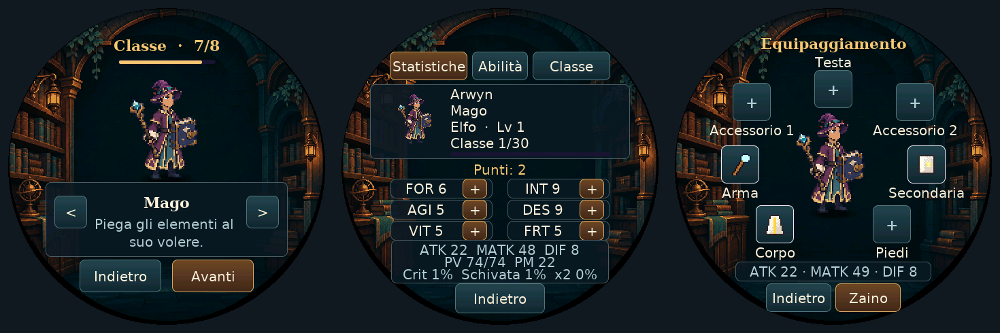

# R5.1 — schermate del personaggio

La preview 0.8.0-preview.1 usa un fondale comune per creazione, Statistiche, Abilità, Classe, atlante ed equipaggiamento del Classico. Il centro dell’archivio è in ombra, scaffali e lanterne incorniciano lo schermo circolare. La palette usa avorio per il testo, verde petrolio per i comandi e ottone per selezioni e azioni principali. I pulsanti mantengono una zona di tocco distinta da quelli adiacenti. [Sorgente, prompt e import](../../../assets/classic-ui/README.md)

| Schermata | Intervento |
|---|---|
| Creazione | Otto tappe con indicatore e anteprima persistente. Le frecce cambiano la scelta, Avanti e Indietro cambiano tappa. |
| Statistiche | Nome e classe hanno righe distinte. Il livello è accanto alla razza, i sei attributi sono in due colonne. |
| Abilità | Grado e azione stanno in una colonna propria. Dopo un miglioramento si mantiene la posizione di scorrimento, entro il contenuto disponibile. |
| Classe e atlante | Carte del prossimo ramo con avatar e nomi. Requisiti visibili e dialoghi con gli stessi caratteri e la stessa palette. L’atlante rimane consultabile dal borgo. |
| Equipaggiamento | I sette slot conservano il nome quando occupati. Il segno + indica uno slot libero. I dettagli distinguono il comando di rimozione e la chiusura. |
| Ritorno | Da Abilità e Classe, touch e BOOT tornano a Eroe. Da Eroe ed Equip tornano al borgo del Classico. |

Le prime catture hanno mostrato che un nome lungo affiancato al livello poteva cambiare l’altezza del profilo. Ora la classe ha una riga tutta sua. Sono stati distanziati anche il titolo, le etichette e i totali nell’equipaggiamento, e allargate le carte per parole come Elementalista.

| Controllo | Risultato |
|---|---|
| Percorsi IT/EN | 26 catture dedicate e interazioni LVGL dalla creazione fino al salvataggio v4. Verificati punti attributo e abilità, ritorno touch e BOOT, rimozione dell’arma e ripristino dallo zaino. |
| Rig e leggibilità | 791 catture. Verificati 64 profili maestri a livello 45 e 99, la separazione tra sprite e controlli, la corrispondenza tra render completo e incrementale e la pulizia della cache. Picco dei buffer immagini 797.306 byte su host. |
| Atlante e promozioni | 78 e 160 catture. Verificati tutti i rami, 96 cambi di classe e riletture, 128 requisiti non raggiunti, 80 schede bilingui e consultazione senza mutare il profilo. |
| Firmware | 3.980.752 byte su 6 MiB. Il nuovo fondale occupa una risorsa indicizzata a schermo intero. [Dimensione e hash](firmware.json) |

I tre programmi di anteprima sono stati verificati con AddressSanitizer e UndefinedBehaviorSanitizer su host. La suite completa aggiunge le regressioni del cerchio di combattimento, dei frame lenti e dell’input. Il collaudo di leggibilità, touch e prestazioni sul Pocket resta aperto. Per il prossimo lotto restano borgo, regioni e mostri del Classico. [Roadmap](../../ROADMAP.md)
