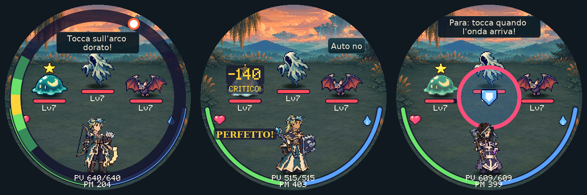
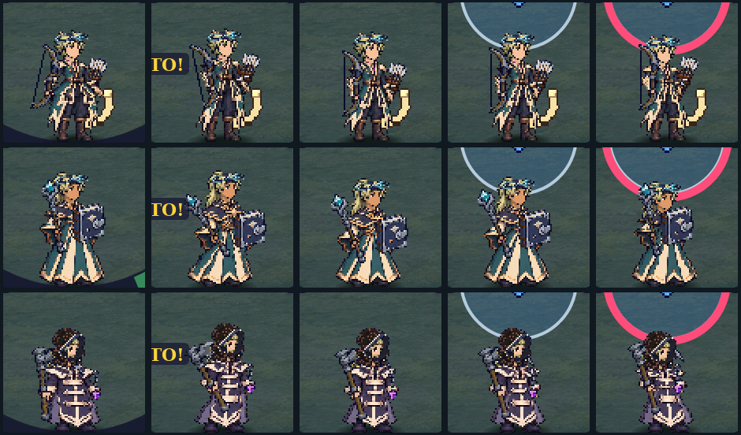

# R7.2b — arco, bastone e falce nel Classico



Le nuove pose arrivano a **17 classi su 40**. Questo lotto aggiunge 15 classi ai due profili di Paladino e Cavaliere del Drago.

| Famiglia | Classi del lotto | Esempio nel renderer |
|---|---|---|
| Arciere | Arciere, Ramingo, Cecchino, Signore delle Bestie, Arco della Tempesta | Arco della Tempesta con arco e faretra |
| Mago | Mago, Elementalista, Arcanista, Arcimago, Cronomante | Arcimago con bastone e tomo |
| Occultista | Occultista, Negromante, Stregone, Signore della Morte, Evocavuoto | Signore della Morte con falce, amuleto e cappuccio |

L’arco cambia inclinazione fra carica e rilascio, mentre la faretra segue il busto. Il Mago alza il bastone e lo porta avanti durante il colpo. La falce ruota attorno alla presa e rimane dietro volto e capelli. Un Occultista equipaggiato con bastone usa il profilo del bastone. Il renderer deforma i costumi esistenti con gli ancoraggi già registrati. [Atlanti, prompt e SHA-256](../../../assets/hero-rig/manifest.json)

Da sinistra **carica, contatto, recupero, ingresso in parata, parata**. I ritagli sono a scala 1:1 dalle schermate LVGL.



[Confronto in scala di grigi](../../img/hero_rig/transizioni-armi-classico-grigio.png)

## Verifiche

- **340 prove** controllano in quattro razze le cinque pose di 17 classi, con la verifica di continuità di busto e cappa. La suite continua a verificare **307.200 combinazioni estetiche**, livelli degli oggetti, piedi fermi e contorni interi.
- Il runner nativo usa l’inventario per equipaggiare gli oggetti e segue cinque classi, tre bersagli per scontro, touch e BOOT in IT/EN, movimento ridotto, parata e risveglio durante l’impatto. Il riavvio conserva il profilo v4 e l’equipaggiamento.
- Le **30 catture** coincidono con il ridisegno completo e sono identiche tra la build normale e la prova con ASan/UBSan. L’impatto sul bersaglio usa il lampo locale per evitare residui dovuti alla scossa sommata all’oscillazione. I 30 salvataggi del percorso mirato sono stati validati.
- Il picco dei buffer immagini nel percorso mirato è **722.498 byte**. Il firmware locale occupa **5.319.056 byte**, con **972.400 byte** liberi nella partizione app. [Build locale ESP32-S3](firmware.json)

```sh
cmake -S firmware/host -B build/host/cmake -DCMAKE_BUILD_TYPE=Release
cmake --build build/host/cmake --target preview_hero_rig test_hero_rig
mkdir -p build/r72b/native
build/host/cmake/test_hero_rig --full
build/host/cmake/preview_hero_rig build/r72b/native --combat-poses
python3 scripts/previews.py build/r72b/native build/r72b/png/hero_rig
```

Restano aperti il collaudo sul Pocket fisico e il playtest con persone. [Roadmap](../../ROADMAP.md)
