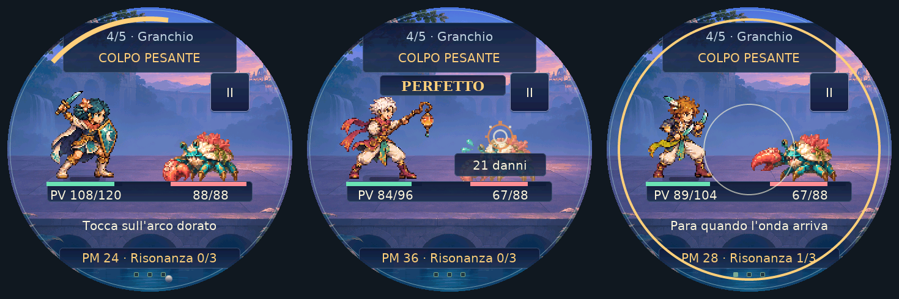
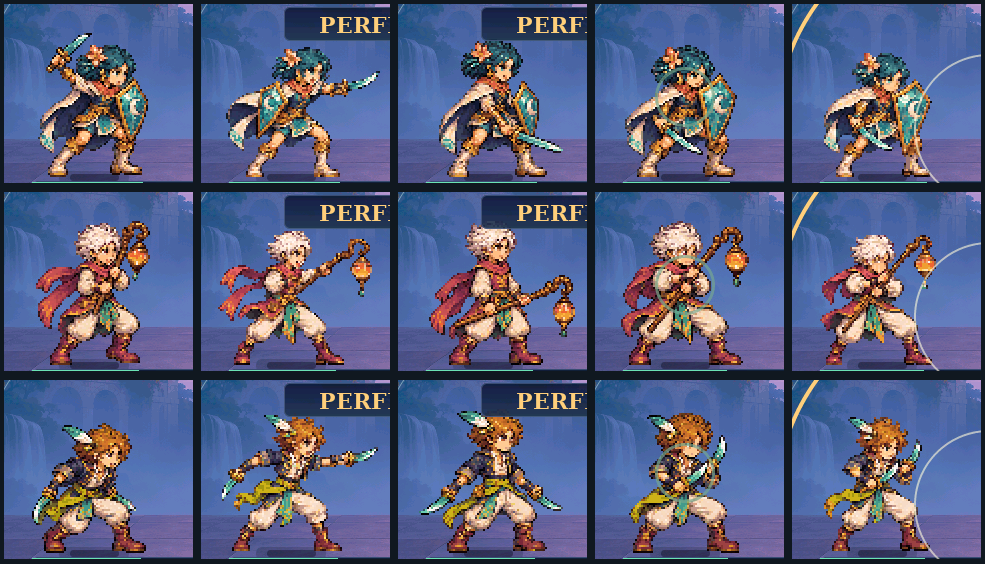

# R7.1 — attacco, recupero e guardia in Lanternbound



La Sentinella raccoglie il fendente sopra la spalla e alza lo scudo per difendersi. Il Piromante avvicina la lanterna in carica e si ripara dietro il bastone in diagonale. Il Predone si abbassa prima dell’affondo e porta avanti le due lame in difesa. Le armi restano visibili e i piedi poggiano sullo stesso piano. I nove nuovi fotogrammi derivano da un atlas ImageGen basato sui tre costumi originali e rimappato sulle loro palette. [Sorgenti e importazione](../../../assets/lantern/README.md)

Righe dall’alto verso il basso **Sentinella, Piromante, Predone**. Colonne da sinistra a destra **carica, contatto, recupero, ingresso in guardia, parata**. Sono ritagli delle catture LVGL a scala 1:1.



[Confronto delle sagome in scala di grigi](../../img/lantern/transizioni-lanternbound-grigio.png)

## Tempi e movimento ridotto

La posa di carica accompagna l’anello. Dopo il giudizio, il contatto dura 150 ms e il recupero termina a 320 ms. La guardia entra in 140 ms e si assesta prima della parte utile dell’onda. Il renderer sceglie la posa dal tempo della fase salvata. Pausa e riavvio mantengono il punto di recupero prima di riattivare l’input.

Con **Movimento ridotto** rimangono le tre pose chiave di carica, contatto e guardia. Gli attori rimangono ancorati, mentre arco, onda e giudizio conservano tempi e comportamento. I fotogrammi della modalità selezionata vengono caricati all’ingresso nello scontro, prima della finestra di timing.

## Verifiche

- Il runner LVGL tocca Attacco e Guardia per tutti e tre gli assetti, in italiano e inglese. Verifica contatto e parata perfetti, pausa durante il recupero, riavvio, conto di preparazione e posizione delle pose con movimento ridotto.
- Le **73 catture** confrontano il ridisegno incrementale con quello completo. Le verifiche delle pose leggono i pixel opachi e controllano spazio sopra l’HUD, area circolare e separazione dal lato nemico. Nel percorso vengono validati **620 salvataggi**.
- Le regressioni mantengono il restringimento dell’onda anche con frame da 120 ms e controllano il giudizio touch e BOOT. Le tracce delle due vie, **Sentiero e Bastione**, combaciano con R6.2 riga per riga.
- La build locale occupa **5.314.240 byte** e lascia **977.216 byte** nella partizione dell’app. Il picco osservato dei buffer immagini Lanternbound è **1.479.110 byte** su host. Il salvataggio v4 misura 2.808 byte. [Build locale ESP32-S3](firmware.json)

```sh
cmake -S firmware/host -B build/host/cmake -DCMAKE_BUILD_TYPE=Release
cmake --build build/host/cmake --target preview_lantern test_device_ui
mkdir -p build/r71/native build/r71/device
build/host/cmake/preview_lantern build/r71/native
build/host/cmake/test_device_ui build/r71/device
python3 scripts/previews.py build/r71/native build/r71/png/lantern
```

Il playtest con persone e il collaudo sul Pocket fisico restano aperti. I controlli host verificano le regole e il renderer. Per misurare il tempo d’ingresso in combattimento, la fluidità e la latenza serve il dispositivo. [Roadmap](../../ROADMAP.md)
