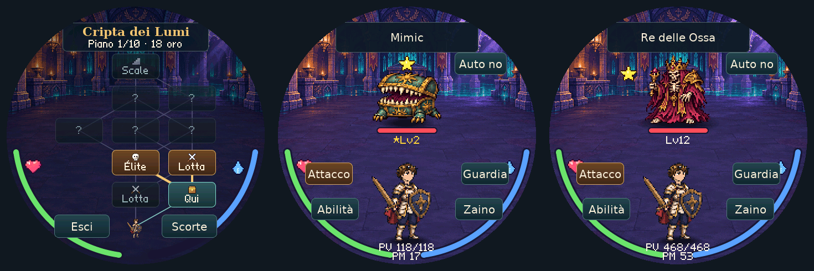

# R5.3 — Cripta dei Lumi

Pietra viola, vetro azzurro e luce ambrata incorniciano la Cripta. Il piano di combattimento lascia spazio al profilo basso del Mimic e alla veste bordeaux del Re delle Ossa. Le due nuove illustrazioni completano le specie incontrate nella prima regione e portano il Classico a 10 su 42. [Sorgenti e manifesto](../../../assets/crypt/README.md)

Il grafico delle stanze mostra in ottone i prossimi ingressi e i collegamenti dalla posizione attuale. I nodi indicano **Qui**, **Visitata** e **?**. La testata mostra piano e oro della discesa. Il checkpoint viene aggiornato anche se si sceglie di tornare al borgo dopo il boss del piano 5.

| Prova | Percorso verificato |
|---|---|
| Entrata e navigazione IT/EN | Ingresso al piano 1, tocco su un nodo bloccato, apertura del forziere, stanza visitata, trappola, mercante e ritorno con BOOT. |
| Scorte e uscita | Uso di una pozione, annullamento dell’uscita e consumo singolo della pergamena dopo conferma. |
| Affidabilità del bottino | Riavvio durante l’incontro con il Mimic, ritorno al bivio con Stamina e stato ripristinati, stesso incontro al secondo tentativo. Riavvio prima di **Continua** e oro accreditato una volta anche nel totale della discesa, usato per calcolare la perdita in caso di sconfitta. |
| Checkpoint e completamento | Vittoria al piano 5, scelta **Città**, riavvio e ingresso dal piano 6. Vittoria al piano 10, riavvio, sblocco della Riva di Vetro e oro assegnato una sola volta. I test inizializzano separatamente i piani dei boss e i tipi di alcune stanze. |
| Catture native | 12 nuove in italiano e inglese, tra ingresso, percorso, checkpoint, soglia e combattimenti. Confronto di render completo e incrementale. [Ingresso dal checkpoint](checkpoint.png) |
| Firmware | ESP32-S3, ESP-IDF 5.5.1, 4.662.128 byte. Rimane il 26% della partizione app da 6 MiB. Salvataggio v4 da 2.808 byte. [Dimensione e hash](firmware.json) |

Il [brief inglese](brief.en.md) è stato esaminato con Game Maker AI. Il controllo del testo ha dato **78/100**. Le voci rimaste parziali riguardano ritmo, ciclo, progressione, audio e layout mobile. Le prove del Pocket usano il renderer LVGL a 466 × 466 e le regole reali del Classico.

Il collaudo su hardware resta aperto per risposta touch, contrasto AMOLED e durata della sessione. Il prossimo lotto comprende la Riva di Vetro e il Tempio Sommerso. [Roadmap](../../ROADMAP.md)
