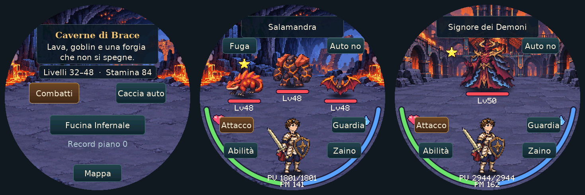
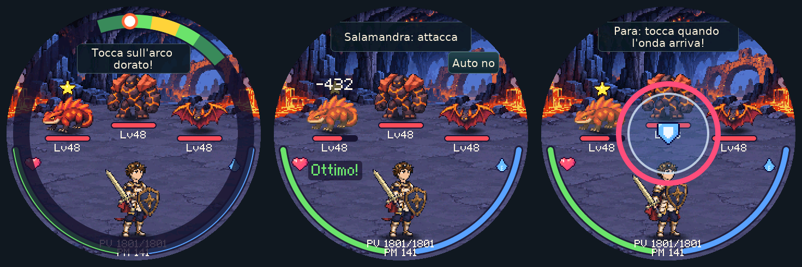

# R5.6 — Caverne di Brace e Fucina Infernale

La lava illumina i bordi della caverna e il fondo della Fucina. Le sagome e gli indicatori occupano la fascia di pietra blu e violacea. Il Golem di lava ha spalle squadrate e fessure arancioni. Il Drago di cenere ha un collo alto e ali chiare. Il Signore dei Demoni ha corna larghe, spallacci color rame e un mantello rosso scuro. [Sorgenti, prompt e importazione](../../../assets/ember/README.md)

| Incontri | Specie ridisegnate |
|---|---|
| Caverne di Brace | Salamandra, Golem di lava, Pipistrello ardente, Goblin minatore |
| Fucina Infernale | Diavoletto, Cavaliere infernale, Drago di cenere, Signore dei Demoni |

Il giudizio dell’anello compare in basso a sinistra nei combattimenti illustrati. Nella prima cattura il testo animato risaliva fino a coprire l’intento. La verifica controlla che il giudizio parta sotto il centro del campo.

| Prova | Verificata su host |
|---|---|
| Accesso dal Bosco | Il nodo delle Caverne risulta bloccato prima di battere la Regina Ragno. Il profilo sbloccato entra dalle isole della mappa. |
| Combattimento IT/EN | Tre aree di tocco distinte, anello, intento e parata nella stessa lotta. Anello e parata provati con input touch in italiano e BOOT in inglese. [Altre sagome](mostri.png) |
| Discesa IT/EN | Ingresso nella Fucina, scontro selezionato dalla mappa, Drago di cenere al piano 5 e ripartenza dal piano 6. [Mappa della Fucina](fucina.png) |
| Ripresa IT/EN | Vittoria sul Signore dei Demoni al piano 10, ritorno al borgo, ricompensa accreditata una volta e accesso alle Guglie dopo il riavvio. Le prove predispongono una stanza e i piani dei boss e usano un profilo rinforzato per verificare interfaccia e progressione. |
| Catture native | 20 fotogrammi delle Caverne e della Fucina identici tra build Release e build con AddressSanitizer e UndefinedBehaviorSanitizer. |
| Firmware | ESP-IDF 5.5.1 su ESP32-S3. L’app occupa 5.052.384 byte, 129.968 in più della preview.5. Rimane il 20% della partizione da 6 MiB. Salvataggio v4 da 2.808 byte. [Misure e hash](firmware.json) |

Il collaudo sul Pocket fisico resta aperto. Il prossimo lotto comprende Guglie del Cielo, Cittadella Celeste e le ultime otto specie del Classico. [Roadmap](../../ROADMAP.md)
