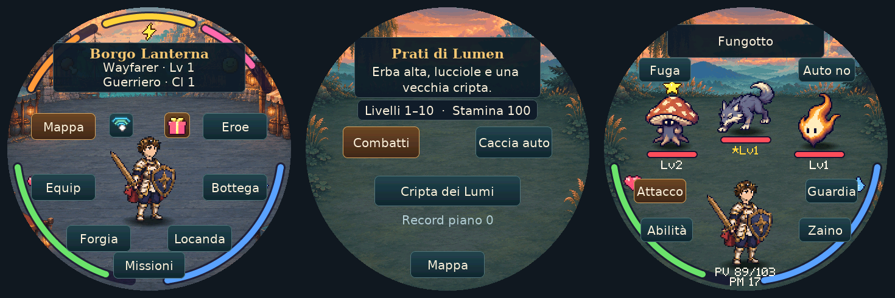

# R5.2 — Borgo Lanterna e Prati di Lumen

Il borgo concentra la luce sulle case e lascia l’eroe sulla pietra fredda della piazza. I Prati portano cielo, isole e vegetazione ai bordi e usano un terreno più uniforme nell’area di scontro. I comandi escono dalla fascia delle creature, ogni bersaglio ha una zona di tocco larga almeno 100 pixel e la stella indica la selezione. Il nome della creatura e l’intento rendono leggibile la preparazione di un colpo anche senza la tinta ambrata. [Sorgenti, prompt e manifesto](../../../assets/lumen/README.md)

| Luogo | Specie ridisegnate |
|---|---|
| Prati di Lumen | Gelatino, Fungotto, Lupo grigio, Scintillo |
| Cripta dei Lumi | Scheletro, Pipistrello, Spettro, Re Gelatino |

Ogni mostro usa una posa illustrata compatibile con gli affondi e le reazioni esistenti. Il nuovo fondale della Cripta, il Mimic, il Re delle Ossa e le altre regioni sono ancora da ridisegnare. La notte nel borgo usa lo stesso fondale con una velatura scura.

| Verifica | Esito |
|---|---|
| Percorso IT/EN | Navigazione touch dal borgo ai Prati, tre selezioni distinte, anello e parata via touch in italiano e BOOT in inglese. La vittoria assegna l’oro e riporta alla zona. Il salvataggio v4 si rilegge con ricompensa e incontro chiuso. |
| Catture native | 15 catture LVGL aggiunte alla suite del personaggio a 466 × 466. Confronto fra render incrementale e completo. [Anello](anello.png) · [Parata](parata.png) · [Cripta](cripta.png) · [Re Gelatino](re-gelatino.png) |
| Affidabilità | Celebrazione della vittoria, effetti di combattimento e ingresso dal piano 6 verificati su host. AddressSanitizer ha individuato il riuso prematuro di un buffer della cache effetti. Gli slot restano occupati fino alla rimozione dell’ultimo widget che li usa. |
| Firmware | Build locale ESP32-S3 con ESP-IDF 5.5.1, 4.435.792 byte, 29% libero nei 6 MiB della partizione. [Dimensione e hash](firmware.json) |

Il collaudo su Pocket rimane aperto, in particolare latenza touch, resa sul pannello AMOLED e una sessione prolungata con combattimenti consecutivi. Il prossimo lotto della roadmap riguarda la Cripta. [Roadmap](../../ROADMAP.md)
