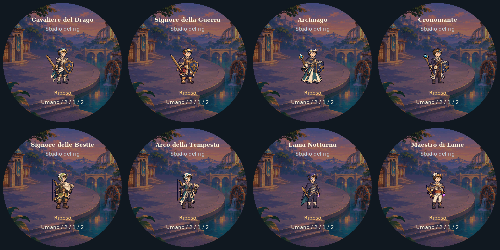
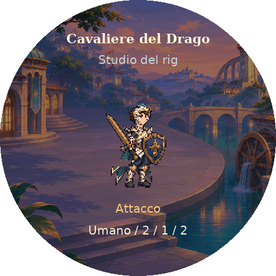
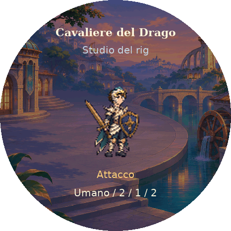
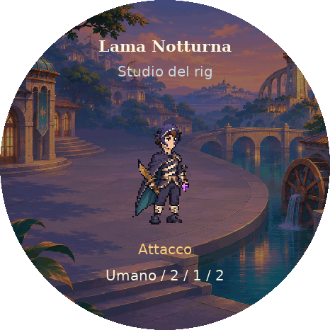
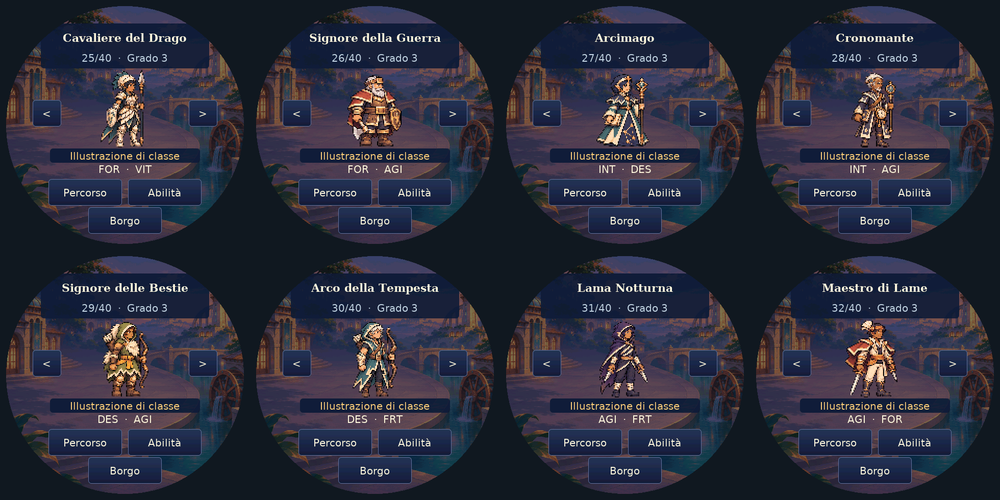

# Prove R4.1 — prime otto maestre

Consegna `0.7.0-preview.1`, 18 novembre 2026. Baseline R3.2:
`326a95d494a538e04511b33d434970090e84abb0`. Il lotto aggiunge gli ID 24–31:
Cavaliere del Drago, Signore della Guerra, Arcimago, Cronomante,
Signore delle Bestie, Arco della Tempesta, Lama Notturna e Maestro di Lame.
Copertura reale: **32/40 avatar modulari e 32 illustrazioni specifiche**.
Le otto maestre ID 32–39 mantengono il renderer precedente e il riferimento
familiare esplicito. Le regole delle 40 classi erano già nel core;
Lanternbound e i suoi tre assetti restano un sistema distinto.

## Verifiche riproducibili

| Evidenza | Risultato |
|---|---|
| `host-checks.txt` | Suite completa: 55.639 controlli RPG, 1.434 compagno, 600 spedizioni; regressioni input/timing, cache, risveglio e vecchie UI conservate |
| `rig-sanitizers.txt` | ASan/UBSan con leak scan: 120 livelli, 361.485 composizioni, 117.792 confronti, 24.320 controlli del giunto e zero errori |
| Aspetto | Tutte le 7.680 combinazioni per ciascuna delle 32 classi: **245.760** totali; quattro razze, cinque pelli, sei capelli/otto colori, quattro occhi e due volti. Quattro espressioni, cinque pose e 16 tipi di oggetto/cinque fasce verificati |
| Fratelli sotto elmo | **1.200 confronti**: dodici coppie × quattro razze × cinque tier elmo × cinque pose, senza arma/offhand. Minimo 119 pixel alfa distinti sotto la testa; revisione nativa colore/grigio delle firme del costume |
| Metadata | Le otto maestre usano famiglia 0–3 e grado UI 2. Chiavi incoerenti respinte. La mutazione che ammette i maestri a tier 1 fallisce con **16 errori attesi** (`wrong-tier-before.txt`) |
| `ui-sanitizers.txt` | **591 catture**: 32 costumi, cinque pose, creazione base IT/EN, borgo/schede/equip, formazioni 1/2/3/boss/élite 99, dungeon, razze e stress livello 99 moderno/legacy. Framebuffer incrementale/completo identico, alfa libera dai comandi, salvataggio/risveglio e allocazione fallita verificati |
| Statistiche | **32 casi**: otto maestre × due lingue × livelli 45/99. Quattro righe complete senza wrap, intero box dentro il cerchio e fuori dal canvas avatar |
| `atlas-sanitizers.txt` | **64 catture**, 80 schede IT/EN, 208 riferimenti alle abilità e 16 percorsi. Trentadue illustrazioni specifiche e otto riferimenti familiari; consultazione, touch/BOOT, chiusura e profilo invariato |
| `promotions-sanitizers.txt` | **104 catture**, 64 cambi tramite touch, 96 rifiuti sotto soglia e 64 roundtrip v4. Include 16 percorsi completi base → avanzata → maestra IT/EN; aspetto e oggetti conservati rispetto al core |
| Maestre | Rifiuti a livello 44/job 40 e 45/39; successo a 45/40. Salto diretto dalla base e maestra del ramo errato rifiutati senza mutazioni. Tutti gli otto ID delle abilità confrontati anche in battaglia, rank precedenti conservati; reset job 1/xp 0, punto abilità aggiunto, nessuna evoluzione successiva e cap job 50 |
| Footer | 169.520 pixel opachi dei glifi dentro il cerchio e sotto i piedi; stress livello 99 IT/EN sulle otto nuove maestre e su un fallback legacy |
| Memoria | Picco immagini rig 788.618 byte, atlante 620.168, promozioni 527.240. I 1.000 cambi mantengono un buffer avatar a regime; non è una misura dell'intero heap ESP32 |
| `firmware-build.txt`, `firmware.json` | ESP-IDF 5.5.1 / ESP32-S3, versione 0.7.0-preview.1, circa 3,51 MiB e 42% libero nei 6 MiB della partizione. Save v4 da 2.808 byte; nessuna struttura persistente aggiunta |

Totale: **759 catture native**. Le tre app UI usano ASan/UBSan con leak scan
finale disabilitato perché mantengono runtime LVGL/cache FX globali; il test
puro del rig mantiene il leak scan attivo. I numeri descrivono i percorsi
esercitati, non prestazioni o latenza fisica.

## Difetto delle cappe e regressione

La revisione indipendente ha trovato un taglio orizzontale nelle cappe lunghe
di Drago e Lama Notturna durante l'attacco. Il rettangolo usato per spostare
il braccio comprendeva anche la cappa appiattita nel costume: traslarla come
un arto lasciava uno strappo nel tessuto.

Il layout ora ammette `rigid_arm_classes` solo per gli ID 24/30. Le pose
attacco/guardia/colpito traslano insieme il costume connesso e le prese degli
oggetti. La fascia piedi resta ferma, con soglia applicata **dopo** la
compressione del Nano. Il respiro conserva l'overlap già verificato al giunto.
Nessun pixel del PNG viene ricostruito, ridipinto o cancellato.

La regressione confronta **3.036 pixel** della cappa composta nelle tre pose,
con almeno 178 pixel opachi osservati per costume. Il vecchio oggetto renderer
collegato al nuovo test produce **860 errori attesi** (`cape-before.txt`).
Una prima correzione applicava la soglia prima della compressione del Nano:
il test dei piedi ha rilevato **720 errori** (`dwarf-before.txt`). La soglia
corretta conserva l'intera matrice delle quattro razze, senza indebolire le
asserzioni precedenti.

| Prima: taglio della cappa | Dopo: posa con costume connesso |
|---|---|
|  |  |
|  |  |

È una posa preliminare più semplice, non un'animazione articolata finale.
Maschere separate per arti/cappa e transizioni restano R7.

## Nomi lunghi e promozioni

La colonna Statistiche a larghezza automatica portava alcuni nomi delle
maestre nel canale dell'avatar. Ora usa 260 px centrati a x 290, con allineamento
a sinistra; i quattro angoli e le quattro righe complete vengono controllati
nel renderer. I titoli della scheda Classe entrano senza abbreviazioni.
I dialoghi di scelta possono usare due righe mantenendo i comandi accessibili.

Il test promozioni seleziona realmente il nodo centrale dell'avanzata: non
riusa le coordinate dei due rami della base. La preparazione avviene tramite
touch anche per base → avanzata; confronti espliciti conservano i rank appresi
e gli oggetti. Le viste sotto elmo senza arma/offhand sono solo diagnostiche
e non modificano l'equipaggiamento salvato.

## Provenienza, revisione e limiti

I tre fogli sono originali generati con ImageGen; sorgenti e prompt esatti
sono conservati. [Rig](../../../assets/hero-rig/README.md),
[illustrazioni](../../../assets/classes/README.md) e relativi manifest
registrano identità, hash e trasformazioni meccaniche. Le firme derivano dalla
bibbia del progetto; non si includono personaggi o sprite commerciali.

Un agente separato ha esteso ed eseguito le proprietà del rig e le prove
negative di tier/cappa, mantenendo la regressione della cintura Alchimista.
La revisione UI indipendente è rimasta in sola lettura. Il lead ha integrato
asset/renderer, promosso i profili nel test reale e costruito firmware/sito.
Le immagini Studio sono strumenti di controllo, non nuovi luoghi giocabili.

Il prossimo lotto è R4.2, ultime otto maestre. R5 per il resto di mondo/UI/mostri
e R7 per animazione/audio rimangono distinti. Il collaudo sul Pocket resta
aperto: host e simulazioni non certificano touch, FPS, autonomia, sessioni
prolungate o coinvolgimento dei giocatori.

Il [workflow](https://github.com/ShydanRem/pocketwayfarer/actions/workflows/pages.yml)
ricostruisce il pacchetto dal commit pubblicato e verifica via HTTP quattro
documenti HTML, nove immagini native esatte, tre hash firmware e ZIP completo.
