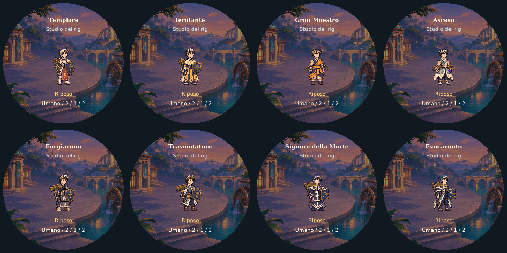
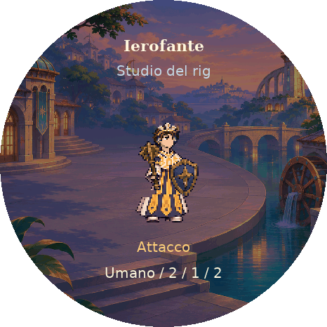
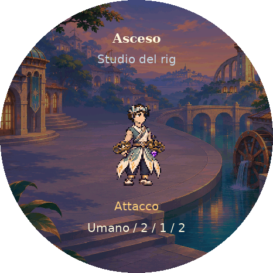
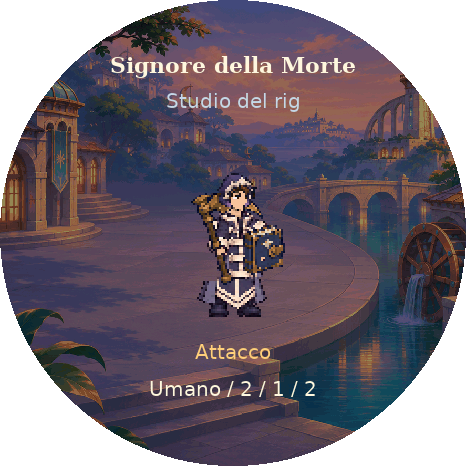
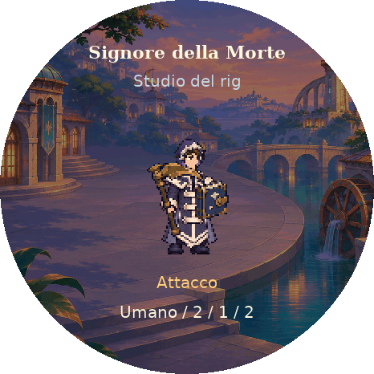
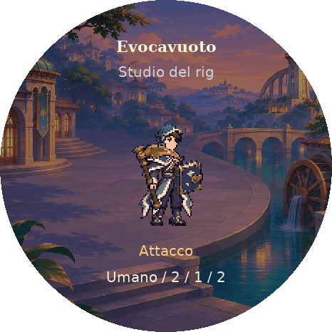
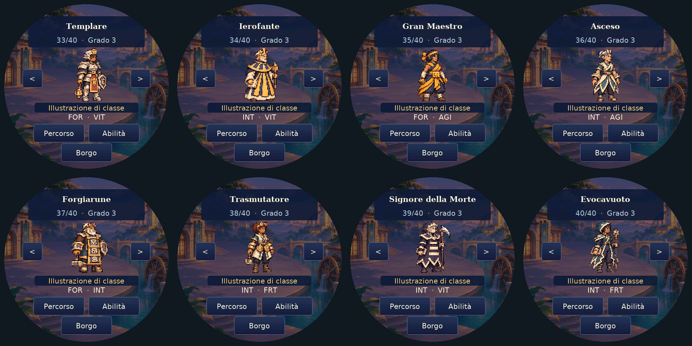

# Prove R4.2 — grafica delle 40 classi

La preview `0.7.0-preview.2` aggiunge Templare, Ierofante, Gran Maestro, Asceso, Forgiarune, Trasmutatore, Signore della Morte ed Evocavuoto. Tutte le 40 classi classiche hanno un costume modulare, un copricapo di classe e un’illustrazione nell’atlante. Oggetti equipaggiati, personalizzazione, progressione e salvataggi v4 sono compatibili con le versioni precedenti.

| Verifica | Esito |
|---|---|
| Rig | 136 livelli, 452.069 composizioni, 307.200 combinazioni estetiche, 30.400 controlli dei giunti e 1.600 confronti dei rami sotto lo stesso elmo. Minimo 96 pixel alfa distinti, suole alle righe 83–84. ASan/UBSan con controllo perdite. |
| Metadata | I 40 ID usano il rig in tutti e tre i formati. La prova negativa che forza il grado UI 1 sulle sedici maestre fallisce con 32 errori attesi. |
| Interfaccia | 765 catture su host, 64 casi Statistiche IT/EN ai livelli 45 e 99, 221.164 pixel dei glifi dei vitali dentro il cerchio e sotto i piedi. Test cache, allocazione fallita, risveglio e aggiornamento incrementale. |
| Atlante | 78 catture, 80 schede esaminate, 208 riferimenti ad abilità, 16 percorsi familiari. Tutte le schede hanno illustrazione dedicata. |
| Promozioni | 160 catture, 96 cambi tramite touch simulato, 128 rifiuti sotto soglia e 96 roundtrip v4. I 32 percorsi completi coprono tutti i rami in IT/EN. Verificati salto diretto, ramo errato, otto abilità disponibili in battaglia e gradi già appresi. |
| Memoria | Picchi dei buffer immagini su host di 788.618 byte per il rig, 620.168 per l’atlante e 527.240 per le promozioni. L’app ESP32-S3 occupa 3.762.144 byte e lascia il 40% libero nella partizione da 6 MiB. |

Le tre app LVGL sono state eseguite con ASan/UBSan. Mantengono oggetti globali fino all’uscita, quindi in queste tre prove il rilevamento delle perdite era disattivato. La matrice del rig l’ha mantenuto attivo. Totale **1.003 catture native** per rig, atlante e promozioni.

## Continuità delle vesti nelle pose

L’audit indipendente ha rilevato strappi orizzontali in attacco su Ierofante, Asceso, Signore della Morte ed Evocavuoto. La trasformazione rettangolare del braccio spostava con sé parte della veste. I quattro costumi adottano la posa preliminare già usata per le cappe del Cavaliere del Drago e della Lama Notturna. La veste e le prese traslano insieme, lasciando ferme le suole dopo la trasformazione di razza.

La regressione confronta 9.108 posizioni nelle tre pose per i sei costumi, con almeno 93 pixel opachi osservati in ciascuno. I dati precedenti alla correzione falliscono 1.205 confronti sulle quattro vesti nuove. Il caso della cintura dell’Alchimista rimane coperto da 1.444 confronti.

| Veste | Prima | Dopo |
|---|---|---|
| Ierofante |  |  |
| Asceso |  |  |
| Signore della Morte |  |  |
| Evocavuoto |  |  |

L’audit indipendente ha verificato i nomi con i font reali e identificato le vesti da correggere. La revisione finale è proseguita in sequenza dopo il limite di utilizzo del revisore. Ha esaminato le 40 pose del lotto, le otto viste con elmo identico in grigio, otto equipaggiamenti, 24 scene di battaglia e dungeon, i 16 ritratti bilingui, 16 dialoghi di promozione e 16 schermate Statistiche a livello 99.

Sorgenti ImageGen, prompt, identità e hash sono nei registri del [rig](../../../assets/hero-rig/README.md) e dell’[atlante](../../../assets/classes/README.md). Le pose sono preliminari. Animazioni articolate, mondo e interfaccia del Classico e collaudo sul Pocket restano nella roadmap. [Roadmap](../../ROADMAP.md).

Il workflow ricostruisce il pacchetto e verifica via HTTP quattro pagine, undici immagini, i tre hash del firmware e lo ZIP. [GitHub Actions](https://github.com/ShydanRem/pocketwayfarer/actions/workflows/pages.yml).
