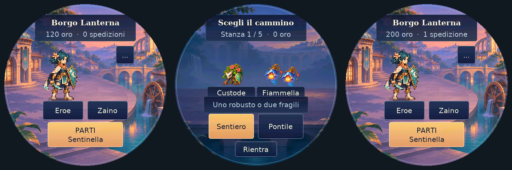

# R6.1 — Dal borgo al primo bivio



In `0.8.0-preview.8` il pulsante **Parti** apriva la scheda dell’assetto, dove serviva un secondo tocco per avviare la spedizione. In `0.9.0-preview.1` **Parti** indica l’assetto in uso e apre il primo bivio direttamente. **Eroe** apre la scheda per cambiare assetto, partire o tornare al borgo.

## Confronto ripetibile

Le prove usano la stessa UI LVGL del Pocket, a 466 × 466, con un orologio simulato e input automatici. Ogni scenario parte dal borgo con la Sentinella, 120 PV, 24 PM e senza reliquia iniziale. Sceglie Sentiero in tutte le stanze di lotta ordinarie, Focolare con +25 PV, poi affronta il Guardiano. Usa attacco base e parata a tempo perfetto e lascia tutte le reliquie. I due seed vengono ripetuti in italiano e inglese.

| Misura su host | Prima | Dopo |
|---|---:|---:|
| Tocchi dal borgo al primo bivio | 2 | 1 |
| Tempo simulato fino al primo bivio | 180 ms | 90 ms |
| Esito delle corse registrate | 4 vittorie | 4 vittorie |
| Oro per vittoria | 80 | 80 |

| Seed | Durata simulata di ciascuna lotta in IT | Tempo fra le lotte in IT | Rientro in IT | PV finali |
|---|---|---|---:|---:|
| 3294095628 | 4,275 s · 7,420 s · 7,420 s · 16,870 s | 0,540 s · 0,270 s · 0,270 s | 37,335 s | 96 |
| 2224073057 | 4,270 s · 7,420 s · 10,570 s · 20,020 s | 0,540 s · 0,270 s · 0,270 s | 43,630 s | 92 |

Il confronto abbina 80 righe fra le due versioni. In ogni riga coincidono lingua, seed, stanza, evento, PV, PM e oro. Tutti gli eventi dopo la partenza sono anticipati di 90 ms, il costo del secondo tocco nell’orologio del test. L’intervallo più lungo fra due lotte include la sosta al Focolare. Entrambi i percorsi terminano in vittoria, quindi queste tracce documentano il ritmo di una corsa con timing perfetto. La durata di una sessione reale, le esitazioni e il collaudo fisico restano da misurare. [Traccia prima](prima.csv) · [Traccia dopo](dopo.csv)

## Riprodurre e verificare

```sh
cmake -S firmware/host -B build/host/cmake -DCMAKE_BUILD_TYPE=Release
cmake --build build/host/cmake --target preview_lantern
mkdir -p build/r61/replay
build/host/cmake/preview_lantern build/r61/replay --pacing > build/r61/replay/trace.csv
```

Per la traccia precedente si usa lo stesso runner con il codice di gioco del commit `325b5ca15456b9a868045cfc65045d80794ed1d4`. Il runner fissa lo stato del generatore host a 17 o 661 subito prima di premere **Parti**. I seed effettivi del gioco sono quelli in tabella.

Le prove native verificano la partenza dal borgo e dalla mappa, la selezione del Piromante e il ritorno via touch e BOOT. Una caccia classica attiva blocca la partenza senza consumare il seed. Riavviare al bivio ripristina assetto e seed, e rientrare conserva l’oro. La suite copre anche una sconfitta da errori di timing, il retry e l’accredito una sola volta dopo la vittoria. La traccia e le tre catture del confronto coincidono tra Release e ASan/UBSan. [Runner](../../../firmware/rpg/host/preview_lantern.c)

Il firmware ESP32-S3 compilato con ESP-IDF 5.5.1 occupa 5.238.960 byte e lascia libero il 17% della partizione da 6 MiB. Il salvataggio resta v4 da 2.808 byte. [Dimensione e hash del binario locale](firmware.json)

R6.2 riparte dagli stessi seed per confrontare le conseguenze di una nuova scelta di percorso su PV, PM, ricompense e ritorno al borgo. [Roadmap](../../ROADMAP.md)
