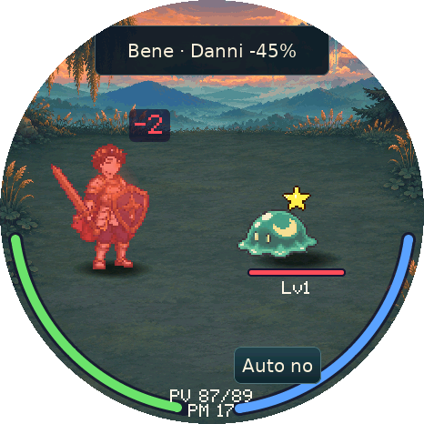
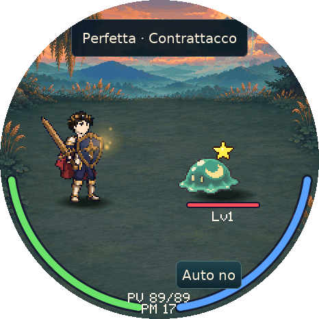

# R7.7 — efficacia e lettura della parata

La parata **Bene** assorbe il 45% del danno in arrivo, rispetto al 30% della preview.7. **Ottimo** assorbe il 55%. **Perfetta** annulla il danno e contrattacca. Il risultato del timing viene applicato prima di Guardia e vale anche per la parata «Bene» usata da Auto.

Sopra l’arena compaiono quattro esiti. La parata perfetta mantiene l’eroe in difesa con scintille dorate, poi mostra il contrattacco sul nemico.





## Campagna simulata

Ogni scenario usa 192 profili nuovi, uno per ogni combinazione di otto famiglie e 24 seed (`120–143`). Oggetti, punti, riposi e tentativi seguono la stessa strategia della [prova sul ritmo della campagna](../campaign-pacing-evidence/README.md). Questi seed sono distinti da quelli usati per la prima prova di taratura.

| Timing | Preview.7, finali raggiunti | Preview.8, finali raggiunti |
|---|---:|---:|
| Bene costante su attacco e parata | 88/192 | 128/192 |
| Attacco Bene, parata mista | 76/192 | 116/192 |
| Ottimo costante su attacco e parata | 190/192 | 190/192 |

Nella prova mista, la sequenza deterministica delle parate usa 15% Mancata, 65% Bene, 18% Ottimo e 2% Perfetta. Con una riduzione intermedia del 40%, il campione ha raggiunto 94 finali su 192 con timing Bene e 99 su 192 con parate miste. Con la riduzione del 45%, il Mago passa da 3 a 16 finali su 24 con timing Bene, il Ladro da 2 a 8 e l’Occultista da 7 a 16. Le tracce Ottimo coincidono riga per riga con la preview.7.

```sh
cc -std=c11 -O2 -Ifirmware/rpg/core -Ifirmware/common \
  firmware/rpg/core/*.c firmware/common/rng.c firmware/common/timing.c \
  firmware/rpg/host/playtest_campaign.c -o /tmp/pocket-campaign
/tmp/pocket-campaign 120 24 good
/tmp/pocket-campaign 120 24 mixed
/tmp/pocket-campaign 120 24 great
```

Per riprodurre la preview.7 usa lo stesso simulatore con il core del commit `d2c1c6d44e3855a808d86eff2d93b22df6f6843a`. [Simulatore](../../../firmware/rpg/host/playtest_campaign.c)

## Verifiche

- La stessa azione nemica riprodotta con quattro qualità, con e senza Guardia, verifica i PV, il valore mostrato e il contrattacco. [Prova delle regole](../../../firmware/rpg/host/test_rpg.c)
- Il test LVGL prova le quattro scritte in italiano e inglese con touch, BOOT, attesa della scadenza e movimento ridotto. [Prova dell’interfaccia](../../../firmware/rpg/host/test_device_ui.c)

Il collaudo sul Pocket deve ancora misurare la latenza di touch e BOOT, la leggibilità durante partite reali e le scelte di Guardia.
