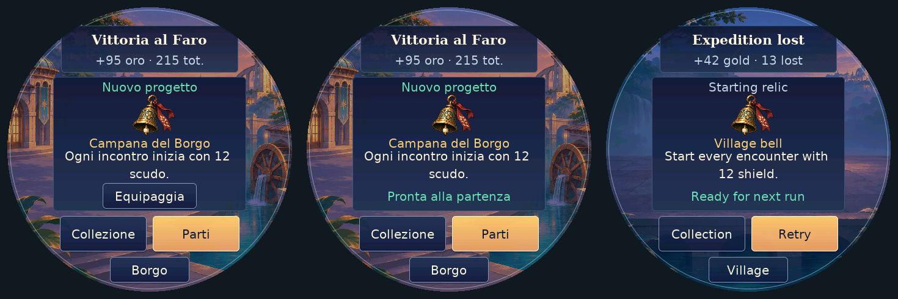
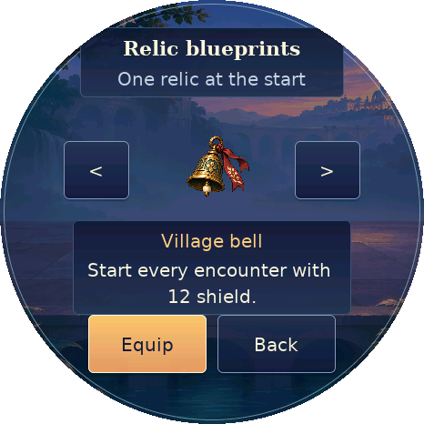

# R6.3 — il rientro in Lanternbound



Il riepilogo mostra quanto oro entra nel profilo. Dopo il Faro indica quale progetto hai conservato, se è nuovo e quale effetto ha la reliquia. **Equipaggia** la imposta per la prossima spedizione. **Collezione** apre il progetto appena conservato e permette di dare un’occhiata agli altri. **Torna** e BOOT riportano al riepilogo. **Parti** avvia una spedizione e **Borgo** riapre il villaggio.

In caso di sconfitta vengono mostrati l’oro accreditato e quello perso. Con 55 oro si vedono 42 accreditati e 13 persi. Il risultato può anche mostrare la reliquia già scelta per la ripartenza. Una vittoria senza reliquie chiude la spedizione con il premio in oro e il conteggio delle vittorie.



## Prove ripetibili

- Il runner nativo percorre tutte e cinque le stanze e vince con e senza reliquie. I casi mirati in IT/EN riavviano prima e dopo la scelta del progetto, verificano un solo accredito, aprono la collezione, tornano via touch e BOOT ed equipaggiano la Campana del Borgo. Dopo un altro riavvio, **Parti** avvia una spedizione e il primo incontro inizia con 12 scudo.
- Le prove ripetono la sconfitta con 55 oro e controllano che il totale massimo del profilo accrediti e mostri solo le monete che entrano effettivamente. I controlli del layout confrontano le aree di testo a 466 × 466.
- Il modello testa tutti e sei i progetti, sia nuovi sia già noti. Verifica l’equipaggiamento durante la preparazione, il recupero dopo il salvataggio e la cancellazione della ricevuta alla partenza. I salvataggi di una vittoria precedente alla preview.3 mostrano la reliquia iniziale o il conteggio dei progetti disponibili.
- Il formato v4 misura 2.808 byte. La scelta usa lo stesso byte dell’azione di combattimento, quando la spedizione si è già conclusa.
- Le tracce di Sentiero e Bastione di R6.2 combaciano riga per riga. I due scenari per lingua conservano tempi simulati, PV, PM e bottino. [Confronto R6.2](../bastion-evidence/README.md)

```sh
cmake -S firmware/host -B build/host/cmake -DCMAKE_BUILD_TYPE=Release
cmake --build build/host/cmake --target test_lantern preview_lantern
mkdir -p build/r63/native
build/host/cmake/test_lantern
build/host/cmake/preview_lantern build/r63/native
python3 scripts/previews.py build/r63/native build/r63/png/lantern
```

Il playtest con persone deve ancora verificare quanto è chiaro il passaggio alla seconda spedizione e quale obiettivo viene scelto. Restano aperte le prove sul Pocket fisico. [Build locale ESP32-S3](firmware.json) · [Roadmap](../../ROADMAP.md)
