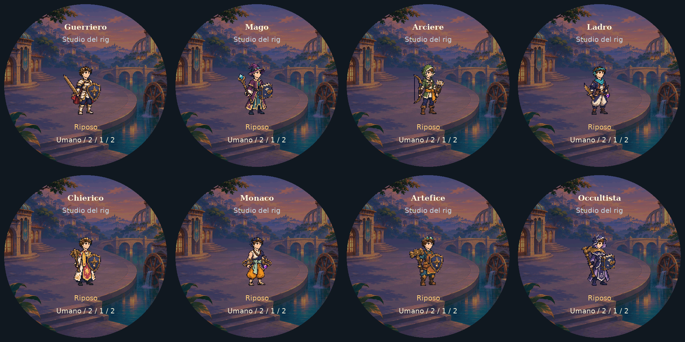

# Prove R2 — otto avatar modulari

Consegna `0.5.0-preview.1`, 18 novembre 2026. Baseline R1: commit
`02987db1b35f2df2508eec7a60eb101d5bdc65ef`. Il rig è integrato negli otto ID base
0–7; le altre 32 classi conservano il fallback legacy. Illustrazioni dell'atlante
e tre assetti Lanternbound sono categorie separate.

## Evidenze riproducibili

| Prova | Risultato e limite |
|---|---|
| `host-checks.txt` | Suite completa: 55.639 controlli RPG, 1.434 compagno, 600 spedizioni; import deterministici, inventario e regressioni input/UI precedenti conservati |
| `rig-sanitizers.txt` | 72 livelli, 89.768 composizioni, 29.052 confronti, 6.080 controlli di continuità centrale, zero errori; ASan/UBSan e leak scan attivi |
| Combinazioni estetiche | Tutte le **7.680 per ciascuna delle otto basi**, 61.440 totali: quattro razze, cinque pelli, sei capelli, otto colori, quattro occhi e due volti. Non si pretende che ogni combinazione sia visivamente unica sotto un cappello o con occhi chiusi |
| Geometria e oggetti | Quattro espressioni e cinque pose; piedi stabili, zero pixel tagliati dal canvas nei casi provati; 16 tipi di oggetto × cinque fasce, inclusi casi combinati. I piedi opachi terminano alle righe 83–84 secondo la razza |
| `cache-sanitizers.txt` | 40 descrittori simultanei stabili; 1.000 cambi live a memoria limitata, condivisione, pin di scena, chiavi copiate, fallimenti di allocazione e ordine di distruzione; ASan/UBSan e leak scan attivi |
| `ui-sanitizers.txt` | **147 catture 466×466** del vero LVGL; creazione delle otto basi IT/EN, cinque pose per costume, borgo/statistiche/classe/equip, battaglie 1/2/3/boss ed élite livello 99, dungeon e tre ulteriori razze. ASan/UBSan; leak scan finale disabilitato perché l'app mantiene cache FX e runtime globali |
| Proprietà UI | Confronto framebuffer incrementale/completo; alfa dell'avatar fuori dai pulsanti; livelli nemici fuori dai comandi; tocchi reali sui bersagli laterali; PWR/salvataggio/ripresa; 40 ID esatti e roundtrip save v4; movimento ridotto forza Idle; allocazione iniziale fallita e cambio live fallito conservano la corretta identità |
| Memoria immagini | Picco host **788.618 byte** nel percorso R2; durante 1.000 cambi un solo buffer avatar stabile da 92.928 byte a regime. Eliminando la scena spariscono tutti i byte avatar; restano 71.106 byte della cache FX globale già esistente. Non è una misura dell'intero heap ESP32 |
| `firmware-build.txt`, `firmware.json` | ESP-IDF 5.5.1, ESP32-S3; app locale **3.419.936 byte / 3,26 MiB**, circa 46% libero nella partizione da 6 MiB. Sotto l'obiettivo di produzione 5,4 MiB. CI ricostruisce la propria immagine dal commit pubblicato |

Le [147 catture e le tavole](../../img/hero_rig/galleria.png) derivano dalla
preview nativa `preview_hero_rig`, non da immagini di presentazione. Le scene
denominate **Studio del rig** sono un banco di verifica: il fondale dipinto
Lanternbound non è stato introdotto come nuovo borgo classico. La tavola
[in grigio](../../img/hero_rig/otto-avatar-grigio.png) verifica che gli otto
costumi non dipendano soltanto dalla tinta.

## Difetti trovati e corretti prima dell'ammissione

- Il respiro lasciava una riga trasparente fra torso e gambe. Overlap del giunto
  corretto; la nuova regressione bare, senza oggetti che mascherino il difetto,
  fallisce in tutte le 32 combinazioni costume/razza quando si rimuove il fix
  da una copia temporanea (`seam-mutation.txt`).
- Attacco/Guardia coprivano i livelli dei nemici laterali. Con il nuovo rig i
  comandi sono a y302, diametro 60; i livelli restano associati ai loro bersagli.
  Le varianti élite Lv99 passano la verifica delle aree effettive.
- La falce nascondeva il volto dell'Occultista in attacco. Ora sta davanti al
  costume ma dietro testa/capelli, mantenendo asta e presa visibili.
- La cache precedente poteva riciclare un descrittore ancora mostrato. Le
  immagini ora hanno identità immutabile e riferimenti dei widget; i descrittori
  raw restano validi fino alla distruzione della scena.

La revisione visiva indipendente ha controllato prima Guerriero/Mago e poi le
altre sei basi: pose, sagome/grigio, oggetti, schermate e formazioni. Nessun
ulteriore blocco concreto del rig è rimasto aperto.

## Limiti e prossimo lotto

Le pose sono trasformazioni parametriche di componenti, **non animazioni finali**.
Alcuni lembi dell'abito si muovono insieme al braccio, più evidente su Monaco
e Artefice: maschere dedicate degli arti e transizioni più ricche restano R7.
Torso, piedi e accessori equipaggiati non hanno ancora livelli grafici separati.
Gli ambienti/mostri e gran parte della UI classica restano R5.

R3.1 è il prossimo lotto: otto rami avanzati delle prime quattro famiglie,
con costume e illustrazione specifici, due firme di forma visibili sotto casco,
mapping per ID e identiche verifiche native. Non vengono contati come nuovi
avatar i rami che usano ancora la grafica precedente.

Il collaudo fisico resta aperto: questi controlli non misurano touch, FPS,
consumi, autonomia o stabilità prolungata sul Pocket. Sorgenti, prompt, hash e
ordine dei componenti: [registro del rig](../../../assets/hero-rig/README.md).
Installer e download sono ricostruiti e controllati via HTTP dal
[workflow](https://github.com/ShydanRem/pocketwayfarer/actions/workflows/pages.yml).

Nota storica: i log sopra descrivono la consegna originale. La directory delle immagini viene ampliata dalle versioni successive; lo stato corrente e i nuovi conteggi sono nelle [prove R3.1](../advanced-a-evidence/README.md).

Aggiornamento storico: la directory delle immagini è ora ampliata da R3.2; i log sopra restano relativi alla loro consegna. [Stato e prove correnti](../advanced-b-evidence/README.md).
