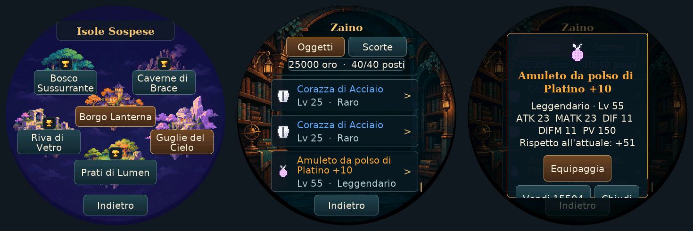
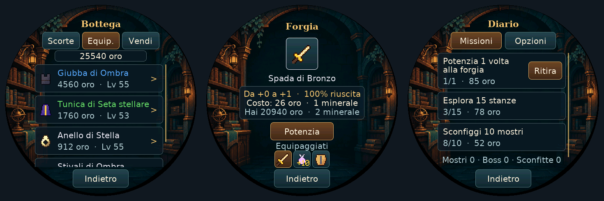

# R5.8 — Mappa e interfacce di servizio

Le cinque regioni e il borgo hanno sagome riconoscibili nell’atlante. Il nome è anche l’area da toccare. I lucchetti, le spade e i trofei distinguono regioni bloccate, cacce attive e dungeon completati. Nel borgo, zaino e bottega usano righe con nome, disponibilità e dettagli su altezze adattate al testo. [Origine della mappa e importazione](../../../assets/classic-ui/README.md)

| Prova IT/EN | Verificata su host |
|---|---|
| Mappa | Le cinque etichette e i loro pulsanti sono dentro il cerchio. Toccando un’isola chiusa si legge il dungeon richiesto. A mappa sbloccata si visitano tutte e cinque le regioni. Touch e BOOT riportano al borgo del Classico. |
| Zaino pieno | Scorrimento con swipe fino all’oggetto in posizione 40, lettura del nome completo, chiusura della scheda con BOOT, equipaggiamento e uso di una pozione. |
| Bottega | Acquisto con zaino pieno respinto senza addebito. Dopo la vendita, acquisto riuscito al prezzo indicato. L’acquisto della pergamena conserva la posizione della lista. |
| Forgia e diario | Il primo potenziamento scala oro e minerale. La missione relativa si aggiorna e viene ritirata una volta. Il diario mostra la scheda Opzioni. |
| Ripresa | Dopo il riavvio, si rileggono l’oggetto equipaggiato, il potenziamento, l’oro, le scorte, lo zaino e lo stato della missione. |
| Firmware | ESP-IDF 5.5.1 su ESP32-S3. L’app occupa 5.238.784 byte. Rimane il 17% della partizione da 6 MiB. Salvataggio v4 da 2.808 byte. [Misure e hash](firmware.json) |

Le prove preparano uno zaino pieno e tre missioni del giorno. Le 24 catture provengono dal renderer LVGL a 466 × 466. Il collaudo sul Pocket fisico resta aperto. [Roadmap](../../ROADMAP.md)
