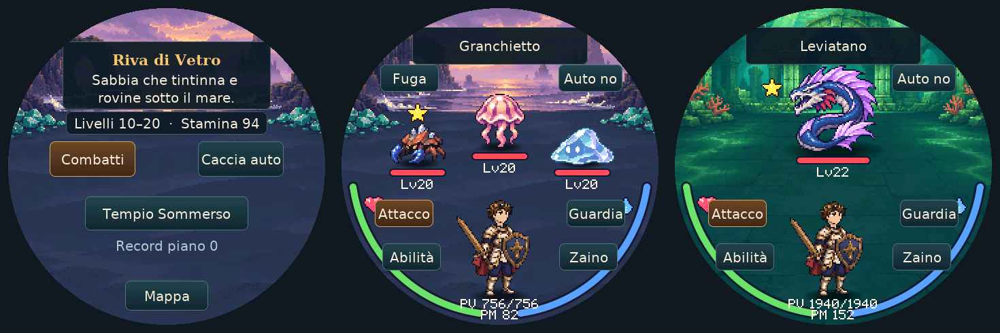
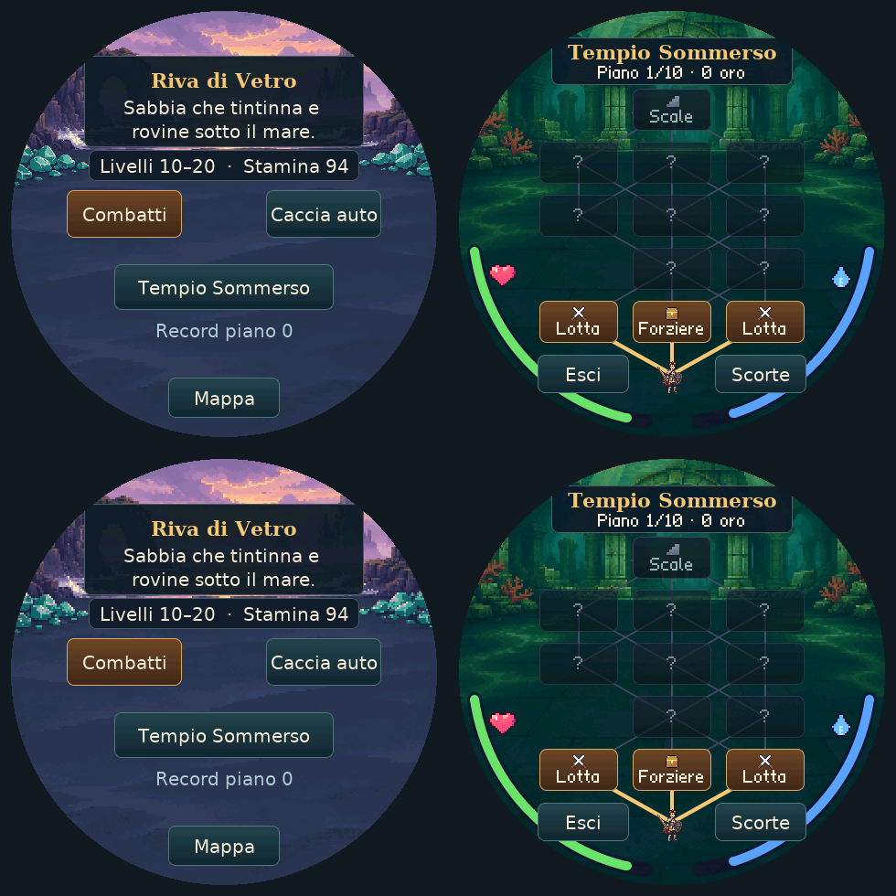

# R5.4 — Riva di Vetro e Tempio Sommerso

La Riva usa ardesia fredda e vetro marino. Il Tempio usa pietra verde e corallo ai margini. In entrambi il terreno dietro gli attori resta poco contrastato. Le sagome dei boss si distinguono per massa e direzione. Il Granchio corazzato è basso e largo con una chela a scudo, il Leviatano si avvolge sotto una pinna violetta. I comandi, gli intenti e la mappa del dungeon riprendono Lumen e la Cripta. [Origine, prompt e import](../../../assets/shore/README.md)

| Incontri | Specie ridisegnate |
|---|---|
| Riva | Granchietto, Medusina, Gelatino blu, Goblin pirata |
| Tempio | Serpe marina, Annegato, Granchio corazzato, Leviatano |

## Confronto dei fondali

| Variante | Indici e palette in flash per i due fondali | Firmware ESP32-S3 |
|---|---:|---:|
| 466 × 466 | 434.730 byte | 5.118.448 byte |
| 233 × 233 a 2× | 108.986 byte | 4.792.704 byte |
| Risparmio | **325.744 byte** | **325.744 byte** |

Sono due compilazioni ESP-IDF 5.5.1 con le stesse scene e la stessa configurazione. Le dimensioni degli indici e delle palette sono state lette dall’ELF. Per il confronto visivo il renderer LVGL ha disegnato le stesse viste a 466 × 466. La versione a 233 mantiene i contorni principali e sacrifica le incisioni più sottili sulle colonne. Il buffer espanso rimane di 434.312 byte RGB565 per fondale visibile. Il risparmio misurato è in flash. [Dimensioni e hash del firmware](firmware.json)

## Prove

| Percorso | Verifica su host |
|---|---|
| Sblocco e campo IT/EN | La Riva bloccata respinge il tocco. Il profilo che ha superato la Cripta entra dalla mappa. I tre bersagli si selezionano individualmente. L’anello accetta touch in italiano e BOOT in inglese. |
| Tempio IT/EN | Ingresso e scelta di una stanza, vittoria contro Serpe marina e Annegato. |
| Boss e salvataggi | Granchio corazzato al piano 5, rientro dal piano 6 e Leviatano al piano 10. Dopo il riavvio il bottino resta accreditato una volta e il nodo del Bosco è raggiungibile. I test impostano i piani dei boss e rinforzano il profilo per verificare UI e progressione. |
| Catture | 14 nuove catture LVGL, identiche tra build Release e build con sanitizer. [Mappa del Tempio](tempio.png) · [Altre specie e boss](mostri.png) |

Il collaudo AMOLED e touch sul Pocket resta aperto. Il prossimo lotto riguarda Bosco Sussurrante, Radici Antiche e altre otto creature. [Roadmap](../../ROADMAP.md)
