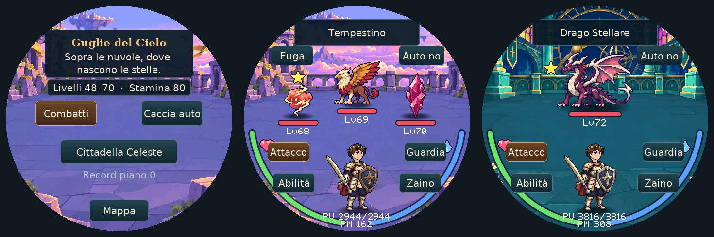
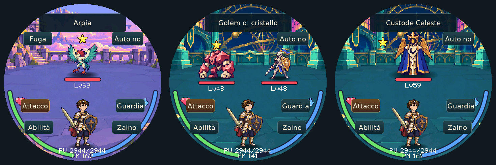
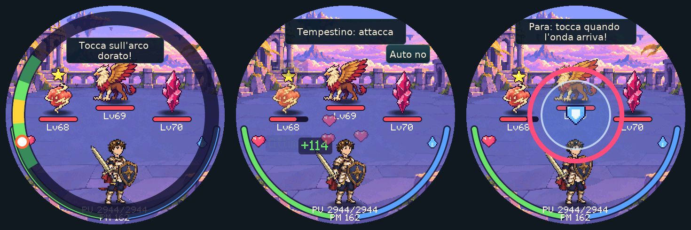
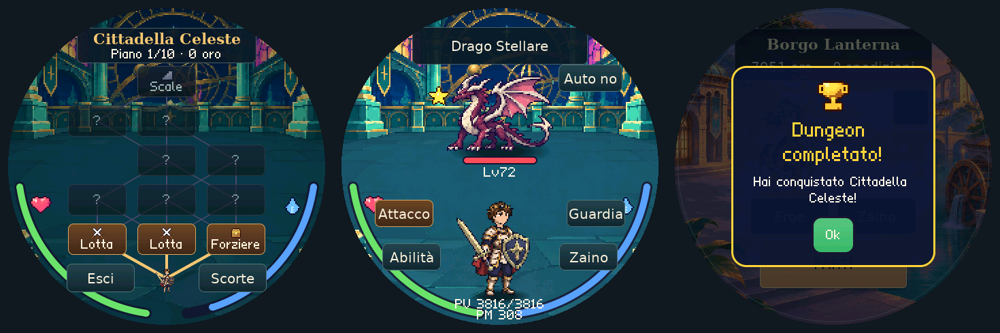

# R5.7 — Guglie del Cielo e Cittadella Celeste

Nelle Guglie, il Tempestino e il Grifone riprendono il corallo dell’alba, mentre il Cristallo errante spicca in fucsia sulla terrazza color pervinca. Nella Cittadella il pavimento verde petrolio lascia visibili il mantello cobalto del Custode e le ali rosa e avorio del Drago Stellare. Le nuvole, le vetrate e gli anelli astronomici occupano la parte più alta e i bordi. [Sorgenti, prompt e importazione](../../../assets/sky/README.md)

| Incontri | Specie ridisegnate |
|---|---|
| Guglie del Cielo | Tempestino, Grifone, Cristallo errante, Arpia |
| Cittadella Celeste | Cavaliere celeste, Golem di cristallo, Custode Celeste, Drago Stellare |

| Prova | Verificata su host |
|---|---|
| Copertura | I manifesti del Classico coprono tutti i 42 ID specie del core, una volta ciascuno. |
| Ingresso | Il nodo delle Guglie è bloccato prima di completare la Fucina. Il profilo sbloccato entra dalla mappa del mondo. |
| Combattimento IT/EN | Tre aree di tocco distinte, nome del bersaglio, anello, intento e parata. Anello e parata usano touch in italiano e BOOT in inglese. La cifra della cura resta sotto la fila dei livelli nemici. |
| Discesa IT/EN | Ingresso dalla terrazza, selezione di una stanza sulla mappa, Custode al piano 5 e ripartenza dal piano 6. Le prove predispongono la stanza e i piani dei boss e usano un profilo rinforzato per verificare interfaccia e progressione. |
| Finale IT/EN | Dopo il Drago Stellare l’eroe torna al borgo premendo Continua in italiano e riavviando dalla schermata di vittoria in inglese. Oro e conteggio dei boss restano invariati nei riavvii e la schermata delle Guglie mostra il record al piano 10. |
| Firmware | ESP-IDF 5.5.1 su ESP32-S3. L’app occupa 5.182.192 byte, 129.808 in più della preview.6. Rimane il 18% della partizione da 6 MiB. Salvataggio v4 da 2.808 byte. [Misure e hash](firmware.json) |

Il collaudo sul Pocket fisico resta aperto. Il prossimo lotto comprende mappa, zaino, bottega, forgia e missioni. [Roadmap](../../ROADMAP.md)
