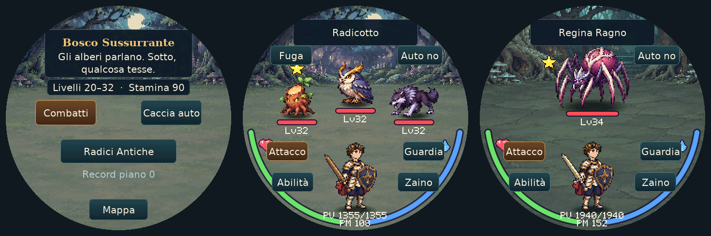
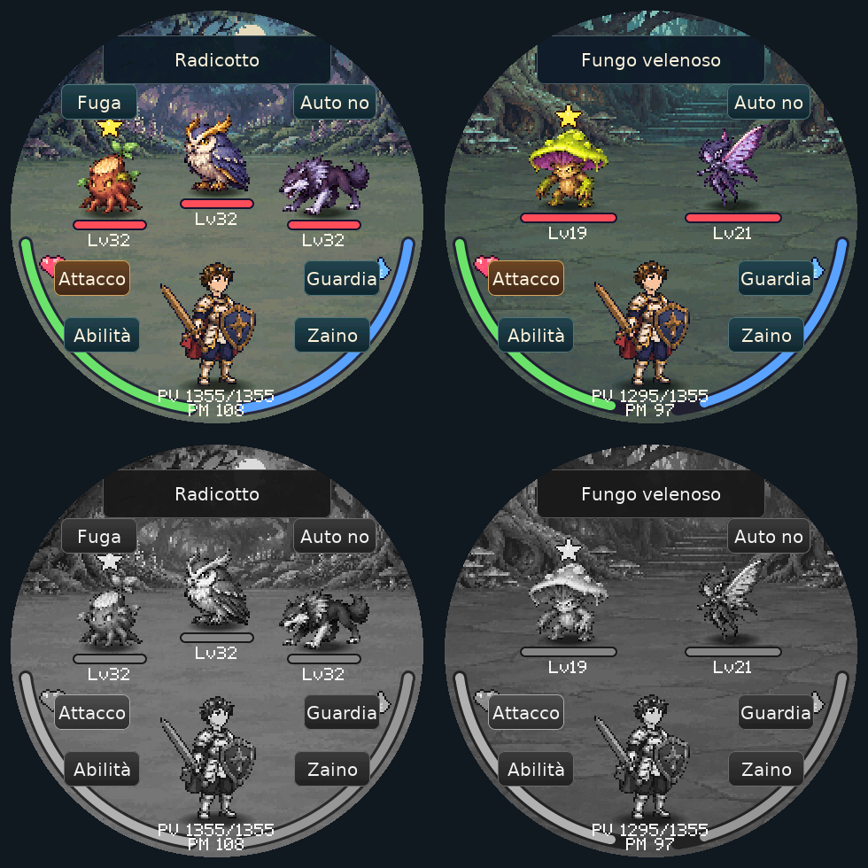

# R5.5 — Bosco Sussurrante e Radici Antiche

La luce lunare cade sulla radura e lascia le ombre indaco nella chioma. Nelle Radici Antiche funghi, radici e punti di luce restano ai lati. Il campo di scontro uniforme sostiene le sagome scure. Il Lupo nero ha muso e zampe argentati, la Fata oscura bordi delle ali color rosa pallido. Il Ragno tessitore ha zampe basse e corpo ramato. Il profilo della Regina Ragno è più alto, con addome e zampe avorio e viola. [Sorgenti e importazione](../../../assets/wood/README.md)

| Incontri | Specie ridisegnate |
|---|---|
| Bosco | Radicotto, Gufo lunare, Lupo nero, Ragno tessitore |
| Radici Antiche | Fungo velenoso, Fata oscura, Antico Ceppo, Regina Ragno |

| Prova | Verificata su host |
|---|---|
| Accesso dal Tempio | Il Bosco resta bloccato fino al completamento del Tempio. Il profilo che ha battuto il Leviatano raggiunge il Bosco dalla mappa. |
| Combattimento IT/EN | Tre aree di tocco distinte, anello con touch e BOOT e catture di tutte le otto sagome. Confronto a colori e in grigio di Lupo nero e Fata oscura. |
| Discesa nelle Radici | Stanza raggiungibile, riconoscimento e risoluzione di una trappola, Antico Ceppo al piano 5 e ritorno dal checkpoint al piano 6. [Percorso con trappola](bivio.png) |
| Uscita e ripresa | Regina Ragno al piano 10, riavvio, ricompensa accreditata una volta e accesso alle Caverne di Brace. Le prove predispongono alcune stanze e potenziano il profilo per isolare UI e progressione. |
| Catture | 16 nuove catture a 466 × 466, identiche tra Release e build con sanitizer. |
| Firmware | ESP-IDF 5.5.1 su ESP32-S3. Il binario occupa 4.922.416 byte, 129.712 in più della preview.4. Rimane libero il 22% della partizione da 6 MiB. Salvataggio v4 da 2.808 byte. [Misure e hash](firmware.json) |

Il collaudo sul Pocket fisico resta aperto. Il prossimo lotto comprende Caverne di Brace e Fucina Infernale. [Roadmap](../../ROADMAP.md)
